<div align="center">

# 🌱🛰️ Raiz Orbital

### What should I plant after the soybeans?

**Eyes on the sky, roots in the ground.**
<sub>"Raiz Orbital" is Portuguese for "Orbital Root".</sub>

**[Open the live app](https://frontend-production-62e614b3.up.railway.app)** · [Product discovery](docs/product/01-product-discovery.md) · [Business plan](docs/product/02-business-plan.md) · [PRD](docs/product/03-prd.md) · [Roadmap](docs/product/04-product-roadmap.md)

NASA Space Apps Challenge 2026 · Challenge **Field Shift: Adapting Farms with NASA Data** · Uberlândia, Brazil

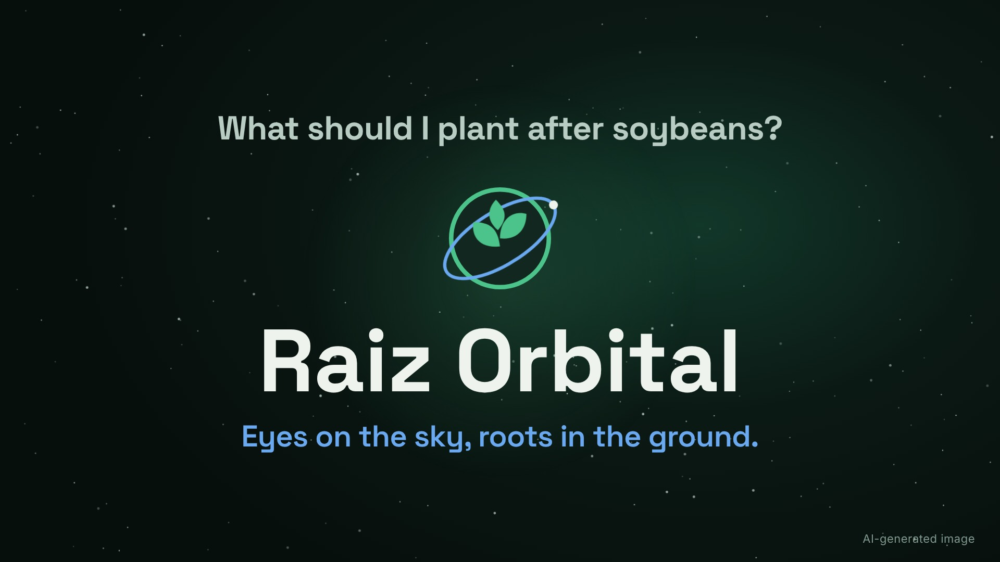

</div>

Raiz Orbital tells a farmer **what to plant after the soybean harvest, on their own field, in about one minute.** It replays six off-season options over **20 years of NASA Earth observations** and the **climate projected for 2041–2060**, recommends one for the farmer's priority, and turns it into a **3-year rotation plan** with a Plan B for a dry autumn. Every number shows its source.

Built in **48 hours** by team Raiz Orbital: Adriano Araújo, Rayanne Lemos and Ricardo Pereira.

---

## Contents

1. [The problem](#1-the-problem)
2. [How we got to the problem](#2-how-we-got-to-the-problem)
3. [How to use it, step by step](#3-how-to-use-it-step-by-step)
4. [What the farmer gets](#4-what-the-farmer-gets)
5. [How it works](#5-how-it-works)
6. [NASA and other data](#6-nasa-and-other-data)
7. [Architecture](#7-architecture)
8. [Quality and testing](#8-quality-and-testing)
9. [Use of AI](#9-use-of-ai)
10. [Running locally](#10-running-locally)
11. [Limits](#11-limits)
12. [What comes next](#12-what-comes-next)
13. [Repository map](#13-repository-map)
14. [Team and thanks](#14-team-and-thanks)

---

## 1. The problem

- **Brazil grows about 4 in every 10 soybeans on Earth**, on almost 49 million hectares, and about half of that area is in the Cerrado.
- **Every year, between January and March, each of those farmers decides what to plant after the harvest**, with the rains about to end. Most repeat second-crop corn or leave the field fallow. Embrapa links that routine to soil degradation, root nematodes and long-term yield loss.
- **The risk is growing.** The rains are ending earlier: on our demo field the longest autumn dry spell grew from 20.8 days (2005–2019) to 27.2 days (2020–2024). The 2025/26 season was hit by drought, and 2026/27 starts under a strong El Niño.
- **There is almost no cushion.** Only 3.3% of Brazil's planted area was insured in 2025, and rural default reached 8.8% in early 2026.

The decision is made with little information about the field itself: how often each option failed there, what it does to the soil, and how it will behave in the climate ahead.

## 2. How we got to the problem

We started from a question, not from a technology. Before writing code, we spent the first hours of the hackathon on product discovery, with one rule: **only public, citable sources, and every number with its link.**

| Step | What we did |
| --- | --- |
| 1. Read the challenge against our region | Field Shift asks for rotation strategies that protect the soil and adapt farms. In the Triângulo Mineiro, the soybean harvest is followed every year by the same decision, so we chose to answer that one decision well. |
| 2. Mapped who farms here | IBGE Agricultural Census data organized by UFU, Minas Gerais state data and Conab: farm sizes, age, schooling, crops and calendar. |
| 3. Mapped what goes wrong | Regional climatology from public universities, Embrapa research on water stress and soil, and regional press reports in the farmers' own words. |
| 4. Mapped how farmers decide | Surveys with published methods (ABMRA, McKinsey, Serasa) and Ipea on technical assistance: who farmers trust and which channel they use. |
| 5. Checked the data | IMERG, POWER, SMAP, MODIS and CMIP6 were tested for the pilot area before the engine was designed. |
| 6. Turned findings into decisions | One question, two inputs, every number with its source, no generative AI in the engine, a report for the agronomist. |

**Sources by type**

| Type | Institutions |
| --- | --- |
| Public universities and institutes, many in our region | UFU (Institute of Geography), IFTM, UFV, UFG, UFGD |
| Research and technology centers | Embrapa, Inpe, Cemaden, University of Leeds (AgroClimatic Monitor), ISRIC, NOAA, FAO |
| Official statistics and policy | IBGE, Conab, MAPA (ZARC), Ipea, Minas Gerais government |
| Surveys with published methods | ABMRA with S&P Global, McKinsey, Serasa, Itaú BBA |
| Regional press | Canal Rural, Diário do Comércio, Notícias Agrícolas, Revista Cultivar |

**Three findings shaped the product:**

1. **The off-season decision repeats every year, with no field-level information.** So the app answers that single question.
2. **Rain changes a lot from one farm to the next.** In the same month, Uberlândia was 20% above average and Uberaba, less than 100 km away, 30% below. So every result is computed for the field's own grid cell.
3. **Farmers trust their agronomist, not AI.** 65% change practice because of a technical recommendation; only 6% trust generative AI for decisions. So the engine is deterministic, cites its sources and produces a report for the agronomist.

Every source is linked in the [product discovery](docs/product/01-product-discovery.md).

## 3. How to use it, step by step

The whole path takes about one minute with the demo field, on a phone or a computer, in Portuguese or English (switch in the header).

1. **Open the app** at **https://frontend-production-62e614b3.up.railway.app** and tap the main button. No sign-up.
2. **Mark the field.** The map opens with a demo field already marked: keep it, tap "Use where I am now", or use "Other ways to mark" to paste coordinates or a Google Maps link. The MVP covers the area around Uberlândia and Uberaba; points outside it get a clear message.
3. **Tell when you harvest the soybeans:** an exact date, or early, mid or late February. Not sure? "Still deciding?" compares harvest periods and the rain left after each one.
4. **Read your field's X-ray:** eight indicators and the last 10 seasons seen by satellite. Confirm what you planted in the last three off-seasons.
5. **Choose your priority** (More safety, Income or Care for the soil) and get one suggestion with "worked in X of 20 years". "Why this suggestion?" shows the NASA data behind it. Compare up to three crops side by side.
6. **Build your 3-year plan.** Change any year and the following years are recalculated, with our suggestion always visible. "What if the year is dry?" shows Plan A and Plan B.
7. **Open "Your plan":** what to do and when, the alerts for your area and **Print report** for your agronomist.
8. **Anytime:** the **Alerts** bell and the **Guide** (27 short articles) are in the header, and "Listen to summary" reads each screen aloud.

| Home | Mark the field |
| --- | --- |
| 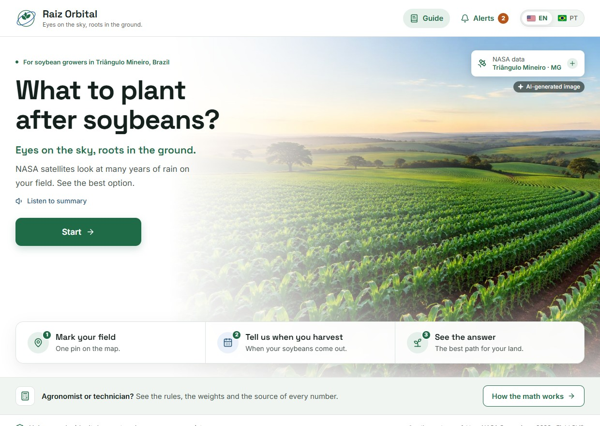 | 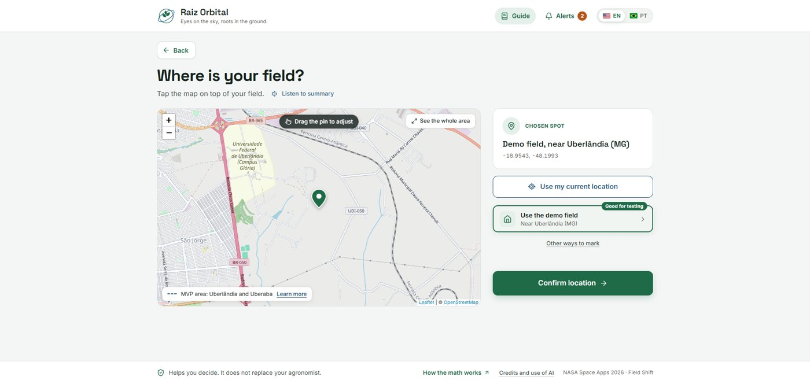 |

## 4. What the farmer gets

**A detailed X-ray of the land:** soil, root-zone moisture now, rain, dry spells, heat and the field's last 10 seasons seen by satellite.

| Field X-ray | Last seasons by satellite |
| --- | --- |
| 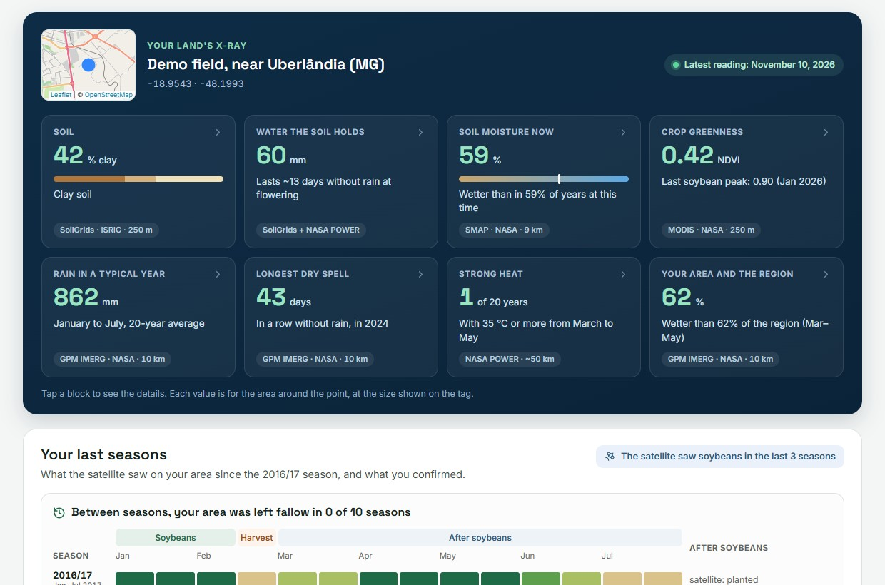 | 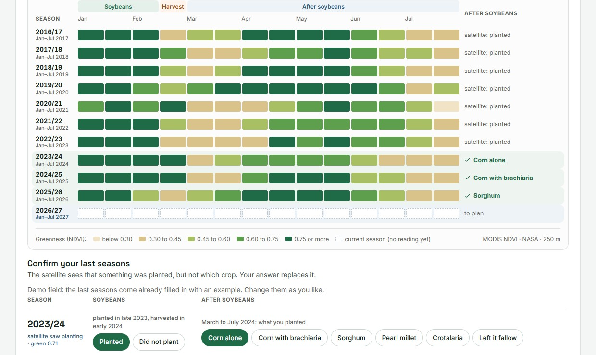 |

**One recommendation for the farmer's priority**, with "worked in X of 20 years" and the reason, and up to three crops compared side by side.

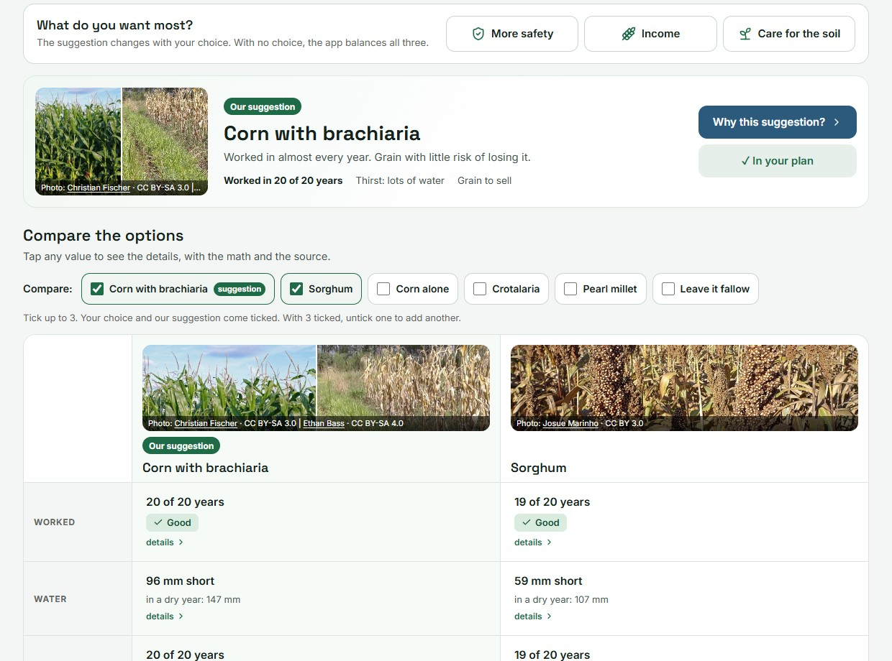

**A 3-year planting plan** compared with how the field is managed today, with Plan A and Plan B for a dry autumn.

| 3-year plan | Dry year: Plan A and Plan B |
| --- | --- |
| 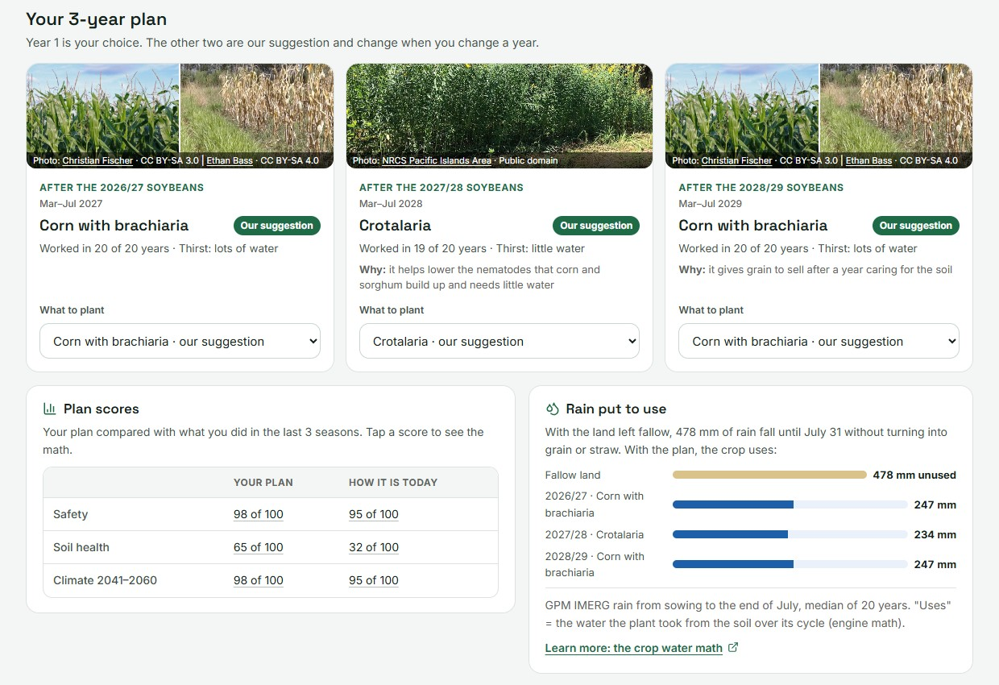 | 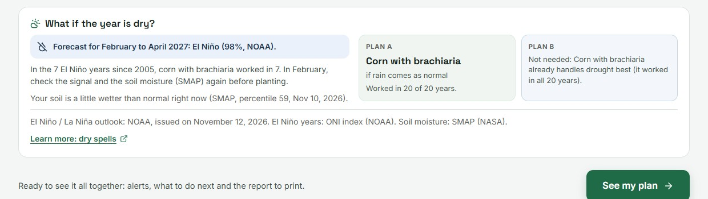 |

**Alerts, a printable planning report and a 27-article guide**, in Portuguese and English, with "Listen to summary" on every screen.

| Alerts | Guide |
| --- | --- |
| 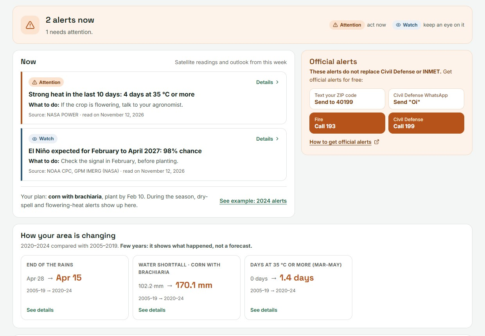 | 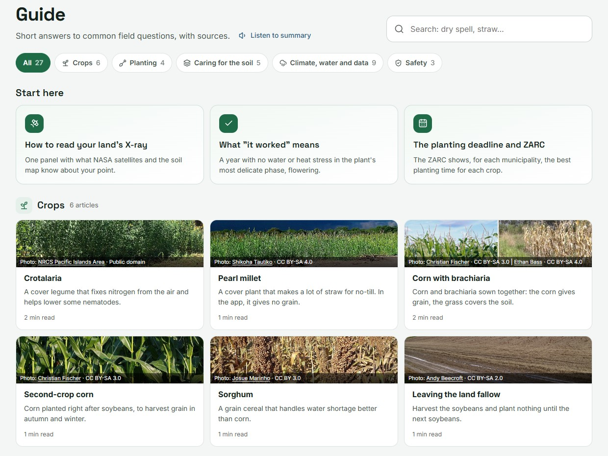 |

## 5. How it works

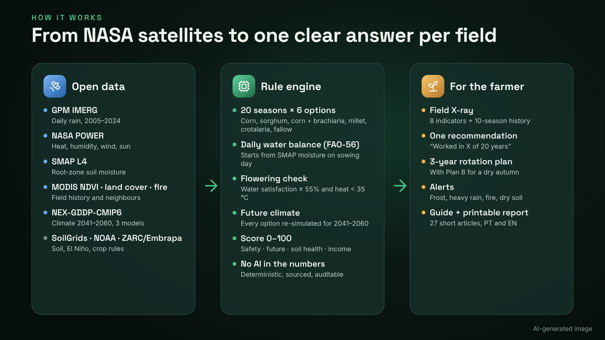

1. **Climate series** for the field's 0.1° cell, 2005–2024: GPM IMERG rain and NASA POWER weather.
2. **Sowing date** derived from the harvest date. An option past its ZARC deadline is shown as out of window and never recommended.
3. **Daily FAO-56 water balance** for six off-season options (second-crop corn, grain sorghum, corn with brachiaria, pearl millet, crotalaria, fallow), starting from SMAP root-zone moisture on each sowing day.
4. **Success rule from ZARC and Embrapa:** water satisfaction (ISNA) of at least 0.55 around flowering (cover crops: 0.50 in the first 30 days) and fewer than 3 days at or above 35 °C. Result: "worked in X of 20 years".
5. **Future climate:** NEX-GDDP-CMIP6 monthly deltas (2041–2060 vs 1995–2014, SSP2-4.5, three models) applied to the observed series, with every option simulated again.
6. **Score from 0 to 100:** climate safety 30%, future climate 15%, soil health 25% (straw, nitrogen, nematode-cycle break), income 30% (grain and climate reliability, no price guesses). The farmer's priority reorders the ranking.
7. **Rotation rules** build the 3-year plan: diversity bonus, at most two fallow years in a row, nematode-suppressing crops where needed.
8. **Autumn signal:** the NOAA ENSO outlook and each crop's results in past El Niño years set Plan A and Plan B.

Every threshold lives in [`regras.yaml`](projeto/backend/app/config_data/regras.yaml) and every crop parameter in [`culturas.yaml`](projeto/backend/app/config_data/culturas.yaml), each with its reference. The API rejects values without one.

## 6. NASA and other data

| Source | Use in Raiz Orbital | Resolution and period |
| --- | --- | --- |
| **GPM IMERG Final, daily V07** (NASA) | Rain in every simulation, rain left after harvest, end of the rains, dry spells, heavy rain | 0.1°, 2005–2024 |
| **NASA POWER**, daily agroclimatology | Evapotranspiration (FAO-56), heat at flowering, frost risk, recent warnings | ~0.5°, 2005–2024 and recent days |
| **SMAP L4 SPL4SMGP v008** (NASA) | Soil water on sowing day, current moisture percentile, dry-soil alert | 9 km, 2016–2025 |
| **MODIS MOD13Q1 + MYD13Q1 NDVI** (NASA) | 10-season history of each field: soybean, planted after or fallow | 250 m, 2017–2026 |
| **MODIS MCD12Q1** land cover (NASA) | Cropland mask to compare with nearby fields within 30 km | 500 m |
| **MODIS MCD64A1** burned area (NASA) | Fire history within 5 km of the field | 500 m, 2016–2025 |
| **NEX-GDDP-CMIP6** (NASA) | Every option re-simulated for 2041–2060 | 0.25° |
| SoilGrids (ISRIC, CC BY 4.0) | Clay and sand, water-holding capacity | 250 m |
| NOAA CPC | Oceanic Niño Index and ENSO outlook | — |
| ZARC (MAPA), Embrapa, FAO-56 | Sowing deadlines, cycles, crop coefficients, thresholds | — |
| OpenStreetMap, Leaflet, Photon | Base map and place names | — |

Data is downloaded directly from NASA services (POWER API, GES DISC, ORNL DAAC, NCCS THREDDS, Earthdata), without Google Earth Engine ([ADR 0005](projeto/backend/docs/adr/0005-fontes-diretas-da-nasa-sem-earth-engine.md)). NASA is cited by name as the source of each dataset; no NASA logos are used.

## 7. Architecture

```
NASA, ISRIC, NOAA ──► data pipeline (Python) ──► PostgreSQL 17 + PostGIS 3.5 (precomputed per 0.1° cell)
                                                        │
                                   FastAPI: controllers → services (engine) → repositories
                                                        │  JSON
                                   React 19: views ← controllers (hooks) → services → repositories
```

| Layer | Choice |
| --- | --- |
| Data pipeline | 14 Python scripts in [`projeto/backend/pipeline`](projeto/backend/pipeline) (IMERG, SMAP, NDVI, burned area, CMIP6, ONI, ENSO outlook) |
| Database | PostgreSQL 17 + PostGIS 3.5, SQLAlchemy and Alembic migrations |
| API | Python 3.12, FastAPI; endpoints for the pilot area, field X-ray, recommendation, 3-year plan, alerts, method and community reports under `/api` |
| Frontend | React 19, TypeScript, Vite, React Router, Leaflet, design system with Space Grotesk and Inter |
| Engine | One deterministic engine; rules and crop parameters in YAML, each with its source |
| Hosting | Railway: PostGIS, backend and frontend behind Caddy; deployed automatically after every merge |

Both backend and frontend follow the same layering: thin controllers, business rules in services, data access in repositories ([`AGENTS.md`](AGENTS.md)). Design decisions are recorded as [ADRs](projeto/backend/docs/adr/).

## 8. Quality and testing

The product was **built test-first (TDD)**: every behavior started with a failing test.

| Type of test | Tool | What it covers | Tests |
| --- | --- | --- | --- |
| **Unit tests** (backend) | Pytest | The engine: water balance, success rule, ZARC window, scores, rotation rules, alerts, with fake repositories | ~1,370 |
| **Integration tests** (backend) | Pytest + disposable PostGIS | API endpoints and repositories against a real database; migrations up, down and up again | ~210 |
| **Unit and controller tests** (frontend) | Vitest | Services, API calls, hooks (`renderHook`), translations and content consistency | ~900 |
| **Component and feature tests** (frontend) | Vitest + Testing Library | Every component and screen rendered as the user sees it, and full flows through the routes | ~530 |

- **Screen reviews:** after each delivery, every screen was checked in headless Chrome in Portuguese and English, on a phone (360 px) and on a desktop, and the front end was adjusted round after round: plain language, no step counters and a real "Back" button, details in pop-ups, the plan's suggestion always visible, a satellite chart with satellite data only and no sideways scroll on a phone.
- **Prototyping:** the first screens were prototyped with Lovable, then rebuilt in React with tests.
- **CI/CD on every pull request** ([`ci-cd.yml`](.github/workflows/ci-cd.yml)): secret scanning (gitleaks) and pre-commit, Ruff and Oxlint, all tests, production build and Docker images. Every merge deploys to Railway, and a smoke test confirms that the live site and API run the new commit.

## 9. Use of AI

AI was an assistant to the team, never the decision maker.

- **In the product: no generative AI.** Every number, score, recommendation and explanation comes from deterministic, rule-based code with a cited source.
- **In the code:** Claude (Anthropic, through Claude Code) and Gemini (Google, through Gemini CLI) were used for pair programming: FastAPI services, React screens, NASA data-ingestion scripts and tests. Both follow the same rules as people, written in [`AGENTS.md`](AGENTS.md) (`CLAUDE.md` and `GEMINI.md` only import it). Every change went through TDD, CI and a team review before merging.
- **In research and texts:** Claude supported product discovery, data review, documentation drafts and the interface and guide texts in Portuguese and English. The team reviewed all of them.
- **Prototyping and images:** Lovable for early screen prototypes and the decorative home-screen image, which carries a visible "AI-generated image" mark.
- **Submission media:** the demo video is AI-generated and marked "AI-generated video"; its narration is a synthetic voice (Piper TTS) and its soundtrack was composed with code. Illustrations marked "AI-generated image" (such as the cover and the diagram above) were made with AI; the other images are real screenshots of the app.

## 10. Running locally

Requires Docker (Docker Desktop or OrbStack).

```bash
cd projeto
docker compose up --build
```

- Interface: http://localhost:5173
- API docs: http://localhost:8000/docs
- Health check: http://localhost:8000/api/health
- Database (PostgreSQL 17 + PostGIS 3.5): `localhost:5433`, database `raiz_orbital`, user `raiz`, password `raiz_local` (**local use only**; to change them, copy `projeto/.env.example` to `projeto/.env`)

Tests:

```bash
docker compose run --rm backend pytest     # backend
docker compose exec frontend npm test      # frontend (with compose running)
```

`docker compose down` stops everything and keeps the database; `docker compose down -v` deletes it. Local data for real-data tests: [`como-preparar-os-dados-locais.md`](projeto/backend/docs/como-preparar-os-dados-locais.md).

To run without Docker, see [`projeto/backend/AGENTS.md`](projeto/backend/AGENTS.md) (needs [uv](https://docs.astral.sh/uv/)) and [`projeto/frontend/AGENTS.md`](projeto/frontend/AGENTS.md) (needs Node 24). Copy `projeto/backend/.env.example` to `projeto/backend/.env` and fill it in **only on your machine**; `.env` is never committed.

**Before your first commit (once per clone).** This repository is public, and hooks block commits with passwords, tokens or keys:

```bash
uv tool install pre-commit   # or: pipx install pre-commit
pre-commit install
```

## 11. Limits

- Satellites observe; they do not forecast. The autumn signal is a probability with its source.
- SMAP (9 km) and IMERG (about 10 km) describe the area around the field; NDVI (250 m) is the field-level layer.
- The MVP covers a pilot area of 226 grid cells around Uberlândia and Uberaba.
- Crop texts are marked "under review" until an agronomist signs off.
- Raiz Orbital helps the farmer decide. It does not replace the agronomist.

## 12. What comes next

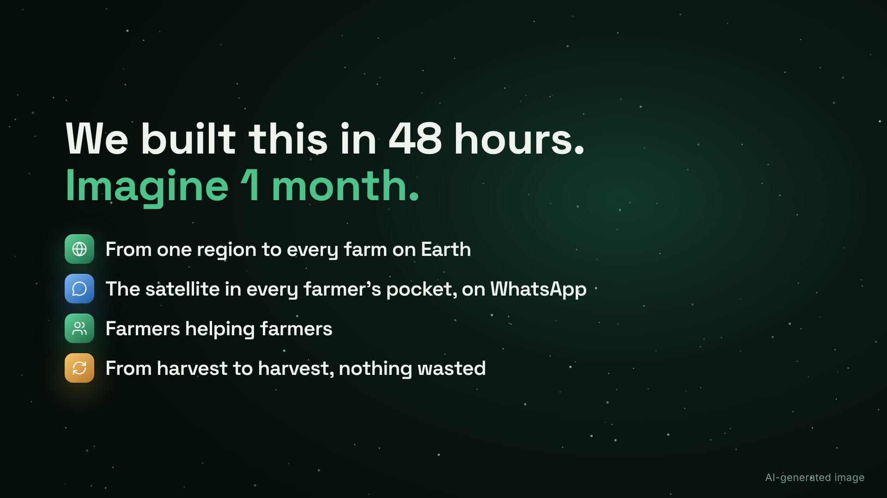

**We built this in 48 hours. Imagine one month.** Full plan in the [roadmap](docs/product/04-product-roadmap.md).

- **From one region to every soybean field on Earth.** NASA data is global and free; expansion is mostly configuration: the whole Triângulo, the Cerrado, every soybean region in Brazil, then other countries, moving to HLS (30 m) and VIIRS.
- **The satellite in every farmer's pocket.** 96% of Brazilian farmers use WhatsApp for business decisions and 66.9% of soybean production is outside 4G/5G coverage. So the whole product goes inside WhatsApp: ask and get the answer as text and audio, follow the plan with reminders, receive at most two alerts a week, and ask by voice.
- **Farmers helping farmers.** A regional community: "It rained here" rain gauges, "What I planted and how it went", "It happened here" for fire and pests, sharing equipment and crews, planting together and buying seed and inputs together for a better price. Only the 10 km area is stored.
- **From harvest to harvest, nothing wasted.** From one question to the whole farm year, with more starting crops and more options.

**First steps:** a WhatsApp beta with 20 farmers and the whole Triângulo on the map in month one; an off-season pilot with 15 to 20 farmers in February–March 2027.

## 13. Repository map

```
projeto/
  docker-compose.yml        local environment (PostGIS, backend, frontend)
  backend/
    app/                    FastAPI: controllers, services (engine), repositories, schemas
      config_data/          regras.yaml and culturas.yaml, every value with its source
    pipeline/               NASA, ISRIC and NOAA download and precompute scripts
    tests/unit, integration Pytest
    docs/                   ADRs, user stories, class and sequence diagrams, tasks, deploy
  frontend/
    src/                    views, controllers, services, repositories, design system, guide content, i18n
docs/
  product/                  discovery, business plan, PRD, roadmap
  submission/               the texts sent to NASA Space Apps
  images/                   screenshots and illustrations used in this README
.github/workflows/ci-cd.yml CI on every pull request, deploy on every merge
AGENTS.md                   shared rules for people and AI agents
```

## 14. Team and thanks

| | |
| --- | --- |
| **Adriano Araújo** | [@adrianoaraujomr](https://github.com/adrianoaraujomr) |
| **Rayanne Lemos** | [@rayannelemos](https://github.com/rayannelemos) |
| **Ricardo Pereira** | [@Ricardo07g](https://github.com/Ricardo07g) |

Uberlândia, Minas Gerais, Brazil.

**Thank you, NASA.** None of this exists without NASA's open data and the Space Apps Challenge. Small decisions in one field. A big difference for the planet.

Licensed under [MIT](LICENSE).
