<!-- Project Details field of the NASA Space Apps Challenge 2026 submission. -->

# Raiz Orbital: What to Plant After Soybeans?

*Eyes on the sky, roots in the ground.*

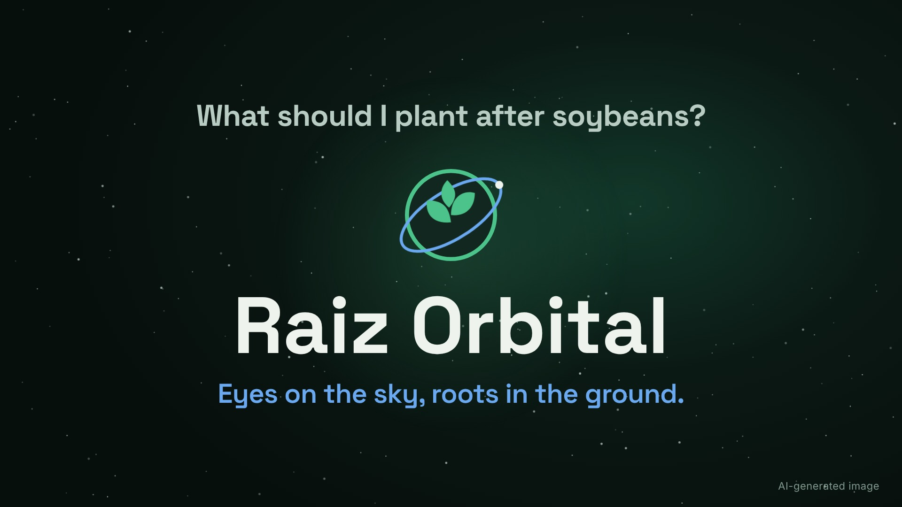

**Live app:** <https://frontend-production-62e614b3.up.railway.app> (no sign-up; a demo field opens with one tap)\
**Source code on GitHub:** <https://github.com/Ricardo07g/nasa-challenge> (README, product documents, tests and data pipeline)

## 1. The challenge and why we chose it

We chose **Field Shift: Adapting Farms with NASA Data** because it describes, word for word, a decision that farmers around us make every year. We live in Uberlândia, in the Triângulo Mineiro region of Minas Gerais, in the heart of the Brazilian Cerrado. Here, soybeans are harvested between January and March, and right after that every farmer faces the same question: **what should I plant next, with the rains about to end?**

Field Shift asks for a tool that combines NASA Earth observations, local soil information, crop characteristics and farmer priorities into crop rotation strategies that strengthen soil health and adapt farms to a changing climate. Raiz Orbital is our answer to that, built for one real region and one real decision.

### How we got to the problem

We started from a question, not from a technology. Before writing code, we spent the first hours on product discovery, with one rule: **only public, citable sources, and every number with its link**.

- **Public universities, many of them in our own region:** UFU (dry spells across 30 weather stations and the farm profile of the Triângulo Mineiro), IFTM with UFU (when the rains end), UFV (when the rains start), UFG and UFGD.
- **Research and technology centers:** Embrapa (soil under the soybean–corn routine, water stress in corn and soybeans, satellite mapping of cropping systems), Inpe and Cemaden, ISRIC, NOAA and FAO.
- **Official statistics and surveys:** IBGE, Conab, MAPA (ZARC), Ipea, and farmer surveys with published methods (ABMRA, McKinsey, Serasa).
- **Farmers' own words:** regional press reports from Uberlândia and Uberaba.

Three findings shaped every decision. The off-season choice repeats every year with no field-level information, so the app answers that one question. Rain changes a lot from one farm to the next, so every result is computed for the field's own grid cell. Farmers trust their agronomist far more than AI, so the engine is deterministic, cites its sources and produces a report for the agronomist. The full research is public in our [product discovery](https://github.com/Ricardo07g/nasa-challenge/blob/main/docs/product/01-product-discovery.md).

## 2. The problem

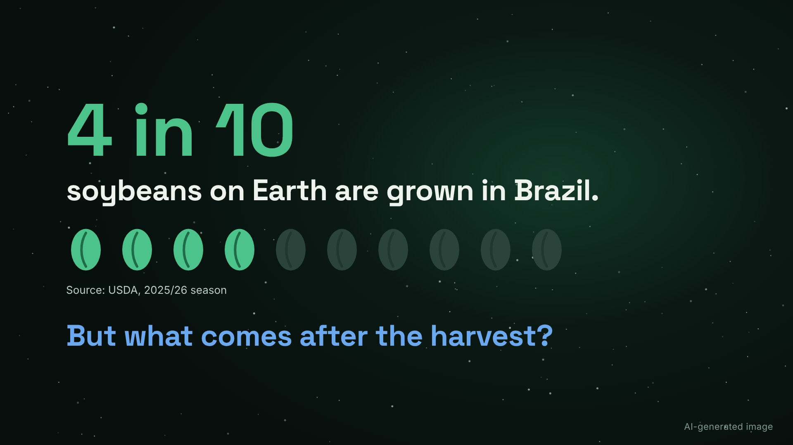

- **Brazil feeds the world with soybeans.** About 4 in every 10 soybeans on Earth are grown in Brazil (USDA, 2025/26), and about half of Brazil's soybean area is in the Cerrado.
- **The off-season decision is made almost blind.** Most farmers repeat second-crop corn or leave the field fallow. Embrapa points out that this succession degrades soil structure and long-term productivity: bare soil has no straw to protect it, and the soybean–corn sequence feeds root nematodes.
- **The climate risk is growing.** In the Triângulo the dry season usually starts in April, so a crop sown late reaches flowering without water. The 2025/26 drought hit rainfed farms in the region hard, and the 2026/27 season starts under a strong El Niño.
- **Almost no safety net.** Only 3.3% of Brazil's planted area was insured in 2025, so every climate loss goes straight to the farmer's income.

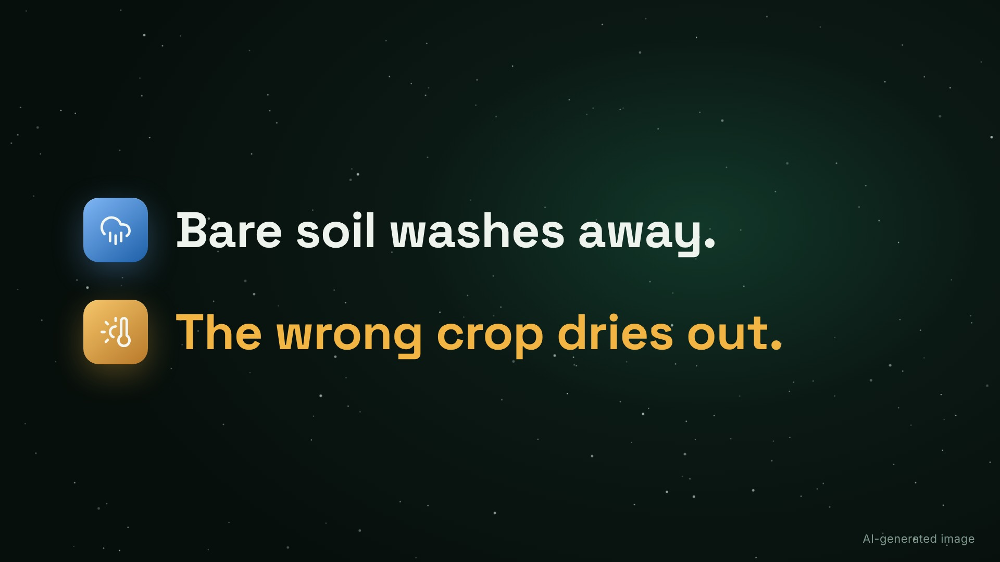

## 3. Our solution: Raiz Orbital

**Raiz Orbital** is a responsive web app that answers one question for one specific field: **"What should I plant after soybeans, and which rotation should I follow for the next 3 years?"**

The farmer answers only two things: **where the field is** and **when the soybeans will be harvested**. NASA satellites answer the rest. Raiz Orbital replays **20 seasons (2005–2024)** of NASA observations for that exact spot, tests **six off-season options** against the local soil, re-runs everything under **2041–2060** NASA climate projections, and turns it into one clear recommendation, explained in plain language, with the source of every number.

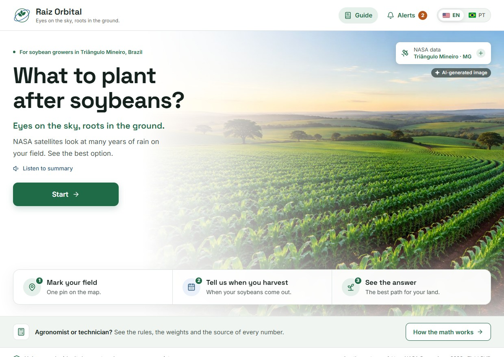

## 4. How to use it, step by step

The whole path takes about one minute with the demo field. It works on a phone and on a computer, in Portuguese and English (switch in the header).

1.  **Open the app** at <https://frontend-production-62e614b3.up.railway.app> and tap the main button on the home screen.
2.  **Mark the field.** The map opens with a demo field already marked: keep it, tap "Use where I am now", or use "Other ways to mark" to paste coordinates or a Google Maps link. The MVP covers the area around Uberlândia and Uberaba; points outside it get a clear message.
3.  **Tell when you harvest the soybeans:** an exact date, or early, mid or late February. Not sure? "Still deciding?" compares harvest periods and how much rain is left after each one.
4.  **Read your field's X-ray:** eight indicators (soil, moisture now, rain, dry spells, heat and more) and the last 10 seasons seen by satellite. Confirm what you planted in the last three off-seasons.
5.  **Choose your priority** (More safety, Income or Care for the soil) and get one suggestion with "worked in X of 20 years". Tap "Why this suggestion?" to see the NASA data behind it, and compare up to three crops side by side.
6.  **Build your 3-year plan.** Change any year and the following years are recalculated, with our suggestion always visible. Open "What if the year is dry?" to see Plan A and Plan B.
7.  **Open "Your plan":** a timeline of what to do and when, the alerts for your area and **Print report** to take to your agronomist.
8.  **Anytime:** the **Alerts** bell and the **Guide** (27 short articles) are in the header, and "Listen to summary" reads each screen aloud.

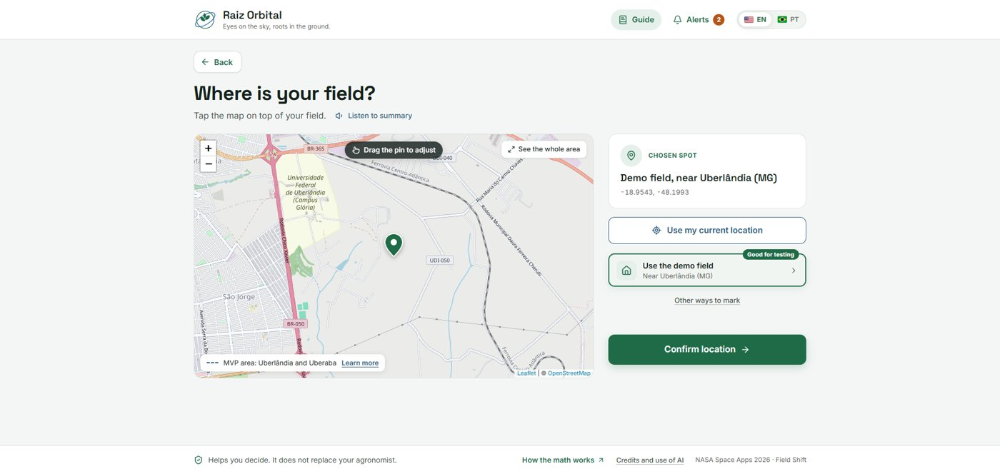

## 5. What the farmer gets

### 5.1 A detailed X-ray of the land

Eight indicators for the chosen point: soil texture, water the soil can hold, root-zone moisture now (SMAP), crop greenness (MODIS), rain in a typical year and the longest dry spell (GPM IMERG), strong-heat years (NASA POWER) and how the field compares with the region. Each block shows its NASA source and resolution.

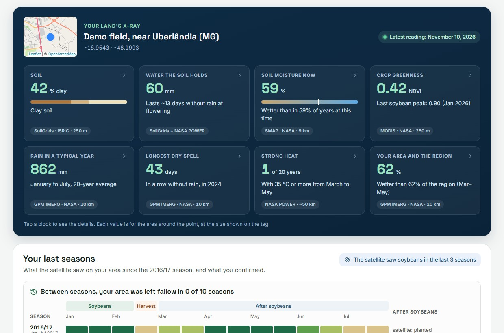

It also shows a **10-season history of the field** from MODIS NDVI: the satellite detects the soybean crop and whether the field was planted or left fallow after it. The farmer confirms each season, and those answers become the baseline for the plan.

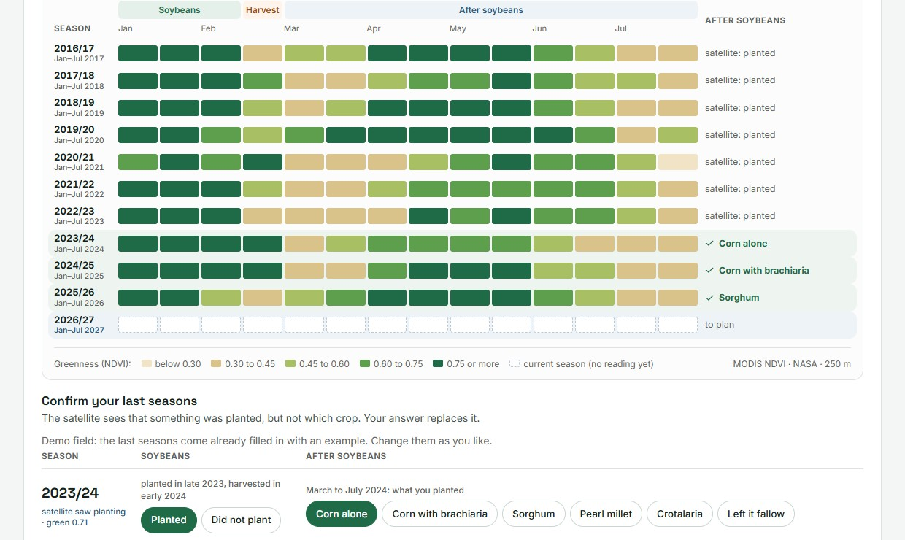

### 5.2 One recommendation, adjusted to the farmer's priority

The farmer chooses what matters most: **more safety**, **income** or **care for the soil**. Raiz Orbital suggests one option, for example "worked in 20 of 20 years", and lets the farmer compare up to three crops side by side: water, future climate, income risk, soil effect, sowing deadline, pros and cons. Every value opens the math and the source.

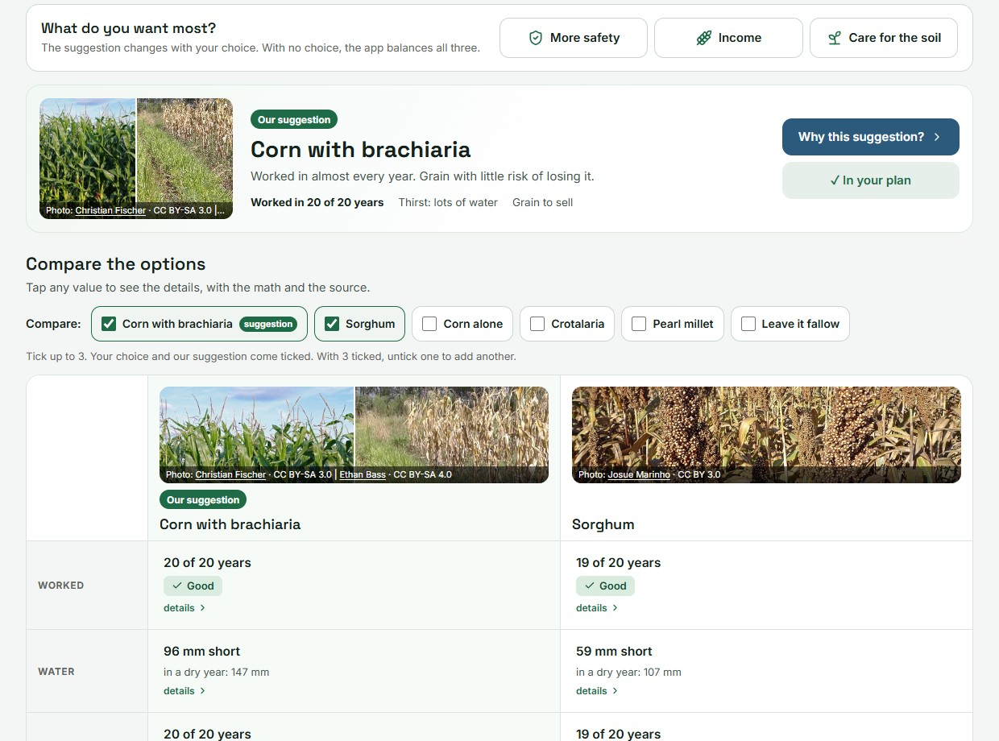

### 5.3 A planting plan for the next 3 years

A rotation suggested year by year, with the reason for each step, scored against how the field is managed today (safety, soil health and 2041–2060 climate). It also shows how much rain is put to use instead of being wasted on bare soil.

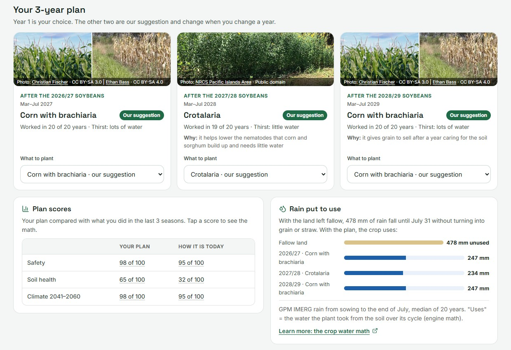

**What if the year is dry?** Using the official NOAA El Niño outlook and the current SMAP soil moisture, the plan gives a Plan A for a normal autumn and a Plan B for a dry one.

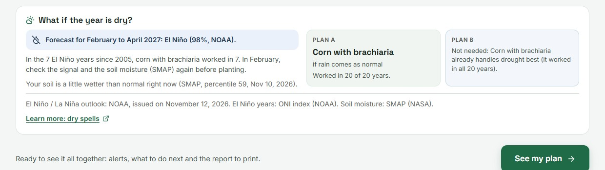

### 5.4 Alerts, reports and guidance

Current alerts (strong heat, dry soil, heavy rain, frost and nearby fire), how the area has changed between 2005–2019 and 2020–2024, the most extreme events of the last 20 years, a printable report to take to the agronomist and links to the official Civil Defense alert channels.

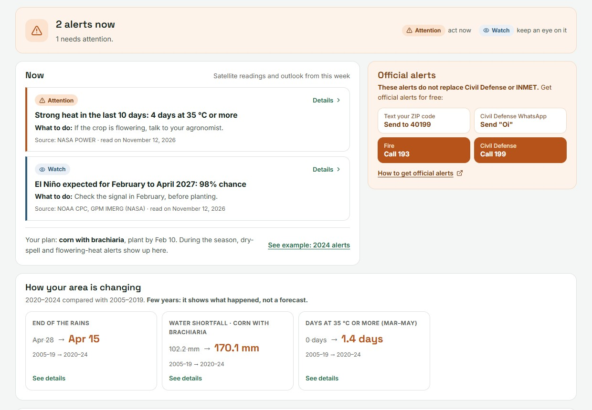

A bilingual guide (Portuguese and English) with 27 short articles on crops, planting, soil care, climate and safety, plus a "How the math works" page listing every rule, threshold and source.

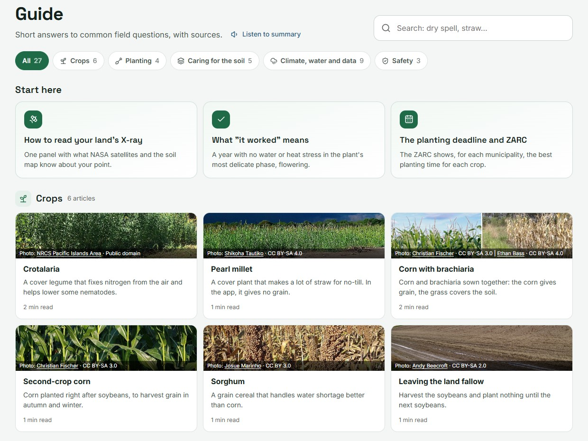

## 6. How it works

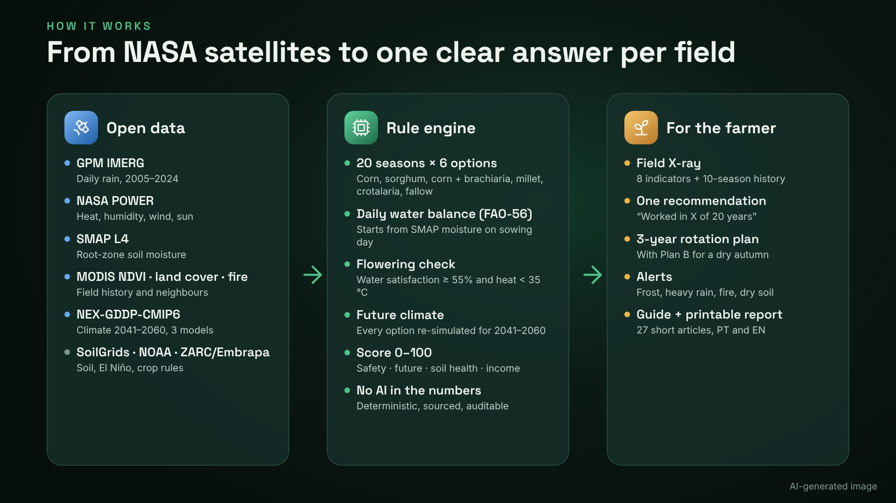

- **Daily climate series** for the field's 0.1° cell, 2005–2024: rain from GPM IMERG Final (NASA POWER as fallback); reference evapotranspiration with FAO-56 Penman–Monteith from NASA POWER.
- **Soil** from ISRIC SoilGrids sets how much water the soil holds (60 mm clayey, 50 mm medium, 40 mm sandy). The farmer can adjust it.
- **Daily soil-water balance (FAO-56)** starting each season from the NASA SMAP root-zone moisture on sowing day.
- **Sowing date** follows the harvest date. Crops past their official ZARC sowing deadline are never recommended.
- **A season "worked"** if the crop's water satisfaction stayed at or above 55% around flowering (50% in the first 30 days for cover crops), with fewer than 3 days at 35 °C or more.
- **Future climate:** monthly changes from three NEX-GDDP-CMIP6 models (SSP2-4.5, 2041–2060 vs 1995–2014) are applied and every option is simulated again.
- **Score 0–100:** climate safety 30%, future climate 15%, soil health 25% (straw, nitrogen, nematode break) and income 30%. The farmer's priority reorders the ranking.
- **Six options:** second-crop corn, sorghum, corn with brachiaria, pearl millet, crotalaria (sunn hemp) and fallow.

## 7. NASA data in every number

| NASA dataset                                 | What it answers in Raiz Orbital                                                                                  |
|----------------------------------------------|------------------------------------------------------------------------------------------------------------------|
| GPM IMERG Final, daily V07 (0.1°, 2005–2024) | Rain in every simulation, rain left after harvest, end of the rainy season, longest dry spell, heavy-rain alerts |
| NASA POWER, daily agroclimatology            | Evapotranspiration (FAO-56), heat at flowering, frost risk, current dry-day and heat warnings                    |
| SMAP L4 SPL4SMGP v008 (9 km)                 | Starting soil water on sowing day, current root-zone moisture percentile, dry-soil alerts                        |
| MODIS MOD13Q1 + MYD13Q1 NDVI (250 m)         | 10-season history of each field: soybean detected, planted or fallow after it                                    |
| MODIS MCD12Q1 land cover (500 m)             | Cropland mask to compare with neighbouring fields within 30 km                                                   |
| MODIS MCD64A1 burned area (500 m)            | Fire history within 5 km of the field                                                                            |
| NEX-GDDP-CMIP6 (0.25°, SSP2-4.5, 3 models)   | Every option re-simulated for 2041–2060, with model agreement                                                    |

We download the data directly from NASA services (POWER API, GES DISC, ORNL DAAC, NCCS THREDDS and Earthdata). NASA is cited only by name as the source of each number; no NASA logos are used.

## 8. How Raiz Orbital answers Field Shift

| The challenge asks for          | Raiz Orbital delivers                                                         |
|---------------------------------|-------------------------------------------------------------------------------|
| NASA Earth observations         | GPM IMERG, NASA POWER, SMAP, MODIS and NEX-GDDP-CMIP6 in every result         |
| Local soil information          | SoilGrids texture and water-holding capacity, adjustable by the farmer        |
| Crop characteristics            | Cycle, flowering, water demand and sowing deadlines from ZARC and Embrapa     |
| Farmer priorities               | Ranking by safety, income or care for the soil                                |
| Crop rotation strategies        | A 3-year plan compared with how the field is managed today                    |
| Soil health                     | Score for straw, nitrogen and nematode break, plus the field's fallow history |
| Adapting to changing conditions | 20-year risk, a dry-autumn Plan B and a 2041–2060 re-simulation               |

## 9. Design decisions

- **Two questions, one answer.** Many farmers in the region are over 45 and have little formal schooling, so the app uses plain language and a "Listen to summary" button on every screen.
- **No invented numbers.** Every threshold is stored with its source (ZARC, Embrapa, FAO-56) and the API rejects any value without one. When data is missing, the block is hidden.
- **No AI in the decision.** Farmers trust agronomists far more than AI, so the engine is deterministic and auditable. The app "helps you decide; it does not replace your agronomist."
- **No guessed prices.** Income is measured by facts: whether the crop gives grain and how often it lost water or suffered heat.
- **A website, not an app store download.** It works on a phone in the field and on the computer at the cooperative, with no sign-up.
- **Honest about scale.** The prototype covers a pilot area of 226 grid cells around Uberlândia and Uberaba.

## 10. Impact

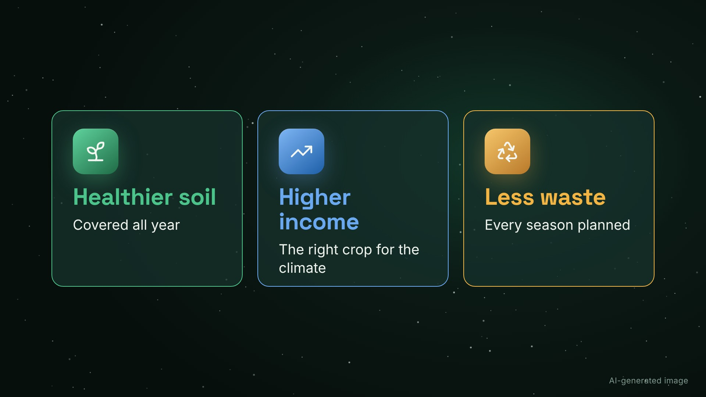

- **Environment:** fields covered all year instead of bare soil mean less erosion, more water kept in the soil, more straw and nitrogen, and fewer nematodes.
- **Farm income:** choosing a crop that fits this field's climate means fewer harvests lost to drought, in a country where almost no area is insured.
- **People:** free access, plain language, audio and two languages put 20 years of NASA satellite data in the hands of farmers who never had it.

**Our hypothesis:** if farmers see, for their own field, how each option performed over 20 years and how it would perform in the 2050s, at least 1 in 3 will try a soil-building option on part of their land.

## 11. Validation and limitations

Next we will interview farmers and agronomists, run a pilot with 15 to 20 farmers in the 2027 off-season and check our "risky years" against IBGE municipal crop-loss data. Limitations we show to users: satellites observe, they do not forecast weather; SMAP and IMERG describe the region, not a single field; optical NDVI is affected by clouds; crop texts are drafts awaiting agronomist review.

## 12. What comes next

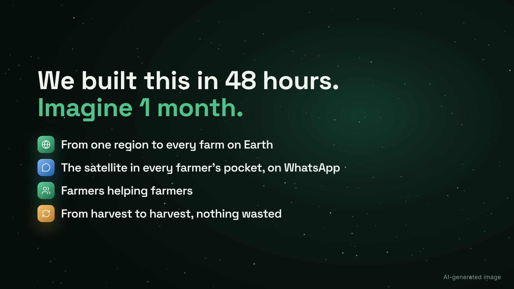

**We built this in 48 hours. Imagine one month.**

What we are submitting is an **MVP**: it covers a pilot area of 226 grid cells around Uberlândia and Uberaba, in the Triângulo Mineiro. The engine, the data pipeline and the screens are ready to grow. Four bets take it from here:

### 12.1 From one region to every soybean field on Earth

NASA data is global and free; what changes from place to place is the agronomy (sowing deadlines, crop cycles, soil). That makes expansion mostly configuration, not new code. The steps are: the whole Triângulo Mineiro and Alto Paranaíba, then the Cerrado (Minas Gerais, Goiás, Mato Grosso, Bahia, Tocantins), then every soybean region in Brazil, including the South, with wheat, oats and frost rules, and then other countries, replacing ZARC with each country's planting calendar. Along the way we move from MODIS to HLS (30 m) and VIIRS, which see individual fields better. The goal: **any farmer who grows soybeans, anywhere, can ask "what do I plant next?" and get an answer for their own field.**

### 12.2 The satellite in every farmer's pocket: fully integrated with WhatsApp

In rural Brazil, WhatsApp is where business happens: **96% of farmers use it for business decisions** (9th ABMRA survey), 98% of farms have internet at least on a phone, and 82% of rural internet users go online only through a phone. At the same time, **66.9% of Brazil's soybean production is outside 4G and 5G coverage**. A website needs a good signal and a new habit; a WhatsApp message arrives anyway. That is why the next version is not "alerts on WhatsApp" but **the whole product inside WhatsApp**:

- **Ask and get the answer in the chat:** send the field's location pin, tap the harvest period, and receive the recommendation as short text and as audio, with a link to the full plan and the PDF report.
- **Build and follow the plan there:** reminders on the plan's dates ("the sowing deadline for sorghum is March 20").
- **Receive alerts that matter:** dry soil, dry spells or heat at flowering, heavy rain, frost and fire nearby, at most two a week so they never become noise.
- **Ask by voice:** record "can I still plant sorghum?" and get an answer from the same engine.
- **Built the right way:** the official WhatsApp Business Cloud API, a verified number, the same engine as the website, opt-in alerts and no personal data beyond the chat.

### 12.3 Farmers helping farmers: a community that works as a whole

Satellites see the region; neighbours see the field. Rain alone can be 20% above average in Uberlândia and 30% below in Uberaba on the same month, less than 100 km apart. The community turns the farmers of a region into one network:

- **It rained here:** farmers with a rain gauge record today's rain in two taps, correcting satellite rainfall for everyone.
- **What I planted and how it went:** "12 neighbours planted sorghum; 9 were happy", the kind of trust no algorithm can buy.
- **It happened here:** hail, fire, flash flood, pests or a bad road, so a warning reaches the next farm first.
- **Share equipment and labour:** a planter for a day, a crew for a firebreak, a shared truck to the cooperative.
- **Plant together:** neighbours who choose the same crop can coordinate sowing and logistics.
- **Buy together:** group purchases of seed and inputs for a better price, so small farms gain the strength of a large one.
- **Ask the agronomist** and get **the week in your region**: rain, what neighbours planted and the alerts, in one short digest.

Privacy by design: only the 10 km area is stored, never the exact spot; names appear only with permission; reports are cross-checked with satellite data and the community is moderated.

### 12.4 From harvest to harvest, nothing wasted

From one question to the whole farm year: a signal for when to plant the soybeans, dry-spell and heat alerts at flowering, the after-harvest decision, frost and fire alerts in the dry season, and a satellite check in July and August that the plan was really planted. More starting crops (after corn, cotton, sugarcane, beans) and more options to plant join the six we cover today. More yield from the same land, less soil, water and money wasted.

**First steps:** month one, a WhatsApp beta with 20 farmers and the whole Triângulo on the map; February–March 2027, an off-season pilot with 15 to 20 farmers in Uberlândia and Uberaba; then the Cerrado and the first partner cooperative. Our north star is the number of hectares that leave fallow and stay covered, **checked from space**. Full plan: [product roadmap](https://github.com/Ricardo07g/nasa-challenge/blob/main/docs/product/04-product-roadmap.md).

## 13. Technology and quality

**Backend:** Python 3.12, FastAPI, SQLAlchemy, Alembic, PostgreSQL 17 + PostGIS 3.5. **Frontend:** React 19, TypeScript, Vite, React Router, Leaflet. **Data pipeline:** 14 Python scripts that download data directly from NASA, ISRIC and NOAA and precompute every grid cell. **Hosting:** Docker and Railway, live 24/7 during judging. No special hardware.

**Built test-first.** Every behaviour started with a failing test (TDD), in four layers:

| Type of test                                                         | What it covers                                                                                               | Tests  |
|----------------------------------------------------------------------|--------------------------------------------------------------------------------------------------------------|--------|
| **Unit tests** (backend, Pytest)                                     | The engine: water balance, success rule, ZARC window, scores, rotation rules, alerts, with fake repositories | ~1,370 |
| **Integration tests** (backend, Pytest)                              | API endpoints and the database, against a disposable PostGIS; migrations up, down and up again               | ~210   |
| **Unit and controller tests** (frontend, Vitest)                     | Services, API calls, hooks, translations and content                                                         | ~900   |
| **Component and feature tests** (frontend, Vitest + Testing Library) | Every component and every screen rendered the way the user sees it, and full flows through the routes        | ~530   |

- **Screen reviews:** after each delivery, every screen was checked in Portuguese and English, on a phone (360 px) and on a desktop, and the interface was adjusted round after round: plain language, no step counters and a real "Back" button, details in pop-ups, the plan's suggestion always visible and no sideways scroll on a phone.
- **Prototyping:** the first screens were prototyped with Lovable, then rebuilt in React with tests.
- **Automated delivery:** every pull request runs secret scanning, linters (Ruff, Oxlint), all tests, the production build and the Docker images; every merge deploys to Railway and a final check confirms that the live site runs the new version.

**What is on GitHub** (<https://github.com/Ricardo07g/nasa-challenge>): almost 600 commits from four contributors in 48 hours, about half Python and half TypeScript.

- **README:** the problem, how we got to it, how to use the app, how it works, architecture, tests, use of AI and how to run it.
- **Product documents:** [Discovery](https://github.com/Ricardo07g/nasa-challenge/blob/main/docs/product/01-product-discovery.md) (research, pains, personas, hypotheses) · [Business plan](https://github.com/Ricardo07g/nasa-challenge/blob/main/docs/product/02-business-plan.md) · [PRD](https://github.com/Ricardo07g/nasa-challenge/blob/main/docs/product/03-prd.md) · [Roadmap](https://github.com/Ricardo07g/nasa-challenge/blob/main/docs/product/04-product-roadmap.md).
- **Code:** the FastAPI backend, the React frontend, the NASA data pipeline, the engine rules with a source for every number, architecture decision records, user stories and diagrams.

## 14. Use of artificial intelligence

We used AI tools as assistants. **No AI produces any number, score or recommendation shown to farmers.**

- **Claude (Anthropic):** research support for product discovery and data review, documentation drafts, pair programming (FastAPI services, React screens, NASA data-ingestion scripts and tests), interface and guide texts in Portuguese and English, and production of the demo video and the illustrations on this page.
- **Gemini (Google):** pair programming, code review and documentation drafts.
- **Lovable:** early interface prototyping and the decorative image on the app's home screen, which carries a visible "AI-generated image" mark.
- **Demo video:** AI-generated, marked "AI-generated video". The narration is a synthetic voice (Piper TTS) and the soundtrack was composed with code by AI.
- **Images on this page:** the illustrations marked "AI-generated image" were produced with AI; the other images are real screenshots of our app.

Every change was reviewed by the team under shared rules for people and AI agents (AGENTS.md in the repository).

## 15. Team

**Team Raiz Orbital**, Uberlândia, Minas Gerais, Brazil: **Adriano Araújo, Rayanne Lemos and Ricardo Pereira**.

## Thank you, NASA

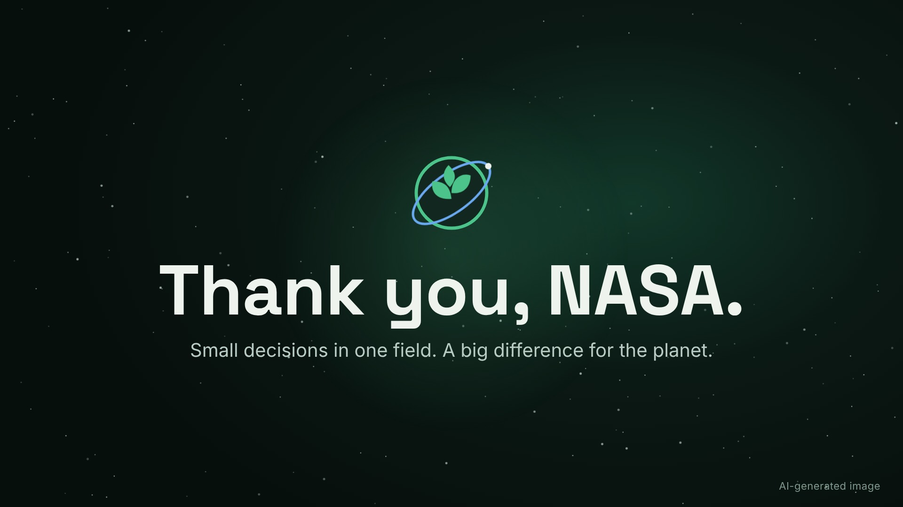

Thank you to NASA and the Space Apps community for opening the data of space to the people who take care of the land. **Small decisions in one field. A big difference for the planet.**
