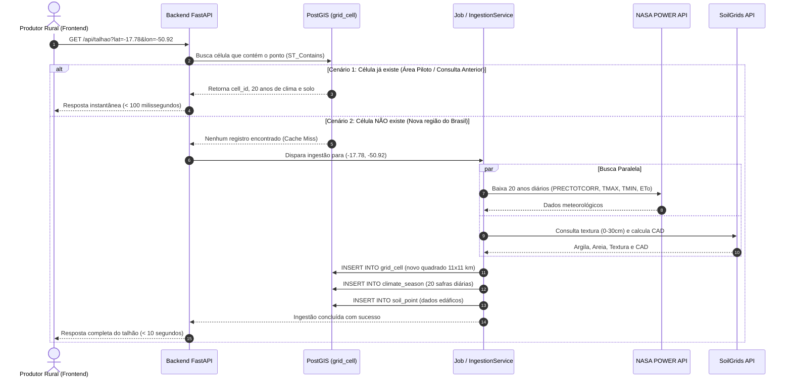

# Como Funcionam os Dados de Satélite, as Grades Espaciais e o PostGIS

Este documento explica os conceitos geográficos e a arquitetura de dados do **Raiz Orbital**: como os satélites capturam dados, por que usamos grades regulares em vez de raios circulares, o papel do PostGIS e o ciclo de vida da ingestão on-demand.

---

## 1. Desmistificando o PostGIS

> [!IMPORTANT]
> **O PostGIS NÃO vem com mapas, cidades ou dados da NASA pré-carregados.**\
> O PostGIS é uma extensão do PostgreSQL que adiciona **suporte a tipos e funções geométricas/espaciais**. Ele é como uma calculadora geométrica e uma gaveta vazia com índice espacial (R-Tree / GiST).

- **O que o PostGIS faz:** sabe responder instantaneamente perguntas como:
  - *"Este ponto de coordenada $(lat, lon)$ está dentro deste polígono?"* (`ST_Contains`)
  - *"Qual é a célula ou ponto mais próximo desta coordenada?"* (`<->` ou `ST_Distance`)
  - *"Qual é a distância em metros entre duas coordenadas?"* (`ST_Distance(geography, geography)`)
- **Quem gera os polígonos e puxa os dados climáticos da NASA?** O **nosso backend em Python**.

---

## 2. Como os Satélites Enxergam a Terra: Grade (Pixel) vs Ponto vs Raio

Os satélites e modelos climáticos **não operam por raios circulares nem por divisões municipais**. A superfície da Terra é dividida em **grades regulares de pixels**:

```
+-----------------------------------------------------------------------------------------+
|                        RESOLUÇÃO ESPACIAL DAS FONTES DE DADOS                          |
+-----------------------------------------------------------------------------------------+
|                                                                                         |
|  [ NASA POWER: Clima / Chuva ]   ──> Quadrado de ~55 km x 55 km (0.5° x 0.5°)           |
|                                                                                         |
|  [ SMAP: Umidade do Solo ]       ──> Quadrado de ~9 km x 9 km (L4 Global)               |
|                                                                                         |
|  [ Grade do Raiz Orbital ]       ──> Quadrado de ~11 km x 11 km (0.1° x 0.1° no PostGIS) |
|                                                                                         |
|  [ ISRIC SoilGrids: Argila/Solo] ──> Quadrado de 250 m x 250 m (Pixel fino)             |
|                                                                                         |
|  [ MODIS (AppEEARS): NDVI ]      ──> Quadrado de 250 m x 250 m (Histórico decenal)      |
|                                                                                         |
+-----------------------------------------------------------------------------------------+
```

### Por que usamos uma grade de 0.1° (~11 km) no nosso banco?
1. **Física da Atmosfera:** Duas fazendas vizinhas a 3 km de distância possuem exatamente o mesmo regime histórico de chuva e temperatura da NASA. Ter um registro para cada centímetro gastaria armazenamento à toa.
2. **Harmonização:** 0.1° é o ponto de equilíbrio perfeito entre a chuva da NASA (55 km) e o solo do SoilGrids (250 m).
3. **Exemplo prático de Uberlândia:** O município de Uberlândia (~4.115 km²) é coberto por aproximadamente **8 a 12 células de 11 km**.

---

## 3. Como o Python Calcula a Célula Espacial (`grid_cell`)

Quando um usuário clica no mapa em qualquer lugar do Brasil, o backend converte as coordenadas contínuas em um identificador discreto de célula pegando o **piso (`floor`) do passo de 0.1°** (plano técnico §5, alinhado à grade do IMERG). É a única regra do backend: `cell_id_for` em `app/repositories/climate_repository.py`, usada pela ingestão, pelos repositories e pelo polígono da célula.

```python
# Fazenda de exemplo: campo de soja da Fazenda Experimental do Glória (UFU), Uberlândia
lat = -18.9543
lon = -48.1993

# Piso do passo de 0.1° (floor, nunca round)
lat_idx = math.floor(lat * 10)  # -190
lon_idx = math.floor(lon * 10)  # -482

cell_id = f"{lat_idx}_{lon_idx}"  # "-190_-482"

# O quadrado de 11 km x 11 km tem as bordas nos décimos: idx/10 até (idx + 1)/10
# Lat: [-19.0 até -18.9] | Lon: [-48.2 até -48.1]
# Centro: ((idx + 0.5) / 10) -> lat -18.95, lon -48.15
```

> Até o R1.2 conviviam duas regras (`round` na ingestão e `floor` na fixture). Desde então só vale o
> `floor`, decidido pelo time em 14/11 ([roteiro](roteiro-de-implementacao.md), seção 5).

Os dados de satélite vêm direto dos serviços da NASA, sem Google Earth Engine no MVP
([ADR-0005](adr/0005-fontes-diretas-da-nasa-sem-earth-engine.md)): NASA POWER e SoilGrids na hora do pedido
(busca sob demanda, ligada no R1.1); NDVI do MODIS (AppEEARS), CMIP6 (THREDDS da NCCS) e SMAP (AppEEARS)
preparados antes pelos scripts de dados.

---

## 4. O Ciclo de Vida da Informação: Cache-Aside Geográfico

O sistema combina consultas ultrarrápidas no banco com busca sob demanda quando o produtor clica em uma região nova:



---

## 5. Resumo das Responsabilidades

| Componente | Papel no Sistema | O que Contém? |
| :--- | :--- | :--- |
| **NASA POWER & SMAP** | Fonte bruta de dados de satélite | Histórico global de chuva, temperatura, radiação e umidade superficial. |
| **ISRIC SoilGrids** | Fonte bruta de dados edáficos | Mapas globais de 250m com porcentagem de argila, areia, carbono e pH. |
| **PostGIS (Nosso Banco)** | Armazenamento e indexador espacial | Polígonos das células já consultadas (`grid_cell`) e tabelas de séries diárias. Começa vazio e cresce conforme novas áreas são consultadas. |
| **Backend (Python / FastAPI)** | Motor inteligente e orquestrador | Calcula as geometrias, coordena as chamadas às APIs externas, calcula o ISNA (risco de quebra) e entrega a recomendação final de plantio. |
