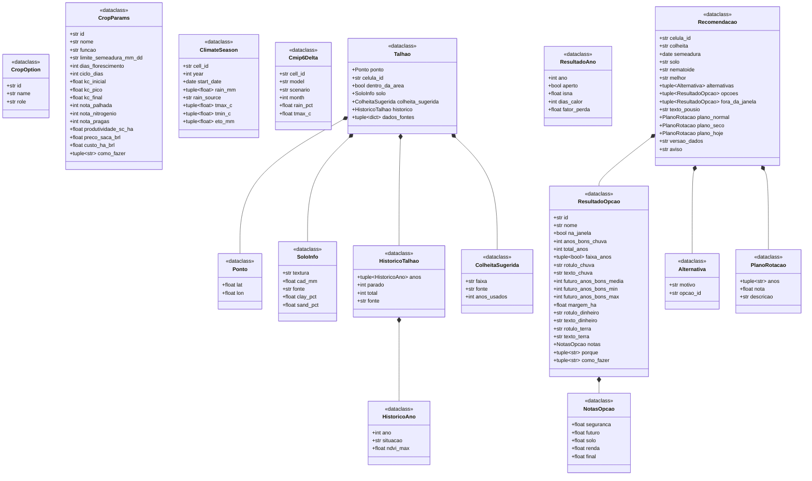
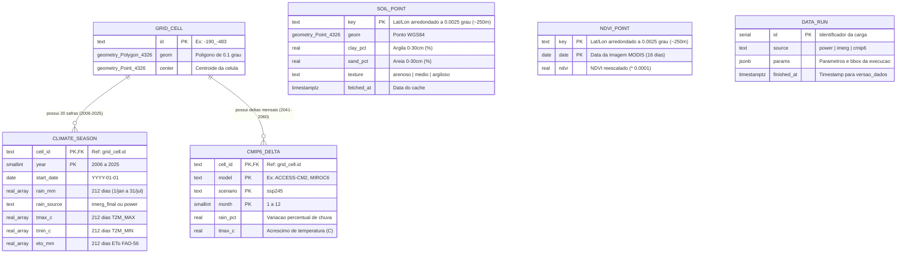

# Diagrama de Classes e Modelo de Dados — Raiz Orbital (Backend)

Este documento apresenta os **Diagramas de Classes (UML)** e o **Diagrama Entidade-Relacionamento (PostGIS)** do backend do **Raiz Orbital**, seguindo rigorosamente a arquitetura **MVC + Service/Repository** definida em `AGENTS.md` e no `Raiz Orbital – plano técnico do backend.md`.

---

## 1. Direção das Dependências e Regras de Camada

A arquitetura garante que regras de negócio fiquem **100% isoladas nos Services** (puro Python, testáveis via TDD com *fakes* sem banco ou rede) e que todo acesso externo fique confinado nos **Repositories** através de contratos (`typing.Protocol`).

```mermaid
flowchart LR
    subgraph View ["View (app/schemas/)"]
        S["Schemas Pydantic<br/>(JSON HTTP)"]
    end
    subgraph Controller ["Controller (app/controllers/)"]
        C["Rotas FastAPI<br/>(Finas, sem regra)"]
    end
    subgraph Service ["Service (app/services/)"]
        SV["Regras de Negócio<br/>(Motor, ISNA, Ranking)"]
    end
    subgraph Repository ["Repository (app/repositories/)"]
        RP["Protocols & Implementações<br/>(Acesso a Dados)"]
    end
    subgraph Model ["Model (app/models/)"]
        M["Dataclasses Imutáveis<br/>(Domínio)"]
    end
    subgraph Data ["Fontes de Dados"]
        DB[("PostGIS 17<br/>(Séries, Deltas, Cache)")]
        YAML["culturas.yaml<br/>regras.yaml"]
        EXT["APIs Externas<br/>(Earth Engine / SoilGrids)"]
    end

    S <-- "converte" --- C
    C -- "Depends()" --> SV
    SV -- "depende do Protocol" --> RP
    SV -. "manipula" .-> M
    RP -. "instancia" .-> M
    RP --> DB
    RP --> YAML
    RP --> EXT
```

---

## 2. Diagrama de Classes — Camada de Domínio (`app/models/`)

Todas as entidades de domínio são `@dataclass(frozen=True)` puras, sem acoplamento com FastAPI, Pydantic ou drivers de banco de dados.



---

## 3. Diagrama de Classes — Camada Repository (`app/repositories/`)

Cada fonte de dados possui um contrato em `Protocol` e uma ou mais implementações concretas (PostGIS, YAML, InMemory, Fixture ou cliente HTTP/Earth Engine com cache).

```mermaid
classDiagram
    direction TB

    class CropOptionRepository {
        <<Protocol>>
        +list_all() list~CropOption~
        +get_by_id(option_id: str) CropOption | None
    }

    class InMemoryCropOptionRepository {
        -list~CropOption~ _options
        +list_all() list~CropOption~
        +get_by_id(option_id: str) CropOption | None
    }

    class CropParamsRepository {
        <<Protocol>>
        +list_all() list~CropParams~
        +get_by_id(crop_id: str) CropParams | None
    }

    class YamlCropParamsRepository {
        -Path _yaml_path
        +list_all() list~CropParams~
        +get_by_id(crop_id: str) CropParams | None
    }

    class RulesRepository {
        <<Protocol>>
        +get_harvest_date(faixa: str, year: int) date
        +get_soil_cad(textura: str) float
        +get_weights() dict~str, float~
        +format_explanation(key: str, lang: str, **kwargs) str
    }

    class YamlRulesRepository {
        -Path _yaml_path
        +get_harvest_date(faixa: str, year: int) date
        +get_soil_cad(textura: str) float
        +get_weights() dict~str, float~
        +format_explanation(key: str, lang: str, **kwargs) str
    }

    class ClimateRepository {
        <<Protocol>>
        +find_cell_id(lat: float, lon: float) str | None
        +get_seasons(cell_id: str) list~ClimateSeason~
        +get_cmip6_deltas(cell_id: str, scenario: str) list~Cmip6Delta~
        +get_latest_data_version() str
    }

    class PostgisClimateRepository {
        -str _database_url
        +find_cell_id(lat: float, lon: float) str | None
        +get_seasons(cell_id: str) list~ClimateSeason~
        +get_cmip6_deltas(cell_id: str, scenario: str) list~Cmip6Delta~
        +get_latest_data_version() str
    }

    class FixtureClimateRepository {
        -Path _fixture_path
        +find_cell_id(lat: float, lon: float) str | None
        +get_seasons(cell_id: str) list~ClimateSeason~
        +get_cmip6_deltas(cell_id: str, scenario: str) list~Cmip6Delta~
        +get_latest_data_version() str
    }

    class SoilRepository {
        <<Protocol>>
        +get_soil(lat: float, lon: float) SoloInfo
    }

    class CachedSoilGridsRepository {
        -str _database_url
        -float _timeout_s
        +get_soil(lat: float, lon: float) SoloInfo
        -_fetch_from_soilgrids(lat: float, lon: float) SoloInfo | None
    }

    class NdviRepository {
        <<Protocol>>
        +get_ndvi_series(lat: float, lon: float) list~tuple~date, float~~
    }

    class CachedEarthEngineNdviRepository {
        -str _database_url
        -str _ee_project
        -float _timeout_s
        +get_ndvi_series(lat: float, lon: float) list~tuple~date, float~~
        -_fetch_from_gee(lat: float, lon: float) list~tuple~date, float~~
    }

    CropOptionRepository <|.. InMemoryCropOptionRepository
    CropParamsRepository <|.. YamlCropParamsRepository
    RulesRepository <|.. YamlRulesRepository
    ClimateRepository <|.. PostgisClimateRepository
    ClimateRepository <|.. FixtureClimateRepository
    SoilRepository <|.. CachedSoilGridsRepository
    NdviRepository <|.. CachedEarthEngineNdviRepository
```



---

## 4. Diagrama de Classes — Camada Service (`app/services/`)

Os Services encapsulam todo o motor biofísico e agronômico (FAO-56, ISNA, risco de calor, deltas do CMIP6, classificação de NDVI e planos de rotação trienal).

```mermaid
classDiagram
    direction TB

    class DomainError {
        <<Exception>>
    }

    class NotFoundError {
        <<Exception>>
    }

    class CropOptionService {
        -CropOptionRepository _repository
        +list_options() list~CropOption~
        +get_option(option_id: str) CropOption
    }

    class WaterBalanceCalculator {
        <<Pure Functions>>
        +simular(chuva: Sequence~float~, eto: Sequence~float~, kc: Sequence~float~, cad: float, arm0: float | None) tuple~list~float~, list~float~~
        +isna(etr_l: Sequence~float~, etc_l: Sequence~float~, ini: int, fim: int) float
    }

    class ClimateRiskService {
        -WaterBalanceCalculator _wb
        +simulate_historical(crop: CropParams, seasons: list~ClimateSeason~, semeadura: date, cad_mm: float) list~ResultadoAno~
        +simulate_future_cmip6(crop: CropParams, seasons: list~ClimateSeason~, deltas: list~Cmip6Delta~, semeadura: date, cad_mm: float) tuple~int, int, int~
        +is_within_window(crop: CropParams, semeadura: date) bool
    }

    class FieldHistoryService {
        +classify_entressafra(ndvi_series: list~tuple~date, float~~) HistoricoTalhao
        +suggest_harvest_band(ndvi_series: list~tuple~date, float~~) ColheitaSugerida
    }

    class RotationPlanService {
        +build_3_year_plans(opcoes: list~ResultadoOpcao~, seasons: list~ClimateSeason~, nematoide: str | None) tuple~PlanoRotacao, PlanoRotacao, PlanoRotacao~
        -_score_sequence(seq: tuple~CropParams, CropParams, CropParams~, notes_by_id: dict) float
        -_diversity_bonus(seq: tuple~CropParams, CropParams, CropParams~) float
    }

    class TalhaoService {
        -ClimateRepository _climate_repo
        -SoilRepository _soil_repo
        -NdviRepository _ndvi_repo
        -FieldHistoryService _history_service
        +inspect_talhao(lat: float, lon: float) Talhao
    }

    class RecommendationService {
        -CropParamsRepository _crop_repo
        -RulesRepository _rules_repo
        -ClimateRepository _climate_repo
        -SoilRepository _soil_repo
        -ClimateRiskService _risk_service
        -RotationPlanService _plan_service
        +recommend(lat: float, lon: float, colheita: str, solo_override: str | None, nematoide: str | None, lang: str) Recomendacao
    }

    DomainError <|-- NotFoundError
    CropOptionService ..> NotFoundError : lança
    ClimateRiskService --> WaterBalanceCalculator : usa
    TalhaoService --> FieldHistoryService : usa
    RecommendationService --> ClimateRiskService : usa
    RecommendationService --> RotationPlanService : usa
```



---

## 5. Diagrama de Classes — Controllers, Schemas e Configuração (`app/controllers/`, `app/schemas/`, `app/config.py`)


---

## 6. Diagrama Entidade-Relacionamento — Banco de Dados (`PostGIS 17`)

O esquema relacional-espacial armazena a grade de 0,1° do Triângulo Mineiro, as séries diárias da entressafra (1/jan a 31/jul = 212 dias) compactadas em *arrays* nativos do PostgreSQL (`real[]`) para leitura em consulta única, os deltas mensais do CMIP6 e os caches por ponto (250 m) do SoilGrids e do MODIS NDVI.


