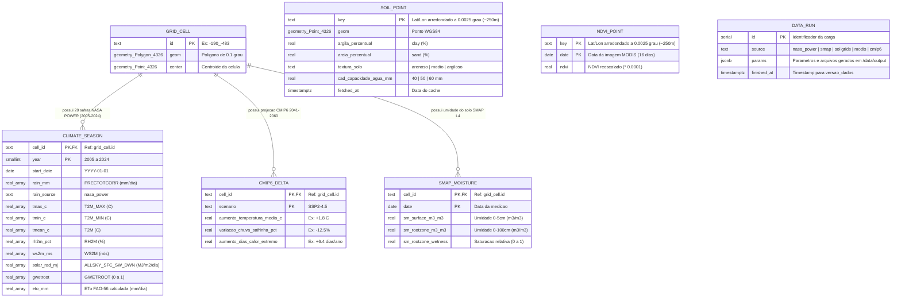

# Diagrama de Classes e Modelo de Dados — Raiz Orbital (Backend & `/data`)

Este documento apresenta os **Diagramas de Classes (UML)** e o **Diagrama Entidade-Relacionamento (PostGIS)** do backend do **Raiz Orbital**, alinhando a arquitetura **MVC + Service/Repository** (`AGENTS.md`) com os **scripts e estruturas de dados reais obtidos em [`/workspace/data/`](file:///workspace/data)**.

---

## 1. Mapeamento: Dados Extraídos em `/data` $\rightarrow$ Classes do Backend

Cada script e arquivo gerado em [`/workspace/data/`](file:///workspace/data) mapeia diretamente para uma Entidade de Domínio (`app/models/`), um Contrato de Repositório (`app/repositories/`) e um Serviço de Negócio (`app/services/`):

| Origem em `/data` | Campos Reais Extraídos | Model (`app/models/`) | Repository (`app/repositories/`) | Service (`app/services/`) |
| :--- | :--- | :--- | :--- | :--- |
| **[`culturas.yaml`](file:///workspace/data/culturas.yaml)** | `nome`, `tipo`, `funcao`, `semeadura_limite_mes_dia`, `dias_florescer`, `ciclo_dias`, `kc_pico`, `palhada_score`, `n_deixado_kg`, `nematoide_efeito`, `produtividade_padrao_sc_ha`, `preco_padrao_saca`, `custo_padrao_ha` | `CropOption`<br>`CropParams` | `CropParamsRepository`<br>`YamlCropParamsRepository` | `CropOptionService`<br>`RecommendationService`<br>`RotationPlanService` |
| **[`extract_nasa_power.py`](file:///workspace/data/extract_nasa_power.py)**<br>**[`extract_historical_20y.py`](file:///workspace/data/extract_historical_20y.py)**<br>([`historico_uberlandia_20anos_diario.json`](file:///workspace/data/output/historico_uberlandia_20anos_diario.json)) | `date`, `PRECTOTCORR` *(mm/dia)*, `T2M_MAX`, `T2M_MIN`, `T2M`, `RH2M`, `WS2M`, `ALLSKY_SFC_SW_DWN` *(MJ/m²/dia)*, `GWETROOT` *(0–1)*;<br>Resumo: `chuva_total_mm`, `chuva_safrinha_fev_mai_mm`, `dias_calor_extremo_ge_35c` | `DailyWeatherRecord`<br>`ClimateSeason`<br>`AnnualClimateSummary` | `ClimateRepository`<br>`PostgisClimateRepository`<br>`JsonOutputClimateRepository` | `WaterBalanceCalculator`<br>`ClimateRiskService` |
| **[`extract_smap.py`](file:///workspace/data/extract_smap.py)**<br>(`smap_uberlandia_2024_safra.json`) | `date`, `latitude`, `longitude`, `sm_surface_m3_m3` *(0–5 cm)*, `sm_rootzone_m3_m3` *(0–100 cm)*, `sm_rootzone_wetness` *(0–1)* | `SmapSoilMoisture` | `SoilMoistureRepository`<br>`AppeearsSmapRepository` | `WaterBalanceCalculator` *(calibra `arm0` do balde)* |
| **[`extract_soilgrids.py`](file:///workspace/data/extract_soilgrids.py)**<br>(`soilgrids_talhao.json`) | `argila_percentual` (`clay`), `areia_percentual` (`sand`), `textura_solo` (`arenoso` \| `medio` \| `argiloso`), `cad_capacidade_agua_mm` (`40` \| `50` \| `60`) | `SoloInfo` | `SoilRepository`<br>`CachedSoilGridsRepository` | `TalhaoService`<br>`RecommendationService` |
| **[`extract_gee_ndvi.py`](file:///workspace/data/extract_gee_ndvi.py)**<br>(`modis_ndvi_historico_10anos.json`) | `serie_ndvi` (`date`, `year`, `month`, `ndvi` $\times 0,0001$), `classificacao_anual` (`ano`, `ndvi_medio_safrinha`, `status_talhao`: `Pousio` \| `Segunda Safra`) | `NdviRecord`<br>`HistoricoAno`<br>`HistoricoTalhao`<br>`ColheitaSugerida` | `NdviRepository`<br>`CachedEarthEngineNdviRepository` | `FieldHistoryService`<br>`TalhaoService` |
| **[`extract_gee_cmip6.py`](file:///workspace/data/extract_gee_cmip6.py)**<br>(`cmip6_projecao_2050.json`) | `cenario` (`SSP2-4.5`), `modelos_referencia`, `delta_climatico_safrinha` (`aumento_temperatura_media_c`, `variacao_chuva_safrinha_pct`, `aumento_dias_calor_extremo_ge_35c`) | `Cmip6Delta` | `ClimateRepository` | `ClimateRiskService` |

---

## 2. Direção das Dependências e Regras de Camada

```mermaid
flowchart LR
    subgraph View ["View (app/schemas/)"]
        S["Schemas Pydantic<br/>(JSON HTTP)"]
    end
    subgraph Controller ["Controller (app/controllers/)"]
        C["Rotas FastAPI<br/>(Finas, sem regra)"]
    end
    subgraph Service ["Service (app/services/)"]
        SV["Regras de Negócio<br/>(FAO-56, ISNA, Ranking)"]
    end
    subgraph Repository ["Repository (app/repositories/)"]
        RP["Protocols & Implementações<br/>(Acesso a Dados)"]
    end
    subgraph Model ["Model (app/models/)"]
        M["Dataclasses Imutáveis<br/>(Domínio)"]
    end
    subgraph Data ["Fontes de Dados (/data & PostGIS)"]
        DB[("PostGIS 17<br/>(Séries, Deltas, Cache)")]
        DATA_DIR["/data/output/*.json<br/>/data/culturas.yaml"]
        EXT["APIs NASA / GEE / SoilGrids<br/>(Scripts /data/extract_*.py)"]
    end

    S <-- "converte" --- C
    C -- "Depends()" --> SV
    SV -- "depende do Protocol" --> RP
    SV -. "manipula" .-> M
    RP -. "instancia" .-> M
    RP --> DB
    RP --> DATA_DIR
    RP --> EXT
```

---

## 3. Diagrama de Classes — Camada de Domínio (`app/models/`)

As classes abaixo refletem exatamente os campos extraídos nos arquivos de [`/workspace/data/`](file:///workspace/data) e o contrato de resposta do protótipo v3:

```mermaid
classDiagram
    direction TB

    class CropOption {
        <<dataclass>>
        +str id
        +str name
        +str role
    }

    class CropParams {
        <<dataclass>>
        +str id
        +str nome
        +str tipo
        +str funcao
        +str | None semeadura_limite_mes_dia
        +int dias_florescer
        +int ciclo_dias
        +float kc_pico
        +int palhada_score
        +int n_deixado_kg
        +int nematoide_efeito
        +float produtividade_padrao_sc_ha
        +float preco_padrao_saca
        +float custo_padrao_ha
        +tuple~str~ como_fazer
    }

    class DailyWeatherRecord {
        <<dataclass>>
        +date data
        +float | None prectotcorr
        +float | None t2m_max
        +float | None t2m_min
        +float | None t2m
        +float | None rh2m
        +float | None ws2m
        +float | None allsky_sfc_sw_dwn
        +float | None gwetroot
    }

    class ClimateSeason {
        <<dataclass>>
        +str cell_id
        +int year
        +date start_date
        +tuple~float~ rain_mm
        +str rain_source
        +tuple~float~ tmax_c
        +tuple~float~ tmin_c
        +tuple~float~ eto_mm
        +tuple~float~ gwetroot
    }

    class SmapSoilMoisture {
        <<dataclass>>
        +date data
        +float latitude
        +float longitude
        +float sm_surface_m3_m3
        +float sm_rootzone_m3_m3
        +float sm_rootzone_wetness
        +str fonte
    }

    class Cmip6Delta {
        <<dataclass>>
        +str cell_id
        +str cenario
        +tuple~str~ modelos_referencia
        +float aumento_temperatura_media_c
        +float variacao_chuva_safrinha_pct
        +float aumento_dias_calor_extremo_ge_35c
    }

    class SoloInfo {
        <<dataclass>>
        +float argila_percentual
        +float areia_percentual
        +str textura_solo
        +float cad_capacidade_agua_mm
        +str fonte
    }

    class HistoricoAno {
        <<dataclass>>
        +int ano
        +float ndvi_medio_safrinha
        +str status_talhao
    }

    class HistoricoTalhao {
        <<dataclass>>
        +tuple~HistoricoAno~ anos
        +int parado
        +int total
        +str fonte
    }

    class ColheitaSugerida {
        <<dataclass>>
        +str faixa
        +str fonte
        +int anos_usados
    }

    class Talhao {
        <<dataclass>>
        +float lat
        +float lon
        +str celula_id
        +bool dentro_da_area
        +SoloInfo solo
        +ColheitaSugerida colheita_sugerida
        +HistoricoTalhao | None historico
        +tuple~dict~ dados_fontes
    }

    class ResultadoAno {
        <<dataclass>>
        +int ano
        +bool aperto
        +float isna
        +int dias_calor
        +float fator_perda
    }

    class NotasOpcao {
        <<dataclass>>
        +float seguranca
        +float futuro
        +float solo
        +float renda
        +float final
    }

    class ResultadoOpcao {
        <<dataclass>>
        +str id
        +str nome
        +bool na_janela
        +int anos_bons_chuva
        +int total_anos
        +tuple~bool~ faixa_anos
        +str rotulo_chuva
        +str texto_chuva
        +int futuro_anos_bons_media
        +int futuro_anos_bons_min
        +int futuro_anos_bons_max
        +float margem_ha
        +str rotulo_dinheiro
        +str texto_dinheiro
        +str rotulo_terra
        +str texto_terra
        +NotasOpcao notas
        +tuple~str~ porque
        +tuple~str~ como_fazer
    }

    class Alternativa {
        <<dataclass>>
        +str motivo
        +str opcao_id
    }

    class PlanoRotacao {
        <<dataclass>>
        +tuple~str~ anos
        +float nota
        +str descricao
    }

    class Recomendacao {
        <<dataclass>>
        +str celula_id
        +str colheita
        +date semeadura
        +str solo
        +str | None nematoide
        +str melhor
        +tuple~Alternativa~ alternativas
        +tuple~ResultadoOpcao~ opcoes
        +tuple~ResultadoOpcao~ fora_da_janela
        +str texto_pousio
        +PlanoRotacao plano_normal
        +PlanoRotacao plano_seco
        +PlanoRotacao plano_hoje
        +str versao_dados
        +str aviso
    }

    Talhao *-- SoloInfo
    Talhao *-- ColheitaSugerida
    Talhao *-- HistoricoTalhao
    HistoricoTalhao *-- HistoricoAno
    Recomendacao *-- ResultadoOpcao
    Recomendacao *-- Alternativa
    Recomendacao *-- PlanoRotacao
    ResultadoOpcao *-- NotasOpcao
```



---

## 4. Diagrama de Classes — Camada Repository (`app/repositories/`)

Os contratos (`Protocol`) permitem que os Services leiam tanto do banco **PostGIS** quanto diretamente dos arquivos JSON/CSV/YAML gerados em [`/workspace/data/output/`](file:///workspace/data/output) e [`/workspace/data/culturas.yaml`](file:///workspace/data/culturas.yaml):

```mermaid
classDiagram
    direction TB

    class CropOptionRepository {
        <<Protocol>>
        +list_all() list~CropOption~
        +get_by_id(option_id: str) CropOption | None
    }

    class InMemoryCropOptionRepository {
        -list~CropOption~ _options
        +list_all() list~CropOption~
        +get_by_id(option_id: str) CropOption | None
    }

    class CropParamsRepository {
        <<Protocol>>
        +list_all() list~CropParams~
        +get_by_id(crop_id: str) CropParams | None
    }

    class YamlCropParamsRepository {
        -Path _yaml_path
        +list_all() list~CropParams~
        +get_by_id(crop_id: str) CropParams | None
    }

    class ClimateRepository {
        <<Protocol>>
        +find_cell_id(lat: float, lon: float) str | None
        +get_seasons(cell_id: str) list~ClimateSeason~
        +get_cmip6_delta(cell_id: str) Cmip6Delta
        +get_latest_smap(lat: float, lon: float) SmapSoilMoisture | None
    }

    class PostgisClimateRepository {
        -str _database_url
        +find_cell_id(lat: float, lon: float) str | None
        +get_seasons(cell_id: str) list~ClimateSeason~
        +get_cmip6_delta(cell_id: str) Cmip6Delta
        +get_latest_smap(lat: float, lon: float) SmapSoilMoisture | None
    }

    class DataOutputClimateRepository {
        -Path _data_output_dir
        +find_cell_id(lat: float, lon: float) str | None
        +get_seasons(cell_id: str) list~ClimateSeason~
        +get_cmip6_delta(cell_id: str) Cmip6Delta
        +get_latest_smap(lat: float, lon: float) SmapSoilMoisture | None
    }

    class SoilRepository {
        <<Protocol>>
        +get_soil(lat: float, lon: float) SoloInfo
    }

    class CachedSoilGridsRepository {
        -str _database_url
        -Path _fallback_json_path
        +get_soil(lat: float, lon: float) SoloInfo
    }

    class NdviRepository {
        <<Protocol>>
        +get_ndvi_history(lat: float, lon: float) tuple~list~dict~, list~HistoricoAno~~
    }

    class CachedEarthEngineNdviRepository {
        -str _database_url
        -str _ee_project
        -Path _fallback_json_path
        +get_ndvi_history(lat: float, lon: float) tuple~list~dict~, list~HistoricoAno~~
    }

    CropOptionRepository <|.. InMemoryCropOptionRepository
    CropParamsRepository <|.. YamlCropParamsRepository
    ClimateRepository <|.. PostgisClimateRepository
    ClimateRepository <|.. DataOutputClimateRepository
    SoilRepository <|.. CachedSoilGridsRepository
    NdviRepository <|.. CachedEarthEngineNdviRepository
```



---

## 5. Diagrama de Classes — Camada Service (`app/services/`)

Os Services implementam as fórmulas biofísicas usando exatamente as variáveis extraídas em `/data` (`PRECTOTCORR`, `T2M_MAX`, `T2M_MIN`, `T2M`, `ALLSKY_SFC_SW_DWN`, `WS2M`, `RH2M`, `GWETROOT`, `sm_rootzone_wetness`, `ndvi` e `delta_climatico_safrinha`):

```mermaid
classDiagram
    direction TB

    class DomainError {
        <<Exception>>
    }

    class NotFoundError {
        <<Exception>>
    }

    class CropOptionService {
        -CropOptionRepository _repository
        +list_options() list~CropOption~
        +get_option(option_id: str) CropOption
    }

    class WaterBalanceCalculator {
        <<Pure Functions>>
        +calculate_eto_fao(t_max: float, t_min: float, t_mean: float, solar_rad_mj: float, ws2m: float, rh2m: float) float
        +simular(chuva: Sequence~float~, eto: Sequence~float~, kc: Sequence~float~, cad: float, arm0: float | None) tuple~list~float~, list~float~~
        +isna(etr_l: Sequence~float~, etc_l: Sequence~float~, ini: int, fim: int) float
    }

    class ClimateRiskService {
        -WaterBalanceCalculator _wb
        +simulate_historical(crop: CropParams, seasons: list~ClimateSeason~, semeadura: date, cad_mm: float, smap_wetness: float | None) list~ResultadoAno~
        +simulate_future_cmip6(crop: CropParams, seasons: list~ClimateSeason~, delta: Cmip6Delta, semeadura: date, cad_mm: float) tuple~int, int, int~
        +is_within_window(crop: CropParams, semeadura: date) bool
    }

    class FieldHistoryService {
        +classify_entressafra(ndvi_records: list~dict~) HistoricoTalhao
        +suggest_harvest_band(ndvi_records: list~dict~) ColheitaSugerida
    }

    class RotationPlanService {
        +build_3_year_plans(opcoes: list~ResultadoOpcao~, seasons: list~ClimateSeason~, nematoide: str | None) tuple~PlanoRotacao, PlanoRotacao, PlanoRotacao~
        +select_4_driest_years(seasons: list~ClimateSeason~) list~ClimateSeason~
    }

    class TalhaoService {
        -ClimateRepository _climate_repo
        -SoilRepository _soil_repo
        -NdviRepository _ndvi_repo
        -FieldHistoryService _history_service
        +inspect_talhao(lat: float, lon: float) Talhao
    }

    class RecommendationService {
        -CropParamsRepository _crop_repo
        -ClimateRepository _climate_repo
        -SoilRepository _soil_repo
        -ClimateRiskService _risk_service
        -RotationPlanService _plan_service
        +recommend(lat: float, lon: float, colheita: str, solo_override: str | None, nematoide: str | None, lang: str) Recomendacao
    }

    DomainError <|-- NotFoundError
    CropOptionService ..> NotFoundError : lança
    ClimateRiskService --> WaterBalanceCalculator : usa
    TalhaoService --> FieldHistoryService : usa
    RecommendationService --> ClimateRiskService : usa
    RecommendationService --> RotationPlanService : usa
```



---

## 6. Diagrama de Classes — Controllers, Schemas e Configuração (`app/controllers/`, `app/schemas/`, `app/config.py`)


---

## 7. Diagrama Entidade-Relacionamento — Banco de Dados (`PostGIS 17`)

O esquema do PostGIS persiste os dados extraídos pelos scripts de [`/workspace/data/`](file:///workspace/data) (`extract_nasa_power.py`, `extract_historical_20y.py`, `extract_smap.py`, `extract_soilgrids.py`, `extract_gee_ndvi.py`, `extract_gee_cmip6.py`):


