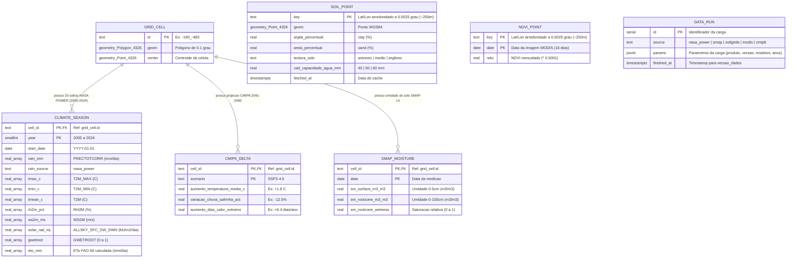

# Diagrama de Classes e Modelo de Dados — Raiz Orbital (Backend e Fontes de Dados)

Este documento apresenta os **Diagramas de Classes (UML)** e o **Diagrama Entidade-Relacionamento (PostGIS)** do backend do **Raiz Orbital**, alinhando a arquitetura **MVC + Service/Repository** (`AGENTS.md`) com as **fontes de dados reais** (scripts de [`data/`](../../../data/README.md), clientes da API e scripts do pipeline).

---

## 1. Mapeamento: Fontes de Dados $\rightarrow$ Classes do Backend

Cada fonte mapeia para uma Entidade de Domínio (`app/models/`), um Contrato de Repositório
(`app/repositories/`) e um Serviço de Negócio (`app/services/`). Sem Google Earth Engine no MVP
([ADR-0005](adr/0005-fontes-diretas-da-nasa-sem-earth-engine.md)); o formato das fontes novas está em
"Contrato dos dados das fontes", no `AGENTS.md` do backend.

| Origem | Campos | Model (`app/models/`) | Repository (`app/repositories/`) | Service (`app/services/`) |
| :--- | :--- | :--- | :--- | :--- |
| **[`app/config_data/culturas.yaml`](../app/config_data/culturas.yaml)** | `nome`, `tipo`, `funcao`, `semeadura_limite_mes_dia`, `dias_florescer`, `ciclo_dias`, `kc_pico`, `nota_solo` (`palhada`, `nitrogenio`, `pragas`), `n_deixado_kg`, `produtividade_padrao_sc_ha`, `preco_padrao_saca`, `custo_padrao_ha` | `CropOption`<br>`CropParams` | `CropParamsRepository`<br>`YamlCropParamsRepository` | `CropOptionService`<br>`RecommendationService`<br>`RotationPlanService` |
| **NASA POWER:** [`data/extract_nasa_power.py`](../../../data/extract_nasa_power.py) e [`data/extract_historical_20y.py`](../../../data/extract_historical_20y.py) → fixture [`app/fixtures/clima_fazenda_exemplo.json`](../app/fixtures/clima_fazenda_exemplo.json); `NasaPowerClient` na API (busca sob demanda, R1.1) | `date`, `PRECTOTCORR` *(mm/dia)*, `T2M_MAX`, `T2M_MIN`, `T2M`, `RH2M`, `WS2M`, `ALLSKY_SFC_SW_DWN` *(MJ/m²/dia)*, `GWETROOT` *(0–1)* | `DailyWeatherRecord`<br>`ClimateSeason`<br>`AnnualClimateSummary` | `ClimateRepository`<br>`FixtureClimateRepository`<br>`PostgisClimateRepository` | `WaterBalanceCalculator`<br>`ClimateRiskService` |
| **SMAP L4:** [`data/extract_smap.py`](../../../data/extract_smap.py) (AppEEARS); `pipeline/fetch_smap.py` a fazer (R2.3) | `data`, `latitude`, `longitude`, `sm_rootzone_m3_m3` *(0–100 cm)*, `sm_rootzone_wetness` *(0–1)*, `sm_surface_m3_m3` *(0–5 cm, opcional)* | `SmapSoilMoisture` | `ClimateRepository.get_latest_smap` | `ClimateRiskService` *(balde inicial, R3.3)* |
| **SoilGrids:** `SoilGridsClient` na API (sem script em `data/`) | `argila_percentual` (`clay`), `areia_percentual` (`sand`), `textura_solo` (`arenoso` \| `medio` \| `argiloso`), `cad_capacidade_agua_mm` (`40` \| `50` \| `60`) | `SoloInfo` | `SoilRepository`<br>`CachedSoilGridsRepository`<br>`PostgisSoilRepository` | `TalhaoService`<br>`RecommendationService` |
| **MODIS MOD13Q1 + MYD13Q1:** `pipeline/fetch_ndvi.py` a fazer (R2.2), pelo AppEEARS | `data`, `ndvi` *(fator 0,0001)*, `qualidade` *(0 ou 1)*, `produto` | `NdviRecord`<br>`HistoricoAno`<br>`HistoricoTalhao`<br>`ColheitaSugerida` | `NdviRepository`<br>`CachedNdviRepository` | `FieldHistoryService`<br>`TalhaoService` |
| **NEX-GDDP-CMIP6:** `pipeline/fetch_cmip6_deltas.py` a fazer (R2.1), pelo THREDDS da NCCS | delta mensal por modelo: `model`, `scenario`, `month`, `rain_pct`, `tmax_c`, `tmin_c` *(opcional)* | `Cmip6Delta` | `ClimateRepository.get_cmip6_deltas` | `ClimateRiskService` |
| **Execução dos scripts de dados** (tabela `data_run`) | `source`, `params`, `finished_at`, `version` | `DataRun` | (R1.6) | `versao_dados` (R3.5) |

---

## 2. Direção das Dependências e Regras de Camada

```mermaid
flowchart LR
    subgraph View ["View (app/schemas/)"]
        S["Schemas Pydantic<br/>(JSON HTTP)"]
    end
    subgraph Controller ["Controller (app/controllers/)"]
        C["Rotas FastAPI<br/>(Finas, sem regra)"]
    end
    subgraph Service ["Service (app/services/)"]
        SV["Regras de Negócio<br/>(FAO-56, ISNA, Ranking)"]
    end
    subgraph Repository ["Repository (app/repositories/)"]
        RP["Protocols & Implementações<br/>(Acesso a Dados)"]
    end
    subgraph Model ["Model (app/models/)"]
        M["Dataclasses Imutáveis<br/>(Domínio)"]
    end
    subgraph Data ["Fontes de Dados (/data & PostGIS)"]
        DB[("PostGIS 17<br/>(Séries, Deltas, Cache)")]
        DATA_DIR["app/fixtures/*.json<br/>app/config_data/culturas.yaml<br/>caches por ponto"]
        EXT["APIs NASA / SoilGrids<br/>(clientes HTTP e scripts de dados)"]
    end

    S <-- "converte" --- C
    C -- "Depends()" --> SV
    SV -- "depende do Protocol" --> RP
    SV -. "manipula" .-> M
    RP -. "instancia" .-> M
    RP --> DB
    RP --> DATA_DIR
    RP --> EXT
```

---

## 3. Diagrama de Classes — Camada de Domínio (`app/models/`)

As classes abaixo refletem os models de `app/models/` (os das fontes novas seguem o contrato do `AGENTS.md`) e o contrato de resposta do protótipo v3:

```mermaid
classDiagram
    direction TB

    class CropOption {
        <<dataclass>>
        +str id
        +str name
        +str role
    }

    class CropParams {
        <<dataclass>>
        +str id
        +str nome
        +str tipo
        +str funcao
        +str | None semeadura_limite_mes_dia
        +int dias_florescer
        +int ciclo_dias
        +float kc_pico
        +int palhada_score
        +int n_deixado_kg
        +int nematoide_efeito
        +float produtividade_padrao_sc_ha
        +float preco_padrao_saca
        +float custo_padrao_ha
        +tuple~str~ como_fazer
    }

    class DailyWeatherRecord {
        <<dataclass>>
        +date data
        +float | None prectotcorr
        +float | None t2m_max
        +float | None t2m_min
        +float | None t2m
        +float | None rh2m
        +float | None ws2m
        +float | None allsky_sfc_sw_dwn
        +float | None gwetroot
    }

    class ClimateSeason {
        <<dataclass>>
        +str cell_id
        +int year
        +date start_date
        +tuple~float~ rain_mm
        +str rain_source
        +tuple~float~ tmax_c
        +tuple~float~ tmin_c
        +tuple~float~ eto_mm
        +tuple~float~ gwetroot
    }

    class SmapSoilMoisture {
        <<dataclass>>
        +date data
        +float latitude
        +float longitude
        +float sm_rootzone_m3_m3
        +float sm_rootzone_wetness
        +str fonte
        +float | None sm_surface_m3_m3
    }

    class Cmip6Delta {
        <<dataclass>>
        +str model
        +str scenario
        +int month
        +float rain_pct
        +float tmax_c
        +float | None tmin_c
    }

    class NdviRecord {
        <<dataclass>>
        +date data
        +float ndvi
        +int | None qualidade
        +str | None produto
    }

    class DataRun {
        <<dataclass>>
        +str source
        +Mapping params
        +datetime finished_at
        +str version
    }

    class SoloInfo {
        <<dataclass>>
        +float argila_percentual
        +float areia_percentual
        +str textura_solo
        +float cad_capacidade_agua_mm
        +str fonte
    }

    class HistoricoAno {
        <<dataclass>>
        +int ano
        +float ndvi_medio_safrinha
        +str status_talhao
    }

    class HistoricoTalhao {
        <<dataclass>>
        +tuple~HistoricoAno~ anos
        +int parado
        +int total
        +str fonte
    }

    class ColheitaSugerida {
        <<dataclass>>
        +str faixa
        +str fonte
        +int anos_usados
    }

    class Talhao {
        <<dataclass>>
        +float lat
        +float lon
        +str celula_id
        +bool dentro_da_area
        +SoloInfo solo
        +ColheitaSugerida colheita_sugerida
        +HistoricoTalhao | None historico
        +tuple~dict~ dados_fontes
    }

    class ResultadoAno {
        <<dataclass>>
        +int ano
        +bool aperto
        +float isna
        +int dias_calor
        +float fator_perda
    }

    class NotasOpcao {
        <<dataclass>>
        +float seguranca
        +float futuro
        +float solo
        +float renda
        +float final
    }

    class ResultadoOpcao {
        <<dataclass>>
        +str id
        +str nome
        +bool na_janela
        +int anos_bons_chuva
        +int total_anos
        +tuple~bool~ faixa_anos
        +str rotulo_chuva
        +str texto_chuva
        +int futuro_anos_bons_media
        +int futuro_anos_bons_min
        +int futuro_anos_bons_max
        +float margem_ha
        +str rotulo_dinheiro
        +str texto_dinheiro
        +str rotulo_terra
        +str texto_terra
        +NotasOpcao notas
        +tuple~str~ porque
        +tuple~str~ como_fazer
    }

    class Alternativa {
        <<dataclass>>
        +str motivo
        +str opcao_id
    }

    class PlanoRotacao {
        <<dataclass>>
        +tuple~str~ anos
        +float nota
        +str descricao
    }

    class Recomendacao {
        <<dataclass>>
        +str celula_id
        +str colheita
        +date semeadura
        +str solo
        +str | None nematoide
        +str melhor
        +tuple~Alternativa~ alternativas
        +tuple~ResultadoOpcao~ opcoes
        +tuple~ResultadoOpcao~ fora_da_janela
        +str texto_pousio
        +PlanoRotacao plano_normal
        +PlanoRotacao plano_seco
        +PlanoRotacao plano_hoje
        +str versao_dados
        +str aviso
    }

    Talhao *-- SoloInfo
    Talhao *-- ColheitaSugerida
    Talhao *-- HistoricoTalhao
    HistoricoTalhao *-- HistoricoAno
    Recomendacao *-- ResultadoOpcao
    Recomendacao *-- Alternativa
    Recomendacao *-- PlanoRotacao
    ResultadoOpcao *-- NotasOpcao
```



---

## 4. Diagrama de Classes — Camada Repository (`app/repositories/`)

Os contratos (`Protocol`) permitem que os Services leiam tanto do banco **PostGIS** quanto dos arquivos JSON/YAML que vão com a API ([`app/fixtures/`](../app/fixtures/clima_fazenda_exemplo.json), [`app/config_data/culturas.yaml`](../app/config_data/culturas.yaml) e os caches por ponto apontados no `Settings`):

```mermaid
classDiagram
    direction TB

    class CropOptionRepository {
        <<Protocol>>
        +list_all() list~CropOption~
        +get_by_id(option_id: str) CropOption | None
    }

    class InMemoryCropOptionRepository {
        -list~CropOption~ _options
        +list_all() list~CropOption~
        +get_by_id(option_id: str) CropOption | None
    }

    class CropParamsRepository {
        <<Protocol>>
        +list_all() list~CropParams~
        +get_by_id(crop_id: str) CropParams | None
    }

    class YamlCropParamsRepository {
        -Path _yaml_path
        +list_all() list~CropParams~
        +get_by_id(crop_id: str) CropParams | None
    }

    class ClimateRepository {
        <<Protocol>>
        +find_cell_id(lat: float, lon: float) str | None
        +get_seasons(cell_id: str) list~ClimateSeason~
        +get_cmip6_deltas(cell_id: str) list~Cmip6Delta~
        +get_latest_smap(lat: float, lon: float) SmapSoilMoisture | None
    }

    class PostgisClimateRepository {
        -str _database_url
        +find_cell_id(lat: float, lon: float) str | None
        +get_seasons(cell_id: str) list~ClimateSeason~
        +get_cmip6_deltas(cell_id: str) list~Cmip6Delta~
        +get_latest_smap(lat: float, lon: float) SmapSoilMoisture | None
    }

    class FixtureClimateRepository {
        -Path _path
        +find_cell_id(lat: float, lon: float) str | None
        +get_seasons(cell_id: str) list~ClimateSeason~
        +get_cmip6_deltas(cell_id: str) list~Cmip6Delta~
        +get_latest_smap(lat: float, lon: float) SmapSoilMoisture | None
    }

    class SoilRepository {
        <<Protocol>>
        +get_soil(lat: float, lon: float) SoloInfo
    }

    class CachedSoilGridsRepository {
        -str _database_url
        -Path _fallback_json_path
        +get_soil(lat: float, lon: float) SoloInfo
    }

    class NdviRepository {
        <<Protocol>>
        +get_ndvi_history(lat: float, lon: float) list~NdviRecord~
    }

    class CachedNdviRepository {
        -Path | None _cache_path
        +get_ndvi_history(lat: float, lon: float) list~NdviRecord~
    }

    CropOptionRepository <|.. InMemoryCropOptionRepository
    CropParamsRepository <|.. YamlCropParamsRepository
    ClimateRepository <|.. PostgisClimateRepository
    ClimateRepository <|.. FixtureClimateRepository
    SoilRepository <|.. CachedSoilGridsRepository
    NdviRepository <|.. CachedNdviRepository
```



---

## 5. Diagrama de Classes — Camada Service (`app/services/`)

Os Services implementam as fórmulas biofísicas usando exatamente as variáveis extraídas em `/data` (`PRECTOTCORR`, `T2M_MAX`, `T2M_MIN`, `T2M`, `ALLSKY_SFC_SW_DWN`, `WS2M`, `RH2M`, `GWETROOT`, `sm_rootzone_wetness`, `ndvi` e os deltas mensais do CMIP6):


---

## 6. Diagrama de Classes — Controllers, Schemas e Configuração (`app/controllers/`, `app/schemas/`, `app/config.py`)

```mermaid
classDiagram
    direction TB

    class Settings {
        +str app_name
        +str environment
        +list~str~ cors_origins
        +str | None database_url
        +str | None earthdata_username
        +str | None earthdata_password
        +str | None ee_project
    }

    class HealthController {
        +get_health() dict
    }

    class CropOptionController {
        +list_crop_options(service: CropOptionService) list~CropOptionResponse~
        +get_crop_option(option_id: str, service: CropOptionService) CropOptionResponse
    }

    class TalhaoController {
        +get_talhao(lat: float, lon: float, service: TalhaoService) TalhaoResponse
    }

    class RecomendacaoController {
        +get_recomendacao(lat: float, lon: float, colheita: str, solo: str | None, nematoide: str | None, accept_language: str, service: RecommendationService) RecomendacaoResponse
        +get_exemplo(accept_language: str) ExemploResponse
    }

    class CropOptionResponse {
        <<Pydantic BaseModel>>
        +str id
        +str name
        +str role
        +from_model(option: CropOption)$ CropOptionResponse
    }

    class TalhaoResponse {
        <<Pydantic BaseModel>>
        +PontoSchema ponto
        +str | None celula_id
        +bool dentro_da_area
        +SoloSchema solo
        +ColheitaSugeridaSchema colheita_sugerida
        +HistoricoSchema | None historico
        +list~FonteDadoSchema~ dados
        +from_model(talhao: Talhao)$ TalhaoResponse
    }

    class RecomendacaoResponse {
        <<Pydantic BaseModel>>
        +EntradaSchema entrada
        +str melhor
        +list~AlternativaSchema~ alternativas
        +list~OpcaoSchema~ opcoes
        +list~OpcaoSchema~ fora_da_janela
        +PousioSchema pousio
        +Plano3AnosSchema plano_3_anos
        +str versao_dados
        +str aviso
        +from_model(rec: Recomendacao)$ RecomendacaoResponse
    }

    CropOptionController --> CropOptionService : Depends
    CropOptionController --> CropOptionResponse : retorna
    TalhaoController --> TalhaoService : Depends
    TalhaoController --> TalhaoResponse : retorna
    RecomendacaoController --> RecommendationService : Depends
    RecomendacaoController --> RecomendacaoResponse : retorna
```



---

## 7. Diagrama Entidade-Relacionamento — Banco de Dados (`PostGIS 17`)

O esquema abaixo é o da migração inicial (`migrations/versions/cb6b775d83e3_create_initial_postgis_tables.py`). Hoje a busca sob demanda grava `grid_cell`, `climate_season` e `soil_point` (NASA POWER e SoilGrids); as outras tabelas ainda não recebem dados. A migração R1.6 troca `cmip6_delta` pelo formato mensal por modelo, põe qualidade e produto em `ndvi_point`, passa o SMAP para uma tabela por ponto e acrescenta `version` em `data_run` (proposta em "Contrato dos dados das fontes", no `AGENTS.md`):


