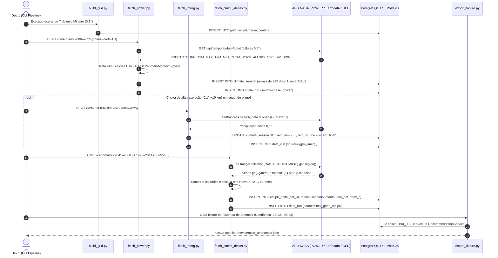
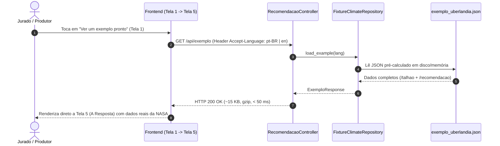
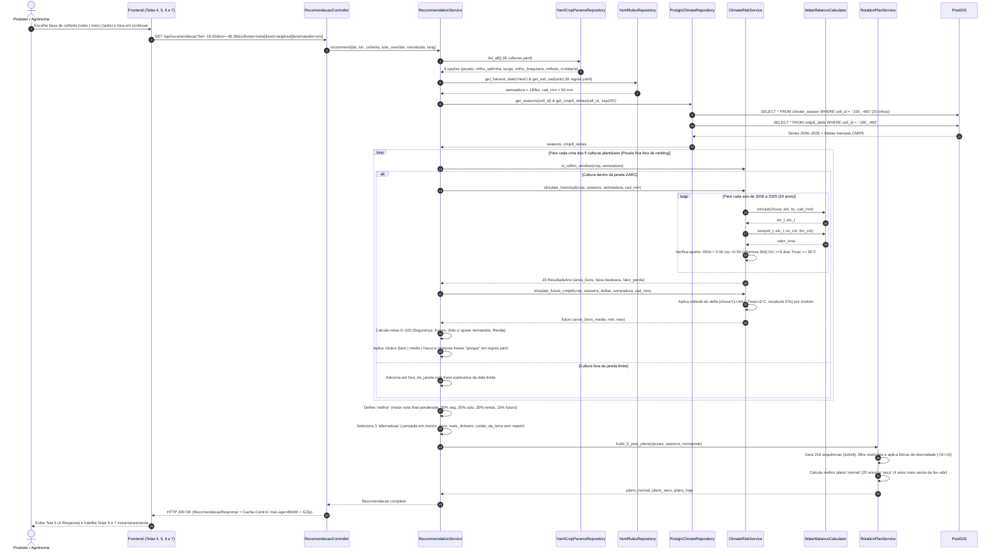
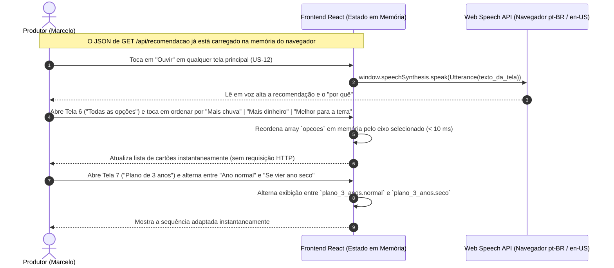
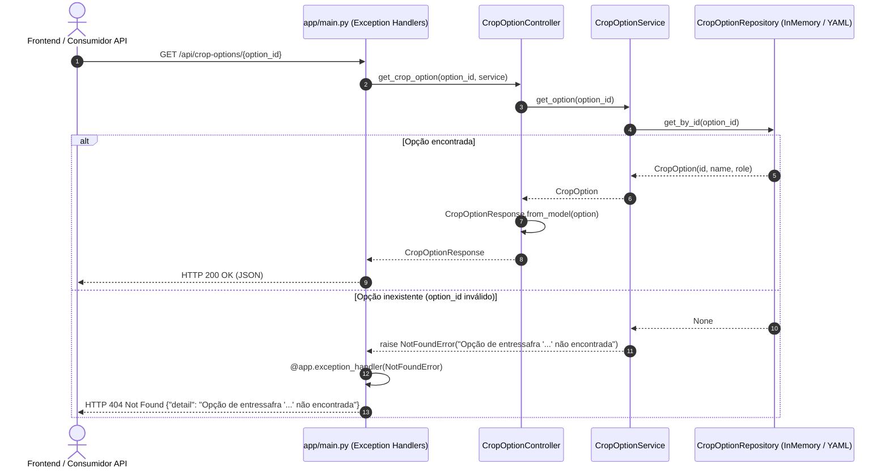

# Diagramas de Sequência — Raiz Orbital (Backend & Integrações)

Este documento detalha os **Diagramas de Sequência (UML)** de todos os fluxos arquiteturais do **Raiz Orbital**, cobrindo o pipeline offline de ingestão orbital, as rotas online da API FastAPI acionadas pelas telas do protótipo v3, os mecanismos de cache/fallback e as interações sem latência no navegador.

---

## 1. Pipeline Offline de Preparação de Dados (`projeto/backend/pipeline/`)

Para garantir que a demonstração e o uso em campo respondam em **menos de 1 segundo (RNF-01)** e nunca dependam da instabilidade de download de milhares de arquivos da NASA em tempo de execução, os dados climáticos pesados são preparados previamente por célula de 0,1° e gravados no **PostGIS**:



---

## 2. Fluxo da Fazenda de Exemplo — Tela 1 para Tela 5 (`GET /api/exemplo`)

Atende à história **US-11 (Jurado)** e ao requisito **RF-11**: abre instantaneamente a recomendação completa para Uberlândia sem depender do banco ou de chamadas externas.



---

## 3. Marcação do Talhão e Leitura por Satélite — Tela 2 para Telas 3 e 4 (`GET /api/talhao`)

Atende às histórias **US-01**, **US-02** e **US-07** (RF-01, RF-02, RF-08, RF-16).
> [!TIP]
> **Otimização de UX/Latência:** O frontend dispara `GET /api/talhao?lat&lon` assim que o produtor toca em **"É aqui"** na Tela 2. Enquanto o usuário lê e responde a Tela 3 (*"Quando você colhe a soja?"*), o backend busca o solo e o NDVI em paralelo.

```mermaid
sequenceDiagram
    autonumber
    actor Produtor as Produtor (Marcelo)
    participant UI as Frontend (Telas 2, 3 e 4)
    participant Ctrl as TalhaoController
    participant Svc as TalhaoService
    participant ClimRepo as PostgisClimateRepository
    participant SoilRepo as CachedSoilGridsRepository
    participant NdviRepo as CachedEarthEngineNdviRepository
    participant HistSvc as FieldHistoryService
    participant DB as PostGIS
    participant Ext as SoilGrids API & Google Earth Engine

    Produtor->>UI: Marca ponto no mapa ou GPS e toca em "É aqui" (Tela 2)
    UI->>Ctrl: GET /api/talhao?lat=-18.92&lon=-48.28
    UI-->>Produtor: Avança imediatamente para a Tela 3 (Pergunta 2/2)

    Ctrl->>Svc: inspect_talhao(lat=-18.92, lon=-48.28)
    Svc->>ClimRepo: find_cell_id(lat, lon)
    ClimRepo->>DB: SELECT id FROM grid_cell WHERE ST_Contains(geom, ST_MakePoint(lon, lat))

    alt Ponto fora da caixa preparada do Triângulo Mineiro
        DB-->>ClimRepo: None
        ClimRepo-->>Svc: None
        Svc-->>Ctrl: Talhao(dentro_da_area=False)
        Ctrl-->>UI: HTTP 200 OK {"dentro_da_area": false}
        UI-->>Produtor: Exibe aviso amigável e botão "Usar fazenda de exemplo"
    else Ponto dentro da caixa preparada
        DB-->>ClimRepo: celula_id = "-190_-483"
        ClimRepo-->>Svc: "-190_-483"

        par Busca Textura do Solo (Cache PostGIS -> SoilGrids)
            Svc->>SoilRepo: get_soil(lat, lon)
            SoilRepo->>DB: SELECT * FROM soil_point WHERE key = '-18.9200_-48.2800'
            alt Cache Miss no PostGIS
                SoilRepo->>Ext: GET SoilGrids v2.0 (clay, sand 0-30cm, timeout Curto)
                alt SoilGrids respondeu com sucesso
                    Ext-->>SoilRepo: clay_pct, sand_pct
                    SoilRepo->>SoilRepo: Regra: argila>35% -> argiloso(60mm); areia>70% -> arenoso(40mm); senão medio(50mm)
                    SoilRepo->>DB: INSERT INTO soil_point (...)
                else Timeout ou erro no SoilGrids
                    SoilRepo->>SoilRepo: Fallback seguro: textura='medio', cad_mm=50, fonte='padrao'
                end
            end
            SoilRepo-->>Svc: SoloInfo(textura, cad_mm, fonte)
        and Busca Série NDVI 10 Anos (Cache PostGIS -> Earth Engine)
            Svc->>NdviRepo: get_ndvi_series(lat, lon)
            NdviRepo->>DB: SELECT date, ndvi FROM ndvi_point WHERE key = '-18.9200_-48.2800'
            alt Cache Miss no PostGIS
                NdviRepo->>Ext: ee.ImageCollection("MODIS/061/MOD13Q1").getRegion(ponto, 250) (timeout 10s)
                alt Earth Engine respondeu a tempo
                    Ext-->>NdviRepo: Série bruta MODIS (2015–2025)
                    NdviRepo->>NdviRepo: Aplica fator de escala (* 0.0001)
                    NdviRepo->>DB: INSERT INTO ndvi_point (key, date, ndvi)
                else Timeout ou falha no Earth Engine
                    NdviRepo-->>Svc: Lista vazia (degradação graciosa)
                end
            end
            NdviRepo-->>Svc: ndvi_series
        end

        Svc->>HistSvc: classify_entressafra(ndvi_series)
        HistSvc->>HistSvc: Avalia máx NDVI (1/abr a 31/jul): >0.60 'plantou', <0.45 'parado'
        HistSvc-->>Svc: HistoricoTalhao (ou None se sem NDVI)

        Svc->>HistSvc: suggest_harvest_band(ndvi_series)
        HistSvc->>HistSvc: Identifica queda <50% do pico de verão (jan–mar) -> mediana ('cedo'|'meio'|'tarde')
        HistSvc-->>Svc: ColheitaSugerida(faixa, fonte)

        Svc-->>Ctrl: Talhao completo
        Ctrl-->>UI: HTTP 200 OK (TalhaoResponse)
        UI-->>Produtor: Pré-seleciona faixa sugerida na Tela 3 e preenche cartões da Tela 4
    end
```

---

## 4. Cálculo da Recomendação, Alternativas e Plano de 3 Anos — Tela 3/4 para Telas 5, 6 e 7 (`GET /api/recomendacao`)

Atende às histórias **US-03, US-04, US-05, US-06, US-08 e US-09** (RF-03 a RF-10). Toda a matemática roda em memória em **milissegundos** sobre as séries carregadas do PostGIS:



---

## 5. Interações Locais no Navegador — Telas 5, 6 e 7 (Zero Latência de Rede)

Atende aos requisitos **RNF-02** (recálculo/reordenação em menos de 1 s no navegador) e **RF-17 / US-12** (botão *"Ouvir"* via síntese de voz nativa):



---

## 6. Fluxo de Listagem/Consulta de Culturas e Tratamento de Erros (`GET /api/crop-options`)

Demonstra o fluxo de referência já implementado em `app/` e a tradução centralizada de exceções de domínio (`DomainError` / `NotFoundError`) no `app/main.py`:


