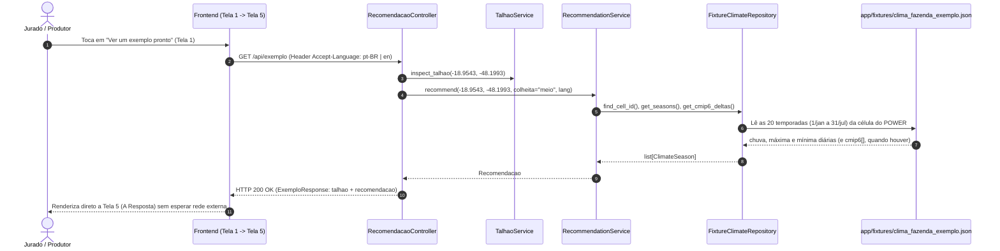
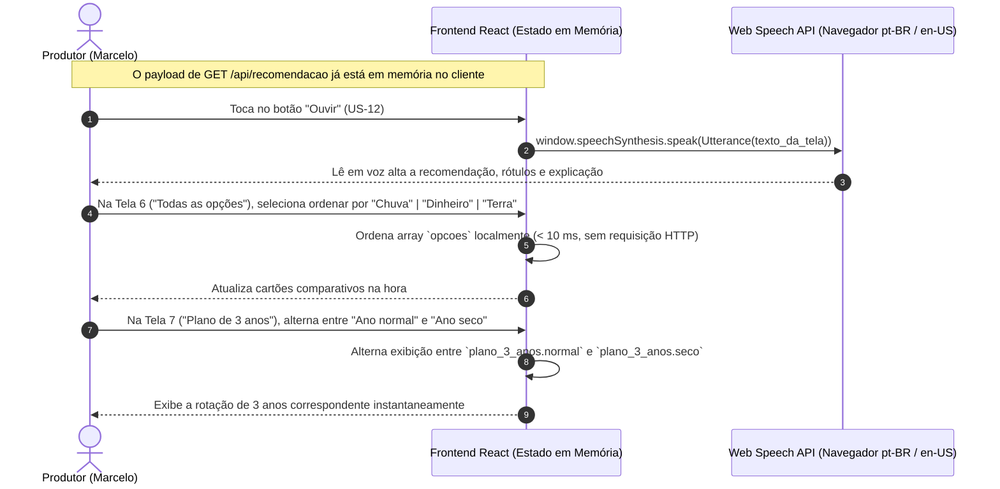
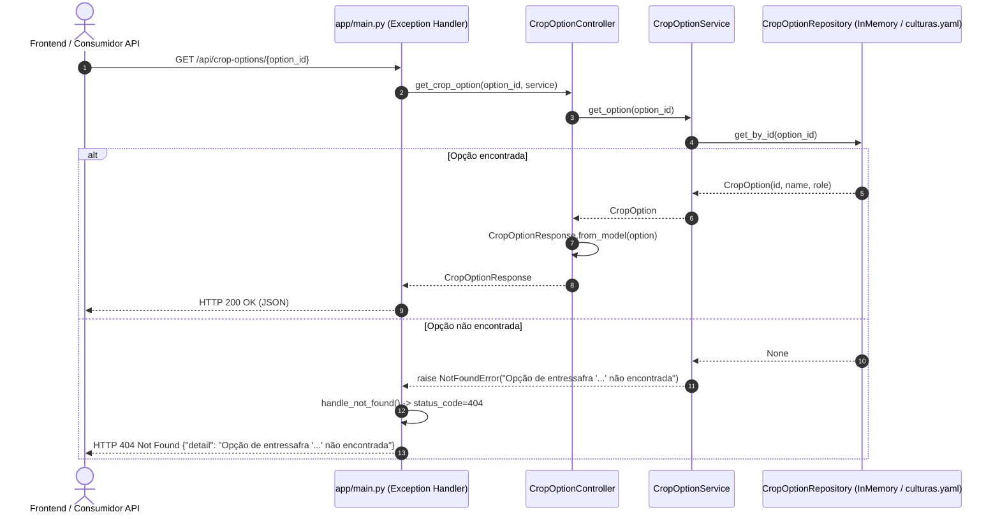

# Diagramas de Sequência — Raiz Orbital (Backend, Protótipo v3 e Scripts de Dados)

Este documento apresenta os **Diagramas de Sequência (UML)** do **Raiz Orbital**, integrando os **scripts de dados** ([`data/`](../../../data/README.md) e `pipeline/`) com as camadas da API FastAPI e as 9 telas do protótipo v3.

---

## 1. Scripts de Dados (`data/` e `projeto/backend/pipeline/`) $\rightarrow$ arquivos e PostGIS

Mostra o que os scripts de dados fazem hoje e o que falta (roteiro R2.1 a R2.3). Todos os dados vêm
direto dos serviços da NASA, sem Google Earth Engine no MVP
([ADR-0005](adr/0005-fontes-diretas-da-nasa-sem-earth-engine.md)). O SoilGrids não tem script: a API
consulta na hora do pedido (diagrama 3). A saída segue "Contrato dos dados das fontes", no `AGENTS.md`
do backend.

```mermaid
sequenceDiagram
    autonumber
    actor Dev as Dev / scripts de dados
    participant Power as data/extract_nasa_power.py e extract_historical_20y.py
    participant Smap as data/extract_smap.py
    participant Fix as pipeline/export_climate_fixture.py
    participant Novos as pipeline/ (a fazer: fetch_cmip6_deltas, fetch_ndvi, fetch_smap)
    participant APIs as Serviços da NASA (POWER, AppEEARS, NCCS THREDDS)
    participant Out as data/output/ (local) e app/fixtures/

    Note over Dev,Out: 1. NASA POWER diário, 2005–2024 (sem login)
    Dev->>Power: Extração para a Fazenda do Glória, UFU (-18.9543, -48.1993)
    Power->>APIs: GET power.larc.nasa.gov/api/temporal/daily/point (community=AG)
    APIs-->>Power: PRECTOTCORR, T2M_MAX, T2M_MIN, T2M, RH2M, WS2M, ALLSKY_SFC_SW_DWN, GWETROOT
    Power->>Power: -999.0 vira None; resumo anual (chuva fev–mai, dias >= 35 °C)
    Power->>Out: historico_uberlandia_20anos_diario.json e resumo anual em data/output/
    Dev->>Fix: export_climate_fixture --entrada (data/output) --saida app/fixtures/clima_fazenda_exemplo.json
    Fix->>Out: Fixture da fazenda de exemplo (o único arquivo de dados que vai para o git)

    Note over Dev,Out: 2. SMAP L4 (SPL4SMGP.007) pelo AppEEARS
    Dev->>Smap: Executa com EARTHDATA_USERNAME e EARTHDATA_PASSWORD
    Smap->>APIs: POST /api/login (devolve o token do AppEEARS, ~48 h)
    Smap->>APIs: POST /api/task (sm_rootzone, sm_surface, sm_rootzone_wetness)
    loop A cada 15 s
        Smap->>APIs: GET /api/task/{task_id}
        APIs-->>Smap: status 'processing' -> 'done'
    end
    Smap->>APIs: GET /api/bundle/{task_id} e download dos arquivos
    Smap->>Out: CSV e JSON em data/output/ (sem credencial, para com erro: nunca gera dado sintético)

    Note over Dev,Out: 3. A fazer (R2.1 a R2.3), sem Google Earth Engine
    Dev->>Novos: fetch_cmip6_deltas.py (R2.1)
    Novos->>APIs: NCCS THREDDS, recorte por ponto em CSV (pr, tasmax; jan–jul)
    Dev->>Novos: fetch_ndvi.py (R2.2) e fetch_smap.py (R2.3)
    Novos->>APIs: AppEEARS (MOD13Q1 + MYD13Q1; SPL4SMGP), com a ORNL DAAC de reserva para o NDVI
    Novos->>Out: Arquivos no formato do contrato; tabelas no PostGIS depois do R1.6
```

---

## 2. Fazenda de Exemplo Instantânea — Tela 1 para Tela 5 (`GET /api/exemplo`)

Atende à história **US-11 (Jurado)** e ao requisito **RF-11**: a resposta sai da fixture
[`app/fixtures/clima_fazenda_exemplo.json`](../app/fixtures/clima_fazenda_exemplo.json) (NASA POWER,
2005–2024, célula do POWER da Fazenda do Glória), sem banco nem rede externa.



---

## 3. Marcação do Talhão e Descoberta por Satélite — Tela 2 para Telas 3 e 4 (`GET /api/talhao`)

Atende às histórias **US-01**, **US-02** e **US-07** (RF-01, RF-02, RF-08, RF-16), combinando os caches por ponto (e o PostGIS, quando ligado no R1.1) com o SoilGrids na hora do pedido. O NDVI nunca é buscado na hora: vem do cache preparado pelo script de dados (ADR-0005):

```mermaid
sequenceDiagram
    autonumber
    actor Produtor as Produtor (Marcelo)
    participant UI as Frontend (Telas 2, 3 e 4)
    participant Ctrl as TalhaoController
    participant Svc as TalhaoService
    participant SoilRepo as CachedSoilGridsRepository
    participant NdviRepo as CachedNdviRepository
    participant HistSvc as FieldHistoryService
    participant DB as Caches por ponto (JSON) / PostGIS
    participant Ext as SoilGrids API

    Produtor->>UI: Marca ponto no mapa ou GPS e toca em "É aqui" (Tela 2)
    UI->>Ctrl: GET /api/talhao?lat=-18.9543&lon=-48.1993
    UI-->>Produtor: Avança imediatamente para a Tela 3 (Pergunta 2/2)

    Ctrl->>Svc: inspect_talhao(lat, lon)

    par Obtém Textura do Solo e CAD (SoilGrids)
        Svc->>SoilRepo: get_soil(lat, lon)
        SoilRepo->>DB: Verifica cache por ponto (SOLO_CACHE_PATH; soil_point no PostGIS)
        alt Não está em cache
            SoilRepo->>Ext: GET SoilGrids v2.0 (clay, sand 0-30cm)
            alt Sucesso na resposta
                Ext-->>SoilRepo: argila_percentual, areia_percentual
                SoilRepo->>SoilRepo: Define textura_solo ('arenoso'|'medio'|'argiloso') e cad_mm (40|50|60)
                SoilRepo->>DB: Salva no cache
            else Falha ou Timeout
                SoilRepo->>SoilRepo: Fallback: textura_solo='medio', cad_mm=50.0, fonte='padrao'
            end
        end
        SoilRepo-->>Svc: SoloInfo(textura_solo, cad_capacidade_agua_mm, fonte)
    and Obtém Histórico de 10 Anos de NDVI (cache do pipeline, sem busca na hora)
        Svc->>NdviRepo: get_ndvi_history(lat, lon)
        NdviRepo->>DB: Lê a série do ponto (NDVI_CACHE_PATH; ndvi_point depois do R1.6)
        alt Ponto sem NDVI no cache
            NdviRepo-->>Svc: série vazia (historico: null, colheita "meio" / fonte "padrao")
        else Ponto com NDVI
            NdviRepo-->>Svc: list[NdviRecord] (MOD13Q1 + MYD13Q1, qualidade 0 ou 1)
        end
    end

    Svc->>HistSvc: classify_entressafra(serie_ndvi)
    HistSvc->>HistSvc: Cada ano de 2016 a 2025: menos de 3 observações de 1/abr a 31/jul -> 'sem_dado'; maior NDVI > 0,60 'plantou', < 0,45 'parado', senão 'incerto' (PRD 7.8, regras.yaml historico_ndvi)
    HistSvc-->>Svc: HistoricoTalhao (anos com n_obs, parado, plantou, sem_certeza, total, fonte, janela)

    Svc->>HistSvc: suggest_harvest_band(serie_ndvi)
    HistSvc->>HistSvc: Detecta queda de NDVI <50% do pico de verão (jan–mar) -> mediana ('cedo'|'meio'|'tarde')
    HistSvc-->>Svc: ColheitaSugerida(faixa, fonte)

    Svc-->>Ctrl: Talhao completo
    Ctrl-->>UI: HTTP 200 OK (TalhaoResponse)
    UI-->>Produtor: Pré-seleciona faixa sugerida na Tela 3 e popula cartões da Tela 4 ("O satélite já viu o resto")
```

---

## 4. Cálculo da Recomendação, Alternativas e Plano de 3 Anos — Tela 3/4 para Telas 5, 6 e 7 (`GET /api/recomendacao`)

Atende às histórias **US-03 a US-06, US-08 e US-09**, operando sobre os parâmetros de [`app/config_data/culturas.yaml`](../app/config_data/culturas.yaml) e as séries de clima (fixture da fazenda de exemplo; PostGIS depois do R1.1):

```mermaid
sequenceDiagram
    autonumber
    actor Produtor as Produtor / Agrônoma
    participant UI as Frontend (Telas 4, 5, 6 e 7)
    participant Ctrl as RecomendacaoController
    participant RecSvc as RecommendationService
    participant CropRepo as YamlCropParamsRepository (app/config_data/culturas.yaml)
    participant ClimRepo as ClimateRepository (fixture / PostGIS)
    participant RiskSvc as ClimateRiskService
    participant WB as WaterBalanceCalculator
    participant PlanSvc as RotationPlanService

    Produtor->>UI: Confirma faixa de colheita (cedo | meio | tarde) e toca em ver recomendação
    UI->>Ctrl: GET /api/recomendacao?lat=-18.9543&lon=-48.1993&colheita=meio[&solo=argiloso][&nematoide=sim]

    Ctrl->>RecSvc: recommend(lat, lon, colheita, solo_override, nematoide, lang)
    RecSvc->>CropRepo: list_all() (lê app/config_data/culturas.yaml)
    CropRepo-->>RecSvc: 6 culturas (pousio, milho_safrinha, sorgo_granifero, milho_braquiaria, milheto, crotalaria_spectabilis)

    RecSvc->>ClimRepo: get_seasons(), get_latest_smap() & get_cmip6_deltas()
    ClimRepo-->>RecSvc: 20 anos NASA POWER (PRECTOTCORR, T2M_MAX, T2M_MIN, T2M, RH2M, WS2M, ALLSKY_SFC_SW_DWN, GWETROOT) + SMAP (sm_rootzone_wetness, quando houver: R3.3) + CMIP6 (deltas mensais por modelo, quando houver: R3.1)

    Note over RecSvc,WB: Semeadura = colheita + 3 dias (cedo=08/fev, meio=18/fev, tarde=03/mar)

    loop Para cada uma das 5 opções plantáveis (Pousio é separado como linha de base)
        RecSvc->>RiskSvc: is_within_window(crop.semeadura_limite_mes_dia, semeadura)
        alt Dentro da janela (ex.: 18/fev <= 02-28 para milho_safrinha)
            RecSvc->>RiskSvc: simulate_historical(crop, seasons, semeadura, cad_mm, sm_rootzone_wetness)
            loop Para cada um dos 20 anos (2005–2024)
                RiskSvc->>WB: calculate_eto_fao(T2M_MAX, T2M_MIN, T2M, ALLSKY_SFC_SW_DWN, WS2M, RH2M)
                WB-->>RiskSvc: eto_diaria (mm/dia)
                RiskSvc->>WB: simular(PRECTOTCORR, eto_diaria, kc_curva, cad_mm, arm0)
                WB-->>RiskSvc: etr_l, etc_l
                RiskSvc->>WB: isna(etr_l, etc_l, ini_crit, fim_crit)
                WB-->>RiskSvc: isna_janela_critica
                RiskSvc->>RiskSvc: Aperto se ISNA < 0.55 (grão/consórcio) ou < 0.50 (cobertura 30d) OU >=3 dias T2M_MAX >= 35°C
            end
            RiskSvc-->>RecSvc: Resultado dos 20 anos (anos_bons, faixa booleana, fator_perda)

            RecSvc->>RiskSvc: simulate_future_cmip6(crop, seasons, cmip6_deltas, semeadura, cad_mm)
            RiskSvc->>RiskSvc: Aplica os deltas mensais de cada modelo (SSP2-4.5) e recalcula os anos bons em 2041–2060 (sem deltas: futuro null)
            RiskSvc-->>RecSvc: futuro (anos_bons_media, min, max)

            RecSvc->>RecSvc: Calcula Notas (Segurança, Futuro, Solo [palhada_score + n_deixado_kg + nematoide_efeito], Renda)
            RecSvc->>RecSvc: Define rótulos (bom | medio | fraco) e monta frases "porque" citando NASA POWER, SMAP e CMIP6
        else Fora da janela (ex.: semeadura 03/mar > limite 02-28)
            RecSvc->>RecSvc: Move opção para fora_da_janela
        end
    end

    RecSvc->>RecSvc: Define 'melhor' (maior nota final ponderada: 30% seg, 25% solo, 30% renda, 15% futuro)
    RecSvc->>RecSvc: Define 'alternativas' (menos_risco, mais_dinheiro, cuidar_da_terra sem repetir a 'melhor')

    RecSvc->>PlanSvc: build_3_year_plans(opcoes, anos_secos, pousio, nematoide)
    PlanSvc->>PlanSvc: 216 sequências com pousio; descarta mais de 2 pousios seguidos e (nematoide) sem crotalária ou milheto; média + bônus por função (+5/+10)
    PlanSvc->>PlanSvc: Cenário 'normal' (20 anos) vs Cenário 'seco' (4 anos de menor chuva_safrinha_fev_mai_mm: 2007, 2010, 2012, 2014)
    PlanSvc-->>RecSvc: plano_normal, plano_seco, plano_hoje

    RecSvc-->>Ctrl: Recomendacao completa
    alt If-None-Match igual ao ETag do corpo (tarefa 0025)
        Ctrl-->>UI: HTTP 304 Not Modified (sem corpo; o navegador usa o que guardou)
    else Primeira vez ou dado mudou
        Ctrl-->>UI: HTTP 200 OK (RecomendacaoResponse + Cache-Control: public, no-cache + ETag + GZip)
    end
    UI-->>Produtor: Renderiza Tela 5 (A Resposta), Tela 6 (Todas as opções) e Tela 7 (Plano de 3 anos)
```

---

## 5. Interações Locais no Navegador — Telas 5, 6 e 7 (Zero Latência de Rede)

Atende aos requisitos **RNF-02** (reordenação instantânea no navegador) e **RF-17 / US-12** (botão *"Ouvir"*):



---

## 6. Listagem de Opções de Cultura e Tradução de Erros (`GET /api/crop-options`)

Mostra o fluxo já implementado em [`app/controllers/crop_option_controller.py`](../app/controllers/crop_option_controller.py) e a captura de [`NotFoundError`](../app/services/errors.py) em [`app/main.py`](../app/main.py):


