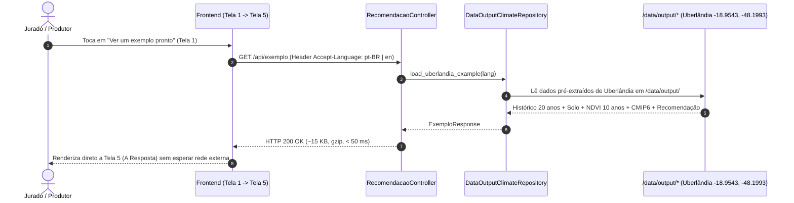
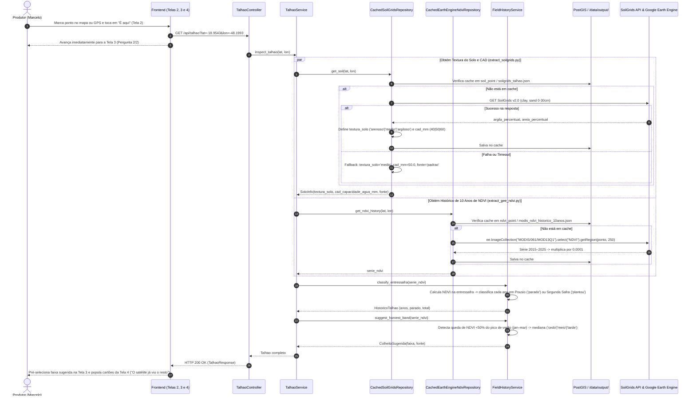
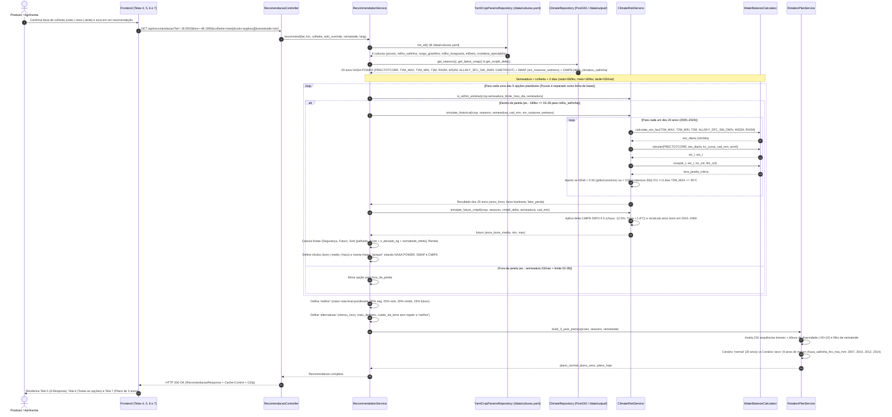
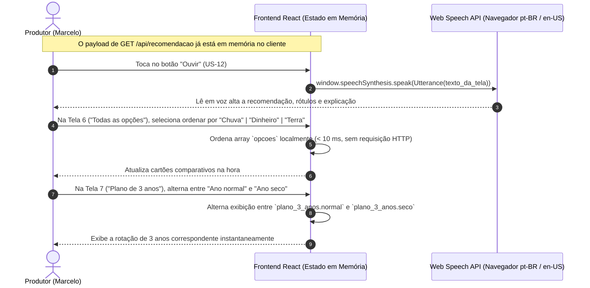
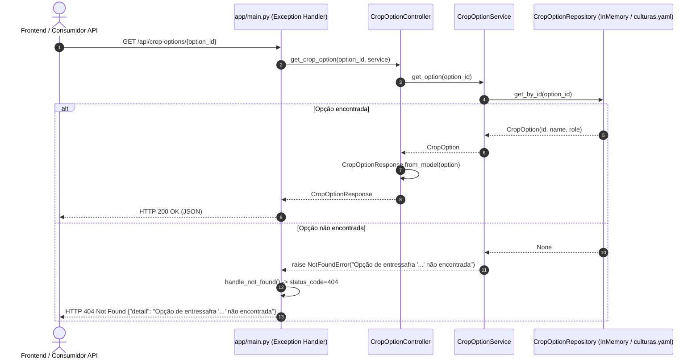

# Diagramas de Sequência — Raiz Orbital (Backend, Protótipo v3 & Scripts `/data`)

Este documento apresenta os **Diagramas de Sequência (UML)** do **Raiz Orbital**, integrando os **scripts reais de extração em [`/workspace/data/`](file:///workspace/data)** com as camadas da API FastAPI e as 9 telas do protótipo v3.

---

## 1. Pipeline de Extração de Dados (`/data/extract_*.py` $\rightarrow$ `/data/output/` & PostGIS)

Mostra como cada script implementado em [`/workspace/data/`](file:///workspace/data) obtém, higieniza e armazena os dados da NASA, do SoilGrids e do Google Earth Engine em [`/workspace/data/output/`](file:///workspace/data/output) e no banco PostGIS:

```mermaid
sequenceDiagram
    autonumber
    actor Dev as Dev / Pipeline (/data)
    participant Power as extract_nasa_power.py & extract_historical_20y.py
    participant Smap as extract_smap.py
    participant Soil as extract_soilgrids.py
    participant GeeNdvi as extract_gee_ndvi.py
    participant GeeCmip as extract_gee_cmip6.py
    participant APIs as APIs Externas (NASA POWER / AppEEARS / SoilGrids / GEE)
    participant Out as /data/output/*.json & .csv (+ PostGIS)

    Note over Dev,Out: 1. Série Meteorológica Diária de 20 Anos (2005–2024) — Sem Cadastro
    Dev->>Power: Executa extração para Fazenda do Glória, UFU (-18.9543, -48.1993)
    Power->>APIs: GET power.larc.nasa.gov/api/temporal/daily/point (community=AG)
    APIs-->>Power: PRECTOTCORR, T2M_MAX, T2M_MIN, T2M, RH2M, WS2M, ALLSKY_SFC_SW_DWN, GWETROOT
    Power->>Power: Converte sentinela -999.0 para None e agrega resumo anual (chuva safrinha fev–mai, dias >=35°C)
    Power->>Out: Salva historico_uberlandia_20anos_diario.json/.csv e resumo_uberlandia_20anos_anual.json/.csv

    Note over Dev,Out: 2. Umidade do Solo na Zona Radicular (NASA SMAP L4 - SPL4SMGP)
    Dev->>Smap: Executa extract_smap.py (Token Hardcoded, Login Earthdata ou Fallback Calibrado)
    alt Token ou Credenciais Earthdata configuradas
        Smap->>APIs: POST appeears.earthdatacloud.nasa.gov/api/task (SPL4SMGP.007: sm_rootzone, sm_surface)
        APIs-->>Smap: task_id
        loop Polling a cada 15s (wait_and_download_task)
            Smap->>APIs: GET /api/task/{task_id}
            APIs-->>Smap: status = 'processing' -> 'done'
        end
        Smap->>APIs: GET /api/bundle/{task_id} & download dos arquivos
    else Modo Desenvolvimento / Hackathon
        Smap->>Smap: generate_smap_sample_dataset (sm_surface_m3_m3, sm_rootzone_m3_m3, sm_rootzone_wetness)
    end
    Smap->>Out: Salva smap_uberlandia_2024_safra.json/.csv

    Note over Dev,Out: 3. Textura do Solo e CAD (SoilGrids ISRIC 250m) — Sem Cadastro
    Dev->>Soil: Executa extract_soilgrids.py
    Soil->>APIs: GET rest.isric.org/soilgrids/v2.0/properties/query (clay, sand 0-30cm)
    APIs-->>Soil: Valores em g/kg -> converte para % (/ 10.0)
    Soil->>Soil: Classifica: argila>35% -> argiloso(60mm); areia>70% -> arenoso(40mm); senão medio(50mm)
    Soil->>Out: Salva soilgrids_talhao.json

    Note over Dev,Out: 4. Histórico de 10 Anos do Talhão (MODIS NDVI via Google Earth Engine)
    Dev->>GeeNdvi: Executa extract_gee_ndvi.py (GEE_PROJECT_ID)
    GeeNdvi->>APIs: ee.ImageCollection("MODIS/061/MOD13Q1").select("NDVI").getRegion(ponto, 250)
    APIs-->>GeeNdvi: Série 16 dias (2015–2025) -> aplica fator * 0.0001
    GeeNdvi->>GeeNdvi: Avalia mar–mai: NDVI < 0.38 -> 'Pousio' | NDVI >= 0.38 -> 'Segunda Safra'
    GeeNdvi->>Out: Salva modis_ndvi_historico_10anos.json/.csv

    Note over Dev,Out: 5. Projeções Climáticas 2041–2060 (NEX-GDDP-CMIP6 via Google Earth Engine)
    Dev->>GeeCmip: Executa extract_gee_cmip6.py (SSP2-4.5)
    GeeCmip->>APIs: ee.ImageCollection("NASA/GDDP-CMIP6").select(["pr", "tasmax"]).getRegion(ponto, 27830)
    APIs-->>GeeCmip: pr (kg/m²/s * 86400 -> mm/dia) e tasmax (K - 273.15 -> °C)
    GeeCmip->>GeeCmip: Calcula delta_climatico_safrinha (-12.5% chuva, +1.8°C, +6.4 dias >=35°C)
    GeeCmip->>Out: Salva cmip6_projecao_2050.json
```

---

## 2. Fazenda de Exemplo Instantânea — Tela 1 para Tela 5 (`GET /api/exemplo`)

Atende à história **US-11 (Jurado)** e ao requisito **RF-11**: serve imediatamente a resposta consolidada a partir dos arquivos reais já extraídos para Uberlândia em [`/workspace/data/output/`](file:///workspace/data/output).



---

## 3. Marcação do Talhão e Descoberta por Satélite — Tela 2 para Telas 3 e 4 (`GET /api/talhao`)

Atende às histórias **US-01**, **US-02** e **US-07** (RF-01, RF-02, RF-08, RF-16), combinando o cache no PostGIS com a lógica implementada em [`extract_soilgrids.py`](file:///workspace/data/extract_soilgrids.py) e [`extract_gee_ndvi.py`](file:///workspace/data/extract_gee_ndvi.py):



---

## 4. Cálculo da Recomendação, Alternativas e Plano de 3 Anos — Tela 3/4 para Telas 5, 6 e 7 (`GET /api/recomendacao`)

Atende às histórias **US-03 a US-06, US-08 e US-09**, operando sobre os parâmetros de [`/workspace/data/culturas.yaml`](file:///workspace/data/culturas.yaml) e as variáveis extraídas em [`/workspace/data/output/`](file:///workspace/data/output):



---

## 5. Interações Locais no Navegador — Telas 5, 6 e 7 (Zero Latência de Rede)

Atende aos requisitos **RNF-02** (reordenação instantânea no navegador) e **RF-17 / US-12** (botão *"Ouvir"*):



---

## 6. Listagem de Opções de Cultura e Tradução de Erros (`GET /api/crop-options`)

Mostra o fluxo já implementado em [`app/controllers/crop_option_controller.py`](file:///workspace/projeto/backend/app/controllers/crop_option_controller.py) e a captura de [`NotFoundError`](file:///workspace/projeto/backend/app/services/errors.py#L5-L6) em [`app/main.py`](file:///workspace/projeto/backend/app/main.py#L23-L25):


