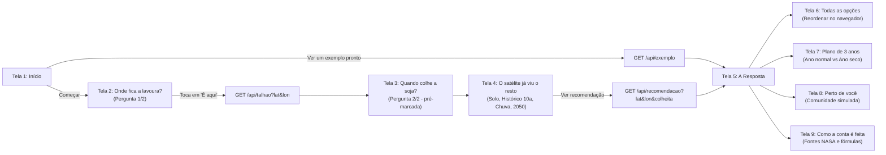

# Histórias de Usuário e Requisitos — Raiz Orbital (Backend & Produto)

Este documento consolida as **personas**, a **decisão central de negócio**, as **histórias de usuário (US-01 a US-13)**, o mapeamento com as **telas do protótipo v3**, os **requisitos funcionais e não funcionais** e os **critérios de aceite** que orientam o desenvolvimento orientado a testes (TDD) do backend do **Raiz Orbital**.

> [!IMPORTANT]
> **A decisão que o produto apoia:**
> *"Depois desta soja, o que eu planto neste talhão, e que sequência sigo nos próximos 3 anos para manter renda, proteger o solo e não perder dinheiro com seca?"*
> Essa decisão ocorre anualmente entre dezembro e março, à medida que a colheita da soja se aproxima no Cerrado / Triângulo Mineiro.

---

## 1. Personas do Produto

| Persona | Perfil | Necessidade Principal | Como interage com o sistema |
| :--- | :--- | :--- | :--- |
| **Marcelo** *(Produtor de grãos de sequeiro — Principal)* | Planta de 200 a 1.500 ha de soja no Triângulo Mineiro. Usa o celular no campo o dia todo e decide a safrinha junto com o agrônomo. | Saber em poucos minutos, com apenas 2 perguntas, qual cultura de entressafra e qual plano de 3 anos trazem mais segurança e retorno para o seu talhão. | Acessa pelo celular (360–390 px) ou computador, responde onde fica a lavoura e quando colhe a soja, lê/ouve os rótulos (*Bom / Médio / Fraco*) e compartilha o link. |
| **Ana** *(Agrônoma de revenda ou cooperativa — Canal de confiança)* | Atende dezenas de produtores rurais na região; precisa embasar recomendações técnicas para tirá-los da sucessão soja/milho ou soja/pousio. | Comparar as 6 opções lado a lado com dados auditáveis da NASA e da Embrapa, ajustando textura do solo, presença de nematoide e parâmetros econômicos. | Usa o computador ou tablet, inspeciona a tela *"Todas as opções"*, *"Como a conta é feita"*, edita solo/nematoide e analisa as notas técnicas (0 a 100). |
| **Jurado do Space Apps** *(Avaliador global/local)* | Avalia dezenas de projetos em poucos minutos buscando Impacto, Criatividade, Validade Científica, Relevância e Apresentação. | Ver o sistema funcionando instantaneamente (sem login/cadastro), em inglês ou português, entendendo qual dado da NASA fundamenta cada recomendação. | Toca em *"Ver um exemplo pronto"* (`GET /api/exemplo`), alterna idioma (`Accept-Language: en`) e verifica as fontes da NASA em cada frase de explicação. |

---

## 2. Mapeamento: Telas do Protótipo v3 × Jornada e Endpoints da API

O protótipo v3 foi desenhado com o princípio de **2 perguntas e 1 resposta clara**, escondendo a complexidade da coleta de satélite atrás de uma experiência fluida:

---

## 3. Catálogo de Histórias de Usuário (MVP)

### Resumo Priorizado (MoSCoW)

| ID | Como... | Quero... | Para... | Prioridade | Endpoint / Camada Backend |
| :--- | :--- | :--- | :--- | :---: | :--- |
| **US-01** | Produtor | Marcar minha lavoura no mapa ou pelo GPS, com um toque | O app buscar os dados daquele lugar | **Must** | `GET /api/talhao` |
| **US-02** | Produtor | Dizer quando colho a soja escolhendo entre três faixas (`cedo`, `meio`, `tarde`), já sugeridas pelo satélite | O app saber quando a entressafra começa sem eu digitar data | **Must** | `GET /api/talhao` (`colheita_sugerida`) |
| **US-03** | Produtor | Ver uma resposta clara (o que plantar, até quando) com chuva, dinheiro e terra em palavras | Decidir rápido, sem precisar interpretar notas de 0 a 100 | **Must** | `GET /api/recomendacao` (`melhor`, `opcoes`) |
| **US-04** | Produtor | Ver alternativas para o que eu priorizo (*menos risco*, *mais dinheiro*, *cuidar da terra*) e todas as opções lado a lado | O resultado refletir o que importa para mim sem mexer em sliders complexos | **Must** | `GET /api/recomendacao` (`alternativas`) |
| **US-05** | Produtor | Ler por que cada opção ganhou ou perdeu nota, com o dado da NASA citado | Confiar na recomendação e discutir com o agrônomo | **Must** | `GET /api/recomendacao` (`porque`) |
| **US-06** | Produtor | Ver planos de rotação de 3 anos comparados com o sistema atual | Sair da sucessão contínua soja/milho ou soja/pousio | **Must** | `GET /api/recomendacao` (`plano_3_anos`) |
| **US-07** | Produtor | Ver o histórico do meu talhão (anos parado vs. anos plantados na safrinha) pelo satélite | Entender de onde estou partindo | **Should** | `GET /api/talhao` (`historico`) |
| **US-08** | Produtor ou Agrônomo | Trocar a textura do solo e informar presença de nematoide, só se eu quiser | Ajustar o cálculo sem tornar o caminho principal mais longo | **Could** | `GET /api/recomendacao?solo=...&nematoide=...` |
| **US-09** | Produtor | Testar o plano num ano seco (tipo El Niño) e ver o impacto do clima de 2050 | Saber se a escolha e a rotação aguentam anos ruins | **Should** | `GET /api/recomendacao` (`futuro`, `plano_3_anos.seco`) |
| **US-10** | Agrônomo | Consultar e editar parâmetros de produtividade, preço e custo | Adequar a estimativa de margem financeira à realidade do cliente | **Could** | `culturas.yaml` / `GET /api/crop-options` |
| **US-11** | Jurado | Abrir uma fazenda de exemplo em Uberlândia com um clique | Ver o produto funcionando em menos de 1 segundo e sem cadastro | **Must** | `GET /api/exemplo` |
| **US-12** | Produtor com pouca leitura | Tocar em "Ouvir" e escutar o conteúdo da tela | Entender a recomendação no campo sem depender de leitura | **Should** | Frontend (Web Speech API) + frases curtas da API |
| **US-13** | Produtor | Usar o mesmo site no celular (no campo) e no computador (no escritório) e compartilhar o link | Não precisar de dois apps nem perder a consulta ao recarregar a página | **Must** | Rotas `GET` idempotentes com query params na URL |

---

## 4. Detalhamento e Critérios de Aceite por História (BDD)

### US-01: Localização do Talhão no Mapa (`Must` · RF-01)
- **Descrição:** Como produtor, quero marcar o ponto do meu talhão no mapa ou usar meu GPS para que o sistema identifique a célula climática de 0,1° e busque os dados orbitais do local.
- **Critérios de Aceite:**
  1. **Dado** que o produtor informa coordenadas `lat` e `lon` dentro do recorte preparado do Triângulo Mineiro, **quando** o frontend chama `GET /api/talhao?lat=-18.92&lon=-48.28`, **então** a API retorna HTTP 200 com `"dentro_da_area": true`, o `celula_id` correspondente (ex.: `"-190_-483"`) e os metadados das fontes carregadas.
  2. **Dado** que o ponto informado está fora da caixa geográfica preparada, **quando** `GET /api/talhao` é chamado, **então** a API retorna HTTP 200 com `"dentro_da_area": false` (sem erro 4xx/5xx), permitindo ao frontend oferecer um clique direto para a fazenda de exemplo.

### US-02: Faixa de Colheita da Soja Sugerida por Satélite (`Must` · RF-02, RF-16)
- **Descrição:** Como produtor, quero escolher quando colho a soja entre 3 faixas simples (`cedo` até 10/fev, `meio` de 11 a 20/fev, `tarde` após 20/fev), vindo pré-selecionada a faixa estimada pela queda do NDVI da soja nos anos anteriores.
- **Critérios de Aceite:**
  1. **Dado** que existem ao menos 5 anos válidos de série MODIS MOD13Q1 para o ponto, **quando** `FieldHistoryService` analisa a queda do NDVI abaixo de 50% do pico de verão entre janeiro e março, **então** a mediana define `"colheita_sugerida": {"faixa": "cedo" | "meio" | "tarde", "fonte": "ndvi_modis", "anos_usados": N}`.
  2. **Dado** que o Earth Engine está indisponível ou há menos de 5 anos válidos, **então** o sistema retorna fallback `"colheita_sugerida": {"faixa": "meio", "fonte": "padrao"}`.
  3. **Dado** a faixa escolhida, a data de semeadura da safrinha é calculada como `colheita + 3 dias`:
     - `cedo` (colheita 05/fev) $\rightarrow$ semeadura `08/fev`
     - `meio` (colheita 15/fev) $\rightarrow$ semeadura `18/fev`
     - `tarde` (colheita 28/fev) $\rightarrow$ semeadura `03/mar`

### US-03: Recomendação Principal com Rótulos Claros (`Must` · RF-03, RF-04)
- **Descrição:** Como produtor, quero receber uma recomendação direta indicando a melhor opção para plantar, a data limite da janela (ZARC) e o desempenho em **Chuva**, **Dinheiro** e **Terra** traduzido nos rótulos `bom`, `medio` ou `fraco`.
- **Critérios de Aceite:**
  1. **Dado** um talhão válido e uma faixa de colheita, **quando** `GET /api/recomendacao` é chamado, **então** o motor simula os 20 anos (2006–2025) de balanço hídrico diário FAO-56 (`simular` e `isna`) para as opções dentro da janela de plantio.
  2. **Regra do Pousio:** O `pousio` **nunca** entra no ranking de recomendação (`opcoes` ou `melhor`); ele é devolvido separadamente no campo `pousio` como linha de base (*"Deixar parado: não depende de chuva, mas a terra fica descoberta"*).
  3. **Regra de Janela Agronômica:** Opções cuja data limite de semeadura (ex.: 28/fev para milho safrinha) seja anterior à data de semeadura calculada (ex.: 03/mar na colheita `tarde`) são movidas para `fora_da_janela` e não podem ser escolhidas como `melhor`.
  4. **Rótulos para o Produtor:**
     - **Chuva:** `bom` ($\ge 17$ de 20 anos sem aperto), `medio` ($12\text{ a }16$ anos), `fraco` ($< 12$ anos).
     - **Dinheiro:** `bom` (nota $\ge 70$), `medio` ($30\text{ a }69$), `fraco` ($< 30$).
     - **Terra (Solo):** `bom` (nota $\ge 50$), `medio` ($20\text{ a }49$), `fraco` ($< 20$).

### US-04: Alternativas por Prioridade e Comparação Lado a Lado (`Must` · RF-05)
- **Descrição:** Como produtor, quero ver 3 alternativas diretas caso eu priorize *"menos risco"* (`menos_risco`), *"mais dinheiro"* (`mais_dinheiro`) ou *"cuidar da terra"* (`cuidar_da_terra`), além da lista completa para reordenar no navegador.
- **Critérios de Aceite:**
  1. **Dado** o conjunto de opções dentro da janela de semeadura, **quando** `RecommendationService` monta o ranking, **então** `melhor` é a opção de maior nota final ponderada (30% segurança, 25% solo, 30% renda, 15% futuro).
  2. **Dado** a opção `melhor`, o campo `alternativas` seleciona a campeã isolada em segurança climática (`menos_risco`), em margem líquida (`mais_dinheiro`) e em saúde do solo (`cuidar_da_terra`), **sem repetir** a opção que já é a `melhor`.

### US-05: Transparência Científica e "Por Quê?" com Dados da NASA (`Must` · RF-06, RNF-05)
- **Descrição:** Como produtor ou jurado, quero ler frases curtas que expliquem exatamente por que cada opção recebeu aquela avaliação, citando os números calculados e a fonte orbital da NASA.
- **Critérios de Aceite:**
  1. As frases em `porque` são geradas por templates determinísticos em `regras.yaml` (sem uso de IA generativa, evitando alucinações).
  2. Os números interpolados na frase (ex.: *"Em 6 dos últimos 20 anos, faltou chuva bem nessa hora (GPM IMERG + NASA POWER)"*) devem ser **exatamente** iguais a `20 - chuva.anos_bons`.
  3. Quando o cabeçalho HTTP `Accept-Language: en` é enviado, todas as frases, nomes de culturas e textos explicativos são retornados em inglês (RNF-03).

### US-06: Plano de Rotação de 3 Anos (`Must` · RF-07)
- **Descrição:** Como produtor, quero visualizar uma sequência recomendada de 3 entressafras seguidas comparada ao meu manejo tradicional (`hoje`), tanto em cenário normal quanto em cenário de anos secos.
- **Critérios de Aceite:**
  1. `RotationPlanService` avalia as $6 \times 6 \times 6 = 216$ combinações trienais.
  2. **Filtros eliminatórios:** descarta sequências com opções fora da janela, sequências com mais de 2 pousios seguidos e, quando `nematoide=sim`, descarta sequências que passem 3 anos sem `crotalaria` ou `milheto`.
  3. **Bônus de Diversidade:** adiciona `+5` pontos na média se o plano contiver 2 funções agronômicas distintas e `+10` pontos se contiver 3 funções distintas (grão, cobertura gramínea, cobertura leguminosa).

### US-07: Histórico de 10 Anos do Talhão via NDVI (`Should` · RF-08)
- **Descrição:** Como produtor, quero ver em quantos dos últimos 10 anos meu talhão ficou parado (pousio) ou teve planta crescendo na entressafra, medido pelo satélite MODIS.
- **Critérios de Aceite:**
  1. Os valores brutos da banda `NDVI` do `MODIS/061/MOD13Q1` são multiplicados pelo fator de escala `0.0001` antes de qualquer comparação.
  2. Para cada ano (2015–2025), analisa-se o maior NDVI entre **1º de abril e 31 de julho**:
     - `ndvi_max > 0.60` $\rightarrow$ `"plantou"` (segunda safra ou cobertura)
     - `ndvi_max < 0.45` $\rightarrow$ `"parado"` (pousio)
     - Entre `0.45` e `0.60` $\rightarrow$ `"incerto"`

### US-08: Ajuste Opcional de Textura do Solo e Nematoide (`Could` · RF-02)
- **Descrição:** Como produtor ou agrônomo, quero poder sobrescrever a textura do solo (`arenoso`, `medio`, `argiloso`) e informar se há problema de nematoide (`sim`, `nao`) na tela 4.
- **Critérios de Aceite:**
  1. Se `solo` não for informado na query string de `/api/recomendacao`, utiliza-se a textura do SoilGrids (ou `medio` com `CAD = 50 mm` se o SoilGrids falhar).
  2. Se o usuário informar `solo=arenoso` (`CAD = 40 mm`) ou `solo=argiloso` (`CAD = 60 mm`), o balanço hídrico é recalculado na hora com a nova capacidade de água disponível.
  3. Se `nematoide=sim`, o peso da coluna "quebra de pragas" na nota de Saúde do Solo é multiplicado por `1.5` (reescalado de 0 a 100) e ativa a restrição obrigatória de crotalária/milheto no plano de 3 anos.

### US-09: Testes de Estresse — Ano Seco e Clima Futuro 2050 (`Should` · RF-09)
- **Descrição:** Como produtor, quero saber como cada cultura se comporta no clima projetado para 2041–2060 (CMIP6) e qual plano de 3 anos escolher se vier uma sequência de anos secos.
- **Critérios de Aceite:**
  1. **Clima Futuro (2041–2060):** aplica o **método do delta** mensal sobre a série observada (chuva $\times (1 + \Delta\%)$ e $T_{max} + \Delta^\circ\text{C}$) para os modelos do `NEX-GDDP-CMIP6` no cenário `SSP2-4.5`, recalculando a ETo e o número de anos bons (`anos_bons_media`, `anos_bons_min`, `anos_bons_max`).
  2. **Plano de 3 Anos em Cenário Seco (`plano_3_anos.seco`):** recalcula as 216 combinações utilizando exclusivamente os **4 anos mais secos** da série histórica de 20 anos (menor precipitação acumulada de fevereiro a abril).

### US-11: Fazenda de Exemplo em Uberlândia (`Must` · RF-11)
- **Descrição:** Como jurado do Space Apps ou visitante, quero abrir um exemplo completo em Uberlândia (`lat=-18.92, lon=-48.28`) com um único clique e resposta instantânea.
- **Critérios de Aceite:**
  1. O endpoint `GET /api/exemplo` lê uma fixture pré-calculada (`exemplo_uberlandia.json`), respondendo em $< 100\text{ ms}$ mesmo que o banco PostGIS esteja vazio ou as APIs externas (Earth Engine / SoilGrids) estejam offline.

---

## 5. Requisitos Não Funcionais (RNF) e Restrições de Arquitetura

| ID | Requisito | Meta / Implementação no Backend |
| :--- | :--- | :--- |
| **RNF-01** | **Desempenho e Latência** | `GET /api/recomendacao` em **< 1 s** (lê séries em arrays do PostGIS e calcula em memória); `GET /api/talhao` em até **10 s** (disparado na Tela 2 enquanto o usuário responde a Tela 3); `GET /api/exemplo` instantâneo. |
| **RNF-02** | **Reordenação Instantânea** | Reordenar as 6 opções por Chuva, Dinheiro ou Terra ocorre 100% no navegador usando os dados já retornados por `/api/recomendacao` (< 1 s). |
| **RNF-03** | **Internacionalização (i18n)** | Suporte a `pt-BR` (padrão para o produtor) e `en` (para os juízes do Space Apps) via header `Accept-Language`, com templates em `regras.yaml`. |
| **RNF-04** | **Payload Enxuto (Sinal Fraco)** | Respostas JSON compactas (~15 KB), compressão `GZipMiddleware` e cabeçalho `Cache-Control: public, max-age=86400`. |
| **RNF-05** | **Transparência e Ética** | Nenhuma caixa-preta ou IA generativa nas notas; cada recomendação inclui o campo `"aviso": "Ajuda a decidir. Não substitui o agrônomo."` e `"versao_dados"`. |
| **RNF-06** | **Privacidade** | Zero cadastro, zero coleta de dados pessoais; coordenadas trafegam apenas na URL (`GET`) para fácil compartilhamento. |
| **RNF-07** | **Atribuição Científica** | Citação explícita de `NASA POWER`, `GPM IMERG`, `SMAP`, `MODIS MOD13Q1`, `NEX-GDDP-CMIP6`, `SoilGrids`, `Embrapa` e `ZARC`. |
| **RNF-08** | **Segurança de Segredos** | Credenciais (`DATABASE_URL`, `EARTHDATA_*`, `EE_PROJECT`, `EE_SERVICE_ACCOUNT_KEY`) lidas exclusivamente via `Settings` (`pydantic-settings`), nunca commitadas. |
