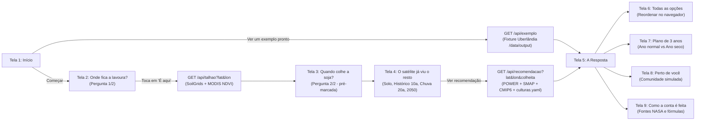

# Histórias de Usuário e Requisitos — Raiz Orbital (Backend & Dados Obtidos em `/data`)

Este documento consolida as **personas**, a **decisão central de negócio**, as **histórias de usuário (US-01 a US-13)**, o mapeamento com as **telas do protótipo v3**, os **critérios de aceite** e a **matriz de rastreabilidade com os dados reais extraídos em [`/data`](file:///workspace/data)**.

> [!IMPORTANT]
> **A decisão que o produto apoia:**
> *"Depois desta soja, o que eu planto neste talhão, e que sequência sigo nos próximos 3 anos para manter renda, proteger o solo e não perder dinheiro com seca?"*
> Essa decisão ocorre anualmente entre dezembro e março, à medida que a colheita da soja se aproxima no Cerrado / Triângulo Mineiro.

---

## 1. Matriz de Rastreabilidade: Dados Obtidos em `/data` × Histórias de Usuário

Os requisitos e histórias abaixo estão diretamente ancorados nos scripts e datasets reais já implementados e extraídos em [`/workspace/data/`](file:///workspace/data):

| Fonte / Script em `/data` | Arquivo Gerado em `/data/output/` | Variáveis Obtidas | Histórias de Usuário Atendidas |
| :--- | :--- | :--- | :--- |
| **NASA POWER (20 Anos)** [`extract_nasa_power.py`](file:///workspace/data/extract_nasa_power.py) [`extract_historical_20y.py`](file:///workspace/data/extract_historical_20y.py) | [`historico_uberlandia_20anos_diario.json`](file:///workspace/data/output/historico_uberlandia_20anos_diario.json) [`resumo_uberlandia_20anos_anual.json`](file:///workspace/data/output/resumo_uberlandia_20anos_anual.json) | `PRECTOTCORR` *(chuva diária, substituindo GPM IMERG)*, `T2M_MAX`, `T2M_MIN`, `T2M`, `RH2M`, `WS2M`, `ALLSKY_SFC_SW_DWN` *(base da ETo FAO-56)*, `GWETROOT` *(umidade na raiz 0–1)* | **US-03, US-04, US-05, US-06, US-09, US-11** |
| **NASA SMAP L4 (9 km)** [`extract_smap.py`](file:///workspace/data/extract_smap.py) | `smap_uberlandia_2024_safra.json` | `sm_surface_m3_m3` *(0–5 cm)*, `sm_rootzone_m3_m3` *(0–100 cm)*, `sm_rootzone_wetness` *(fração 0–1 para calibrar arm0 do balde)* | **US-03, US-05** |
| **SoilGrids ISRIC (250 m)** [`extract_soilgrids.py`](file:///workspace/data/extract_soilgrids.py) | `soilgrids_talhao.json` | `argila_percentual` (`clay`), `areia_percentual` (`sand`), `textura_solo` (`arenoso` \| `medio` \| `argiloso`), `cad_capacidade_agua_mm` (`40` \| `50` \| `60` mm) | **US-01, US-03, US-08** |
| **MODIS MOD13Q1 (NDVI 10 Anos)** [`extract_gee_ndvi.py`](file:///workspace/data/extract_gee_ndvi.py) | `modis_ndvi_historico_10anos.json` | `ndvi` *(reescalado $\times 0,0001$)*, `ndvi_medio_safrinha`, `status_talhao` (`Pousio` vs `Segunda Safra`), estimativa de faixa de colheita | **US-02, US-05, US-07** |
| **NEX-GDDP-CMIP6 (2041–2060)** [`extract_gee_cmip6.py`](file:///workspace/data/extract_gee_cmip6.py) | `cmip6_projecao_2050.json` | `pr` *(convertido p/ mm/dia)*, `tasmax` *(convertido p/ °C)*, `delta_climatico_safrinha` (`aumento_temperatura_media_c`, `variacao_chuva_safrinha_pct`, `aumento_dias_calor_extremo_ge_35c`) | **US-03, US-05, US-09** |
| **Parâmetros Agronômicos** [`culturas.yaml`](file:///workspace/data/culturas.yaml) | — *(Configuração YAML)* | `pousio`, `milho_safrinha`, `sorgo_granifero`, `milho_braquiaria`, `milheto`, `crotalaria_spectabilis` (`semeadura_limite_mes_dia`, `dias_florescer`, `ciclo_dias`, `kc_pico`, `palhada_score`, `n_deixado_kg`, `nematoide_efeito`, custos e preços) | **US-03, US-04, US-06, US-08, US-10** |

---

## 2. Personas do Produto

| Persona | Perfil | Necessidade Principal | Como interage com o sistema |
| :--- | :--- | :--- | :--- |
| **Marcelo** *(Produtor de grãos de sequeiro — Principal)* | Planta de 200 a 1.500 ha de soja no Triângulo Mineiro. Usa o celular no campo o dia todo e decide a safrinha junto com o agrônomo. | Saber em poucos minutos, com apenas 2 perguntas, qual cultura de entressafra e qual plano de 3 anos trazem mais segurança e retorno para o seu talhão. | Acessa pelo celular (360–390 px) ou computador, responde onde fica a lavoura e quando colhe a soja, lê/ouve os rótulos (*Bom / Médio / Fraco*) e compartilha o link. |
| **Ana** *(Agrônoma de revenda ou cooperativa — Canal de confiança)* | Atende dezenas de produtores rurais na região; precisa embasar recomendações técnicas para tirá-los da sucessão soja/milho ou soja/pousio. | Comparar as 6 opções lado a lado com dados auditáveis da NASA e da Embrapa, ajustando textura do solo, presença de nematoide e parâmetros econômicos. | Usa o computador ou tablet, inspeciona a tela *"Todas as opções"*, *"Como a conta é feita"*, edita solo/nematoide e analisa as notas técnicas (0 a 100). |
| **Jurado do Space Apps** *(Avaliador global/local)* | Avalia dezenas de projetos em poucos minutos buscando Impacto, Criatividade, Validade Científica, Relevância e Apresentação. | Ver o sistema funcionando instantaneamente (sem login/cadastro), em inglês ou português, entendendo qual dado da NASA fundamenta cada recomendação. | Toca em *"Ver um exemplo pronto"* (`GET /api/exemplo`), alterna idioma (`Accept-Language: en`) e verifica as fontes da NASA em cada frase de explicação. |

---

## 3. Mapeamento: Telas do Protótipo v3 × Jornada e Endpoints da API

O protótipo v3 foi desenhado com o princípio de **2 perguntas e 1 resposta clara**, alimentado pelos dados extraídos em `/data`:

---

## 4. Catálogo de Histórias de Usuário (MVP)

| ID | Como... | Quero... | Para... | Prioridade | Endpoint / Dados de `/data` |
| :--- | :--- | :--- | :--- | :---: | :--- |
| **US-01** | Produtor | Marcar minha lavoura no mapa ou pelo GPS, com um toque | O app buscar os dados daquele lugar | **Must** | `GET /api/talhao` (`soilgrids_talhao.json`) |
| **US-02** | Produtor | Dizer quando colho a soja escolhendo entre três faixas (`cedo`, `meio`, `tarde`), já sugeridas pelo satélite | O app saber quando a entressafra começa sem eu digitar data | **Must** | `GET /api/talhao` (`modis_ndvi_historico_10anos.json`) |
| **US-03** | Produtor | Ver uma resposta clara (o que plantar, até quando) com chuva, dinheiro e terra em palavras | Decidir rápido, sem precisar interpretar notas de 0 a 100 | **Must** | `GET /api/recomendacao` (`historico_uberlandia_20anos_diario.json` + `smap`) |
| **US-04** | Produtor | Ver alternativas para o que eu priorizo (*menos risco*, *mais dinheiro*, *cuidar da terra*) e todas as opções lado a lado | O resultado refletir o que importa para mim sem mexer em sliders complexos | **Must** | `GET /api/recomendacao` (`alternativas`) |
| **US-05** | Produtor | Ler por que cada opção ganhou ou perdeu nota, com o dado da NASA citado | Confiar na recomendação e discutir com o agrônomo | **Must** | `GET /api/recomendacao` (`porque`) |
| **US-06** | Produtor | Ver planos de rotação de 3 anos comparados com o sistema atual | Sair da sucessão contínua soja/milho ou soja/pousio | **Must** | `GET /api/recomendacao` (`plano_3_anos` + `culturas.yaml`) |
| **US-07** | Produtor | Ver o histórico do meu talhão (anos parado vs. anos plantados na safrinha) pelo satélite | Entender de onde estou partindo | **Should** | `GET /api/talhao` (`classificacao_anual` do `extract_gee_ndvi.py`) |
| **US-08** | Produtor ou Agrônomo | Trocar a textura do solo e informar presença de nematoide, só se eu quiser | Ajustar o cálculo sem tornar o caminho principal mais longo | **Could** | `GET /api/recomendacao?solo=...&nematoide=...` (`nematoide_efeito` em `culturas.yaml`) |
| **US-09** | Produtor | Testar o plano num ano seco (tipo El Niño) e ver o impacto do clima de 2050 | Saber se a escolha e a rotação aguentam anos ruins | **Should** | `GET /api/recomendacao` (`cmip6_projecao_2050.json` + `resumo_uberlandia_20anos_anual.json`) |
| **US-10** | Agrônomo | Consultar e editar parâmetros de produtividade, preço e custo | Adequar a estimativa de margem financeira à realidade do cliente | **Could** | `culturas.yaml` / `GET /api/crop-options` |
| **US-11** | Jurado | Abrir uma fazenda de exemplo em Uberlândia com um clique | Ver o produto funcionando em menos de 1 segundo e sem cadastro | **Must** | `GET /api/exemplo` (dados pré-extraídos de Uberlândia `-18.9186, -48.2772`) |
| **US-12** | Produtor com pouca leitura | Tocar em "Ouvir" e escutar o conteúdo da tela | Entender a recomendação no campo sem depender de leitura | **Should** | Frontend (Web Speech API) + textos curtos da API |
| **US-13** | Produtor | Usar o mesmo site no celular (no campo) e no computador (no escritório) e compartilhar o link | Não precisar de dois apps nem perder a consulta ao recarregar a página | **Must** | Rotas `GET` idempotentes com query params na URL |

---

## 5. Detalhamento e Critérios de Aceite por História (BDD)

### US-01: Localização do Talhão e Textura Automática do Solo (`Must` · RF-01, RF-02)
- **Dados de `/data` utilizados:** [`extract_soilgrids.py`](file:///workspace/data/extract_soilgrids.py) (`clay`, `sand` na camada `0-30cm`).
- **Critérios de Aceite:**
  1. **Dado** que o produtor informa coordenadas `lat` e `lon` dentro do recorte do Triângulo Mineiro, **quando** o frontend chama `GET /api/talhao?lat=-18.92&lon=-48.28`, **então** a API retorna HTTP 200 com `"dentro_da_area": true`, o `celula_id` e a classificação textural calculada pelo SoilGrids:
     - `argila_percentual > 35.0%` $\rightarrow$ `textura: "argiloso"`, `cad_mm: 60.0`
     - `areia_percentual > 70.0%` $\rightarrow$ `textura: "arenoso"`, `cad_mm: 40.0`
     - Demais casos (ou fallback offline) $\rightarrow$ `textura: "medio"`, `cad_mm: 50.0`
  2. **Dado** que o ponto informado está fora da área preparada, **quando** `GET /api/talhao` é chamado, **então** retorna HTTP 200 com `"dentro_da_area": false`.

### US-02: Faixa de Colheita da Soja Sugerida por Satélite (`Must` · RF-02, RF-16)
- **Dados de `/data` utilizados:** [`extract_gee_ndvi.py`](file:///workspace/data/extract_gee_ndvi.py) (`MODIS/061/MOD13Q1`, banda `NDVI` com fator `0.0001`).
- **Critérios de Aceite:**
  1. **Dado** que existem ao menos 5 anos válidos de série MODIS para o ponto, **quando** `FieldHistoryService` analisa a queda do NDVI abaixo de 50% do pico de verão entre janeiro e março, **então** a mediana define `"colheita_sugerida": {"faixa": "cedo" | "meio" | "tarde", "fonte": "ndvi_modis", "anos_usados": N}`.
  2. **Dado** a faixa escolhida, a data de semeadura da safrinha é calculada como `colheita + 3 dias`:
     - `cedo` (colheita 05/fev) $\rightarrow$ semeadura `08/fev`
     - `meio` (colheita 15/fev) $\rightarrow$ semeadura `18/fev`
     - `tarde` (colheita 28/fev) $\rightarrow$ semeadura `03/mar`

### US-03: Recomendação Principal com Balanço Hídrico Real (`Must` · RF-03, RF-04)
- **Dados de `/data` utilizados:**
  - [`extract_nasa_power.py`](file:///workspace/data/extract_nasa_power.py) / [`historico_uberlandia_20anos_diario.json`](file:///workspace/data/output/historico_uberlandia_20anos_diario.json): `PRECTOTCORR` (chuva diária), `T2M_MAX`, `T2M_MIN`, `T2M`, `RH2M`, `WS2M`, `ALLSKY_SFC_SW_DWN` (cálculo da ETo FAO-56) e `GWETROOT`.
  - [`extract_smap.py`](file:///workspace/data/extract_smap.py): `sm_rootzone_wetness` e `sm_rootzone_m3_m3` para calibrar o armazenamento inicial do balde (`arm0 = cad * sm_rootzone_wetness` ou `cad * 0.5`).
  - [`culturas.yaml`](file:///workspace/data/culturas.yaml): `semeadura_limite_mes_dia`, `dias_florescer`, `ciclo_dias`, `kc_pico`.
- **Critérios de Aceite:**
  1. **Simulação de 20 anos:** Para cada opção plantável, simula o balde diário (`simular`) ao longo de `ciclo_dias` a partir da data de semeadura.
  2. **Detecção de Aperto:** Um ano tem aperto se, na janela crítica (`dias_florescer ± 15 dias` para grãos/consórcio), o `ISNA < 0.55` **ou** houver `3+ dias` com `T2M_MAX >= 35.0°C`. Para coberturas (`milheto`, `crotalaria_spectabilis`), o aperto ocorre se `ISNA < 0.50` nos primeiros 30 dias.
  3. **Regra do Pousio:** O `pousio` fica fora do ranking e aparece apenas como referência (`"como é hoje"`).
  4. **Regra da Janela Limite:** Se a data de semeadura ultrapassar `semeadura_limite_mes_dia` de [`culturas.yaml`](file:///workspace/data/culturas.yaml) (ex.: `02-28` para `milho_safrinha`, `milho_braquiaria` e `crotalaria_spectabilis`; `03-15` para `milheto`; `03-20` para `sorgo_granifero`), a cultura vai para `fora_da_janela`.

### US-04: Alternativas por Prioridade e Comparação Lado a Lado (`Must` · RF-05)
- **Critérios de Aceite:**
  1. `melhor` é a opção dentro da janela com maior nota final ponderada (30% segurança, 25% solo, 30% renda, 15% futuro).
  2. `alternativas` lista a melhor opção isolada em segurança climática (`menos_risco`), em margem líquida (`mais_dinheiro`) e em saúde do solo (`cuidar_da_terra`), sem repetir a `melhor`.

### US-05: Transparência Científica e "Por Quê?" com Dados da NASA (`Must` · RF-06, RNF-05)
- **Critérios de Aceite:**
  1. Cada frase em `porque` interpola os números exatos da simulação sobre os datasets de `/data` (ex.: *"Em 6 dos últimos 20 anos, faltou chuva ou fez calor >= 35°C no florescimento (NASA POWER + SMAP)"*).
  2. Suporte bilíngue (`pt-BR` e `en`) via header `Accept-Language`.

### US-06: Plano de Rotação de 3 Anos (`Must` · RF-07)
- **Dados de `/data` utilizados:** [`culturas.yaml`](file:///workspace/data/culturas.yaml) (`tipo`: `pousio`, `grao`, `consorcio`, `cobertura`; `n_deixado_kg`; `nematoide_efeito`) e [`resumo_uberlandia_20anos_anual.json`](file:///workspace/data/output/resumo_uberlandia_20anos_anual.json).
- **Critérios de Aceite:**
  1. Avalia as $6 \times 6 \times 6 = 216$ combinações trienais, descartando opções fora da janela, sequências com mais de 2 pousios seguidos e, quando `nematoide=sim`, sequências sem `crotalaria_spectabilis` ou `milheto`.
  2. Aplica bônus de diversidade (`+5` para 2 funções distintas, `+10` para 3 funções distintas).

### US-07: Histórico de 10 Anos do Talhão via NDVI (`Should` · RF-08)
- **Dados de `/data` utilizados:** [`extract_gee_ndvi.py`](file:///workspace/data/extract_gee_ndvi.py) (`modis_ndvi_historico_10anos.json`).
- **Critérios de Aceite:**
  1. Avalia o NDVI da entressafra (reescalado por `0.0001`) de 2015 a 2025 para classificar cada ano como `parado` (pousio) ou `plantou` (segunda safra), alimentando a frase: *"Sua área ficou parada em K dos últimos 10 anos (NDVI do MODIS)"*.

### US-08: Ajuste Opcional de Textura do Solo e Nematoide (`Could` · RF-02)
- **Dados de `/data` utilizados:** `palhada_score`, `n_deixado_kg` e `nematoide_efeito` de [`culturas.yaml`](file:///workspace/data/culturas.yaml) (`milho_safrinha: -15`, `pousio: -10`, `milho_braquiaria: +5`, `sorgo_granifero: +10`, `milheto: +15`, `crotalaria_spectabilis: +30`).
- **Critérios de Aceite:**
  1. Permite sobrescrever `solo=arenoso|medio|argiloso` e informar `nematoide=sim|nao`, reescalando o peso de controle de nematoides na nota de Saúde do Solo.

### US-09: Testes de Estresse — Ano Seco e Clima Futuro 2050 (`Should` · RF-09)
- **Dados de `/data` utilizados:**
  - [`extract_gee_cmip6.py`](file:///workspace/data/extract_gee_cmip6.py) (`cmip6_projecao_2050.json` — cenário `SSP2-4.5`, modelos `ACCESS-CM2`, `MIROC6`, `MPI-ESM1-2-HR`, delta de `-12.5%` na chuva da safrinha e `+1.8°C` na temperatura).
  - [`resumo_uberlandia_20anos_anual.json`](file:///workspace/data/output/resumo_uberlandia_20anos_anual.json) — seleção dos **4 anos mais secos** na safrinha (`chuva_safrinha_fev_mai_mm`, ex.: 2007 com 278.2 mm, 2014 com 314.6 mm, 2010 com 317.6 mm, 2012 com 336.4 mm) para calcular `plano_3_anos.seco`.

### US-11: Fazenda de Exemplo em Uberlândia (`Must` · RF-11)
- **Dados de `/data` utilizados:** Datasets reais já extraídos em [`/workspace/data/output/`](file:///workspace/data/output) para as coordenadas de Uberlândia (`lat=-18.9186, lon=-48.2772`).
- **Critérios de Aceite:**
  1. `GET /api/exemplo` responde em $< 100\text{ ms}$ usando os dados pré-extraídos de Uberlândia sem depender de banco ou rede externa.
