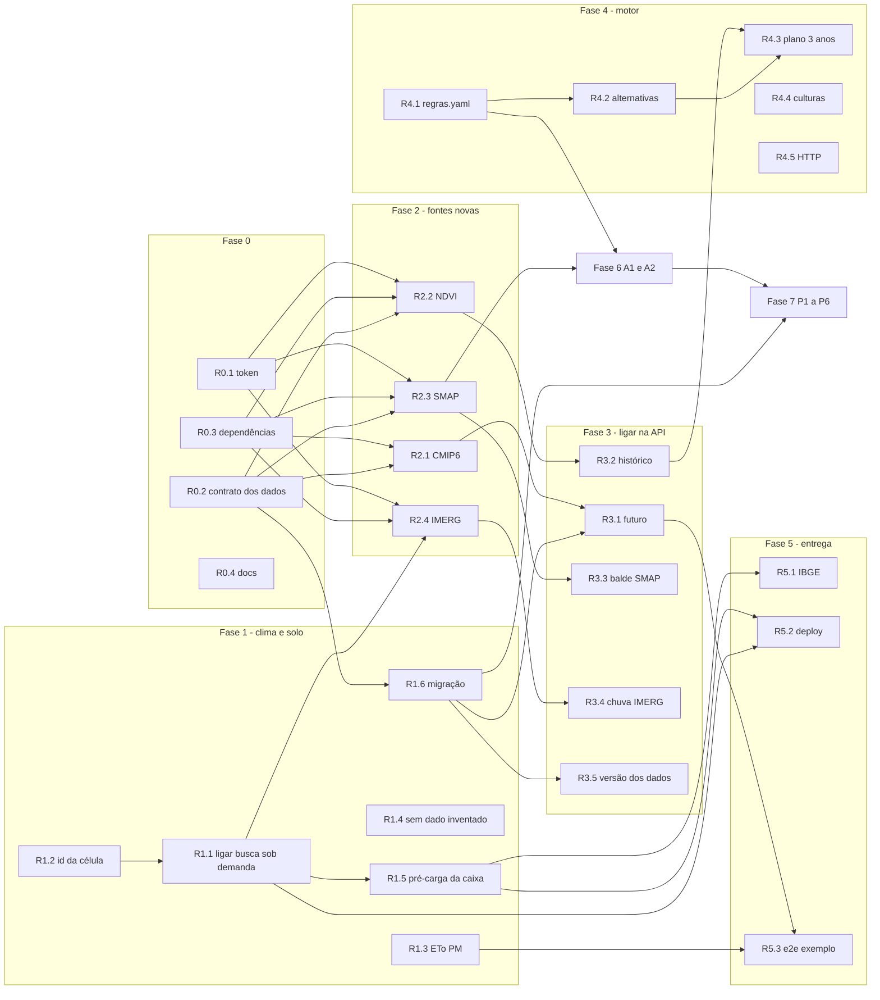

# Roteiro de implementação do backend

- **Atualizado em:** 2026-11-14
- **Base:** `main` em `1a4b42d` (121 testes passando), PRD v3.1, plano técnico do backend, plano de evolução,
  guia do histórico NDVI e prompt do Lovable (todos em `arquivos contexto/`), e a
  [tarefa 0001](tarefas/0001-ingestao-on-demand-dados-satelite.md) (busca sob demanda + PostGIS).
- **Objetivo:** levar o backend do estado atual ao produto completo com **dados reais da NASA**,
  dizendo o que depende do quê e o que pode ser feito **em paralelo**.

> **Como usar:**
> 1. Escolha uma tarefa da seção 6 cujas dependências já estejam prontas.
> 2. Crie o detalhe dela em `docs/tarefas/`, seguindo a convenção de [docs/tarefas/README.md](tarefas/README.md).
> 3. Abra a branch (`feat/...`, `fix/...`, `docs/...`) e siga o TDD do `AGENTS.md`.
> 4. No mesmo PR, marque a tarefa como feita (✅) aqui.
>
> O roteiro dá a ordem; o arquivo em `docs/tarefas/` dá o detalhe. A seção 7 mostra quem pode trabalhar
> ao mesmo tempo sem pisar no trabalho do outro.

---

## 1. Resumo

- **A API funciona, mas só num lugar.** `/talhao`, `/recomendacao` e `/exemplo` respondem de ponta a ponta,
  mas **em execução** só para a célula do NASA POWER em volta da lavoura de demonstração (perto de Uberlândia), que vem da
  fixture. Fora dela, `/recomendacao` dá 404 `OUTSIDE_AREA`.
- **A busca sob demanda já existe, mas está desligada.** A tarefa 0001 trouxe clientes do NASA POWER e do
  SoilGrids, repositories do PostGIS e um serviço que busca e guarda dados de células novas.
  - O `app/dependencies.py` ainda injeta os repositories de arquivo.
  - O `TalhaoService` só aciona a busca quando o repository de clima sabe gravar (`save_cell_seasons`).
  - Resultado: a busca nunca roda.
- **Só o NASA POWER chega à API como dado real.** CMIP6, NDVI do MODIS, SMAP e IMERG ainda não chegam.
  O solo real também não, porque o cliente do SoilGrids existe mas está desligado.
- **Acesso:** com o token da Earthdata, **todos os dados do MVP vêm direto da NASA**, sem Google Earth
  Engine (seção 3 e [ADR-0005](adr/0005-fontes-diretas-da-nasa-sem-earth-engine.md)). A API em produção
  não precisa de credencial: só os scripts de dados de IMERG, SMAP e AppEEARS usam o token.
- **Caminho crítico do MVP com dado real:**
  - principal: R1.2 → R1.1 → R1.5 → R5.2 (deploy);
  - em paralelo: R2.1 → R3.1 (nota de futuro) e R2.2 → R3.2 (histórico do talhão).

---

## 2. Onde estamos

| Área | O que os docs pedem | Como está no código | O que falta |
| --- | --- | --- | --- |
| Endpoints | `/health`, `/crop-options`, `/talhao`, `/recomendacao`, `/exemplo` (plano técnico §3) | Todos existem e batem com o contrato que o front usa | <ul><li>`Cache-Control` em `/recomendacao` (§8)</li><li>422 em problem+json</li><li>RF-10</li><li>Campos que o front já propôs: A1, A2 e `/api/regiao` (P3); ver Fases 6 e 7</li><li>~~P1 (`anos_detalhe`)~~ ✅ (tarefa 0035)</li></ul> |
| Área com dados | Caixa piloto: lat −19,9 a −18,4, lon −49,0 a −47,5 (ADR-0003; `PILOT_*` em `app/constants.py`). Busca sob demanda fora dela (tarefa 0001) | Fixture de uma célula do POWER | <ul><li>Ligar a busca sob demanda (R1.1)</li><li>Um único id de célula (R1.2)</li><li>Pré-carregar a caixa (R1.5)</li></ul> |
| Clima histórico | POWER, 20 anos, com ETo FAO-56 Penman-Monteith. IMERG como refinamento (ADR-0003) | <ul><li>Fixture POWER sem `eto_mm` (o motor usa Hargreaves-Samani)</li><li>`NasaPowerClient` calcula uma ETo própria, mistura de Hargreaves com radiação de superfície, dentro do cliente</li><li>Dia sem dado vira 30 °C / 18 °C / 0 mm</li></ul> | <ul><li>ETo Penman-Monteith no service (R1.3)</li><li>Não inventar dado (R1.4)</li><li>IMERG (R2.4)</li></ul> |
| Clima futuro | Deltas mensais NEX-GDDP-CMIP6, 3 modelos, SSP2-4.5 (PRD 7.3) | <ul><li>Motor pronto (`ClimateRiskService.simulate_future_cmip6`)</li><li>A fixture não tem `cmip6[]`, então `futuro: null`</li><li>`PostgisClimateRepository.get_cmip6_deltas` só repassa à fixture</li></ul> | <ul><li>Gerar os deltas (R2.1)</li><li>Tabela mensal e leitura (R1.6, R3.1)</li></ul> |
| Solo | SoilGrids → textura → CAD (PRD 6.4) | `SoilGridsClient` (0–30 cm) e `PostgisSoilRepository` prontos, porém desligados; em execução, sempre "médio, `fonte: padrao`" | Ligar (R1.1) |
| Histórico NDVI | MOD13Q1 (+MYD13Q1), regra do PRD 7.8 e do guia NDVI | `FieldHistoryService` pronto; `CachedNdviRepository` sem cache, então `historico: null` | <ul><li>Baixar o NDVI (R2.2)</li><li>Ligar e completar o contrato (R3.2)</li></ul> |
| SMAP | Balde inicial pelo `sm_rootzone` (PRD 7.2) e sinal do outono (A2) | Existem `smap_wetness` em `simulate_historical` e `get_latest_smap` no repository, mas ninguém passa o dado; o balde começa em 50% da CAD | <ul><li>Baixar (R2.3)</li><li>Ligar (R3.3)</li></ul> |
| Motor | PRD 7.1–7.7 | Balde, ISNA, aperto, notas, ranking, frases pt/en e plano de 3 anos | <ul><li>`regras.yaml` (R4.1)</li><li>Alternativas (R4.2)</li><li>Plano de 3 anos fiel ao PRD 7.7 (R4.3)</li><li>Frase de histórico (R3.2)</li><li>~~`como_fazer` e `nome_en` vazios (R4.4)~~ ✅</li></ul> |
| Banco | PostGIS com `grid_cell`, `climate_season`, `cmip6_delta`, `soil_point`, `ndvi_point`, `data_run` (plano técnico §5) | <ul><li>Repositories de clima e solo gravam e leem, mas não são usados</li><li>`cmip6_delta` da migração é agregado e não bate com o modelo `Cmip6Delta`</li><li>`scripts/seed_db.py` usa caminho fixo `/workspace/...`</li></ul> | <ul><li>R1.1</li><li>Migração nova (R1.6)</li></ul> |
| Docs | — | <ul><li>`data/README.md` marca como prontos `extract_soilgrids.py`, `extract_gee_ndvi.py` e `extract_gee_cmip6.py`, que não existem (a tarefa 0001 também cita `extract_soilgrids.py`)</li><li>ADR-0003/0004 citam a "Fazenda Santa Luzia"</li><li>A seção "Dados da API" do `AGENTS.md` ainda descreve só a fixture</li></ul> | R0.4 |

---

## 3. Acesso aos dados

Testado em **2026-11-14**, numa máquina **sem credencial nenhuma**:

| Fonte | Para quê | Serviço | Precisa de login? | Resultado do teste |
| --- | --- | --- | --- | --- |
| NASA POWER (diário, ponto) | chuva, Tmax, Tmin, UR, vento, radiação → balde e ETo | `power.larc.nasa.gov/api/temporal/daily/point` | não | HTTP 200 |
| SoilGrids v2 (ISRIC) | argila e areia → CAD | `rest.isric.org/soilgrids/v2.0/properties/query` | não | HTTP 200 (argila em g/kg, `d_factor` 10: dividir por 10 para ter %) |
| MODIS MOD13Q1 v061 | NDVI do talhão | ORNL DAAC `modis.ornl.gov/rst/api/v1/MOD13Q1/subset` | não | HTTP 200, mas **lento e instável**. Leva de poucos segundos a ~60 s por pedido, com no máximo 10 datas cada; o MYD13Q1 (Aqua) estourou 30 s. Tem `250m_16_days_NDVI` e `250m_16_days_pixel_reliability` (equivale ao `SummaryQA`). Reserva para o talhão; **fonte da região (P3)**, por área (±100 km por pedido, o tempo quase não muda com a área; tarefa 0034) |
| NEX-GDDP-CMIP6 | deltas de chuva e temperatura 2041–2060 | NCCS THREDDS (recorte por ponto em CSV) e S3 público `nex-gddp-cmip6` | não | HTTP 200. Cada arquivo inteiro tem ~220 MB (global, 1 ano, 1 variável), então **recortar por ponto** no THREDDS. Os nomes têm sufixo de versão (`_v1.1`, `_v2.0`) |
| GEOS-S2S-3 (GMAO) | chance de outono seco (A2) | `portal.nccs.nasa.gov/datashare/gmao/geos-s2s-3/` | não | HTTP 200 e download livre, mas **só NetCDF-4/HDF5** (`NRT/NMME/monthly/`, ~1 MiB por membro e mês, sem probabilidade nem tercis), sem OPeNDAP, THREDDS ou texto. Precisa do R0.3 e de uma decisão sobre o "abaixo do normal" ([tarefa 0032](tarefas/0032-geos-s2s-investigacao.md)) |
| GPM IMERG Final `GPM_3IMERGDF` v07 | chuva em 0,1° (refinamento) | GES DISC | **sim** (Earthdata) | 302 para `urs.earthdata.nasa.gov` |
| GPM IMERG Late `GPM_3IMERGDL` v07 | chuva dos últimos 30 dias (A2) | CMR (lista, aberto) + Cloud OPeNDAP `opendap.earthdata.nasa.gov` | CMR não; OPeNDAP **sim** | CMR: 30 granulos em 0,8 s (sufixo `V07C` em 14/11/2026; o último dia era o de ontem). OPeNDAP sem token: 302 para o login ([tarefa 0033](tarefas/0033-chuva-30-dias-imerg-late.md)) |
| SMAP L3 `SPL3SMP_E` / L4 `SPL4SMGP` | umidade do solo (balde inicial, A2) | NSIDC | **sim** (Earthdata) | 302 para `urs.earthdata.nasa.gov` (testado com o L3) |
| AppEEARS | recortes de SMAP e MODIS por ponto ou área | `appeears.earthdatacloud.nasa.gov/api` | **sim** (Earthdata) | não testado sem token |
| Google Earth Engine | caminho original dos docs para NDVI, CMIP6 e SMAP | — | sim (projeto no Google Cloud) | **não é usado no MVP** ([ADR-0005](adr/0005-fontes-diretas-da-nasa-sem-earth-engine.md)) |

### Credencial

- **Uma só para o MVP:** o token da Earthdata. Gere em `https://urs.earthdata.nasa.gov`, em *Generate Token*.
  - Ele vai no `projeto/backend/.env` como `EARTHDATA_TOKEN=...`. O git ignora esse arquivo.
  - Cada worktree tem o próprio `.env`.
- **Autorize os aplicativos** no perfil da Earthdata, em *Applications → Authorized Apps*:
  **NASA GESDISC DATA ARCHIVE** (IMERG) e o aplicativo da **NSIDC** (SMAP). Sem isso, o login funciona
  e o download é recusado.
- **Quem usa o token:** só quem roda os scripts de dados de IMERG, SMAP e AppEEARS. A API em produção
  não precisa dele:
  - ela lê o banco e as fixtures;
  - na hora do pedido, só chama o POWER e o SoilGrids, que são abertos.
- Nunca escreva o token em código, teste, log ou PR (ver o `AGENTS.md` da raiz).

### Como revalidar o acesso

Fontes abertas (de qualquer pasta):

```bash
curl -s -o /dev/null -w "POWER %{http_code}\n" "https://power.larc.nasa.gov/api/temporal/daily/point?parameters=PRECTOTCORR&community=AG&longitude=-48.1993&latitude=-18.9543&start=20240101&end=20240105&format=JSON"
curl -s -o /dev/null -w "SoilGrids %{http_code}\n" "https://rest.isric.org/soilgrids/v2.0/properties/query?lon=-48.1993&lat=-18.9543&property=clay&depth=0-5cm&value=mean"
curl -s -m 120 -o /dev/null -w "ORNL MODIS %{http_code} em %{time_total}s\n" "https://modis.ornl.gov/rst/api/v1/MOD13Q1/subset?latitude=-18.9543&longitude=-48.1993&startDate=A2024001&endDate=A2024017&kmAboveBelow=0&kmLeftRight=0"
curl -s -o /dev/null -w "CMIP6 THREDDS %{http_code}\n" "https://ds.nccs.nasa.gov/thredds/ncss/grid/AMES/NEX/GDDP-CMIP6/ACCESS-CM2/ssp245/r1i1p1f1/pr/pr_day_ACCESS-CM2_ssp245_r1i1p1f1_gn_2050_v2.0.nc?var=pr&latitude=-18.95&longitude=311.8&time_start=2050-02-01T12:00:00Z&time_end=2050-02-03T12:00:00Z&accept=csv"
```

Fontes com token (a partir de `projeto/backend`, sem imprimir o token):

```bash
TOKEN=$(grep '^EARTHDATA_TOKEN=' .env | cut -d= -f2-)
for SN in GPM_3IMERGDF SPL4SMGP; do
  URL=$(curl -s "https://cmr.earthdata.nasa.gov/search/granules.json?short_name=$SN&page_size=1&sort_key=-start_date" \
    | python3 -c "import sys,json; e=json.load(sys.stdin)['feed']['entry'][0]; print([l['href'] for l in e['links'] if l['href'].startswith('https') and l['href'].endswith(('.nc4','.h5'))][0])")
  curl -s -o /dev/null -r 0-1023 -L --location-trusted -H "Authorization: Bearer $TOKEN" -w "$SN %{http_code}\n" "$URL"
done
```

- **Esperado:** `200` ou `206` (só o primeiro KB).
- **`302`, `401` ou `403`:** o token venceu ou falta autorizar o aplicativo.

---

## 4. Decisões deste roteiro

1. **Dados direto da NASA, sem Earth Engine no MVP**
   ([ADR-0005](adr/0005-fontes-diretas-da-nasa-sem-earth-engine.md)).
   - NDVI: pelo AppEEARS, com a ORNL de reserva.
   - CMIP6: pelo THREDDS da NCCS.
   - SMAP e IMERG: com o token da Earthdata.
   - O Earth Engine fica como opção só para a máscara MapBiomas do P3.
2. **PostGIS com busca sob demanda** (tarefa 0001) para o clima do POWER e o solo.
   - Os arquivos continuam valendo para três usos:
     - a fazenda de exemplo, que precisa funcionar sem banco (plano técnico §8);
     - os testes;
     - as fontes que ainda não têm tabela (CMIP6, NDVI, SMAP), lidas como reserva (`_fallback`) do repository do PostGIS.
   - Cada fonte nova ganha tabela quando a migração R1.6 sair.
3. **A ADR-0003 continua valendo:**
   - janela de **2005 a 2024**;
   - chuva oficial do MVP = `PRECTOTCORR` do NASA POWER;
   - IMERG como refinamento. Com o token, ele deixa de estar bloqueado, mas continua fora do caminho crítico.

---

## 5. Decisões pendentes do time

Cada linha diz quem decide e qual tarefa fica parada até lá.

| Decisão | Opções | Quem decide | Bloqueia |
| --- | --- | --- | --- |
| Id da célula ✅ | **Decidido em 14/11: `floor`** (`cell_id_for`, plano técnico §5, alinhado à grade 0,1° do IMERG) | backend | R1.2 |
| Ano com dia faltando no POWER ✅ | **Decidido em 14/11: descartar o ano** (como `pipeline/export_climate_fixture.py`) | backend + agrônoma | R1.4 |
| Anos do histórico NDVI ✅ | **Decidido em 14/11: 2016–2025; em 15/11 passou a 2017–2026** (10 anos até a entressafra mais recente; o produtor confirma 2024, 2025 e 2026, [tarefa 0039](tarefas/0039-confirma-safras.md)) (plano técnico, guia NDVI, Lovable) | produto | R2.2 |
| Formato do `historico` ✅ | **Decidido em 14/11: completo do guia NDVI** (`n_obs`, `plantou`, `sem_certeza`, `janela` e o estado `sem_dado`) | produto + front | R3.2 |
| Delta de Tmin no CMIP6 (padrão adotado, **a revisar**) | Adotado no R2.1: `tasmax` **e** `tasmin` | backend | R2.1 |
| Modelos do CMIP6 (padrão adotado, **a revisar**) | Adotados no R2.1: ACCESS-CM2, MPI-ESM1-2-HR e MRI-ESM2-0 (`r1i1p1f1`, `_v2.0`, conferidos no THREDDS) | backend + agrônoma | R2.1 |
| Regra das alternativas (padrão adotado, **a revisar**) | Adotado no R4.2: só aparece se for melhor que a `melhor` no próprio eixo, sem repetir cultura; sem candidata, o eixo some. O produto pode trocar | produto | R4.2 |
| Reescala do nematoide | como levar a nota de solo de volta a 0–100 com pragas × 1,5 (o PRD 7.4 não define) | agrônoma | R4.3 (teste) |
| Plano "hoje" | de onde vem a sequência atual (histórico NDVI do talhão, PRD 7.7) e o que fazer sem histórico | produto | R4.3 |
| Contrato do RF-10 | parâmetros de produtividade, preço e custo em `/recomendacao` (nenhum doc define) | produto + front | R4.6 |
| Valores de custo (A1) | `custo_padrao_ha` e `custo_semente_ha` por cultura, com fonte | agrônoma | A1.1 |
| Pecuária (`gado`) | completar (plano técnico §3.2) ou retirar (o plano de evolução §7 tirou a pergunta "Tem gado?") | produto | R4.7 |
| Chave da fonte de chuva ✅ | **Decidido em 14/11: `gpm_imerg`** nos dois lados (o front já usava; o back deixou o `imerg_final` na [0027](tarefas/0027-imerg-na-conta.md)) | back + front | R3.4 |
| Nomes do detalhe por ano (P1) (padrão adotado, **a revisar**) | Adotado na [tarefa 0035](tarefas/0035-detalhe-de-cada-ano.md): o contrato do front (`fase_critica`, `dias_sem_chuva`), que a tela já usa, no lugar do plano de evolução §4.1 (`floracao`, `dias_secos`, `isna`, `dias_calor`); a frase cita o calor quando ele causou o aperto. Dia seco de 1 mm (o dos avisos, tarefa 0019), não os 5 mm do §4.1 | back + front | P1 |
| Fase do ENSO de cada safrinha (padrão adotado, **a revisar**) | Adotado na tarefa 0035: média do ONI da NOAA nas estações DJF, JFM e FMA do ano; +0,5 ou mais = El Niño, −0,5 ou menos = La Niña (grupo `enso` do `regras.yaml`). Outras opções: só o DJF, ou as 5 estações seguidas do "episódio" da NOAA | produto + agrônoma | — |
| Máscara da região pelo satélite (P3) (padrão adotado em 15/11, **a revisar**) | Adotado na [tarefa 0036](tarefas/0036-regiao-calibrada.md): só conta o pixel com a soja do ano (pico de NDVI ≥ 0,70 de 1/jan a 15/mar e colheita, ≤ 0,40, até 15/mai) dentro do MCD12Q1 classe 12; a entressafra é lida depois da colheita (grupo `regiao_ndvi` do `regras.yaml`). Substitui a máscara de soja do MapBiomas, que só existe pelo Earth Engine. A primeira rodada, só com a classe 12, deu "plantou" de 83% a 98% (cana e café) | produto + agrônoma | P3 |
| Sinal para o outono sem GEOS-S2S e sem IMERG Late (decidido em 15/11, **números a revisar**) | Adotado na [tarefa 0038](tarefas/0038-sinal-outono-enso.md): previsão oficial do ENSO da NOAA CPC para FMA + o desempenho da opção do 1º ano do Plano A nos anos daquela fase (ONI) marca Plano A ou B; regra da data (chuva dos 30 dias antes da data limite < 60% da média → Plano B); SMAP de agora só como informação (grupo `sinal_enso`). GEOS-S2S e IMERG Late ficam fora por decisão do usuário | produto + agrônoma | A2.1, A2.3 |

---

## 6. Roteiro por fases

**Legenda:**
- **Dep.:** tarefas que precisam estar prontas antes.
- **Cred.:** credencial necessária para rodar. Testes nunca usam credencial nem rede real.
- **PRD:** tarefa equivalente no backlog do PRD §9.

### Fase 0: preparação (tudo pode começar já, em paralelo)

| ID | Tarefa | Onde | Dep. | Cred. | PRD |
| --- | --- | --- | --- | --- | --- |
| [R0.1](tarefas/0009-token-earthdata-e-contrato-dados-fontes.md) ✅ | <ul><li>Campo `earthdata_token` no `Settings` e o nome `EARTHDATA_TOKEN` no `.env.example`</li><li>Avaliar remover `ee_project`, se a ADR-0005 for aceita</li></ul> | `app/config.py`, `.env.example`, `tests/unit/test_config.py` | — | — | T-01 |
| [R0.2](tarefas/0009-token-earthdata-e-contrato-dados-fontes.md) ✅ | **Contrato dos dados das fontes novas.** Formato em arquivo (agora) e em tabela (R1.6) para: <ul><li>CMIP6: mensal por modelo, igual ao `Cmip6Delta`</li><li>NDVI: por ponto, com a qualidade já filtrada</li><li>SMAP: por ponto e data</li></ul> Também a versão dos dados (`data_run` → `versao_dados`). Documentar em "Dados da API" no `AGENTS.md` | `app/models/`, `AGENTS.md` | — | — | — |
| R0.3 ⏸️ (adiado: [motivo](tarefas/0010-docs-backend-em-dia.md)) | **Dependências dos scripts de dados:** um grupo `pipeline` no uv, com `earthaccess`, `xarray`, `h5netcdf` e `numpy`. Fazer **uma vez só**, para evitar conflito no `uv.lock`, e justificar no PR. O `httpx2` já está na API | `pyproject.toml`, `uv.lock`, `requirements.txt` | — | — | — |
| [R0.4](tarefas/0010-docs-backend-em-dia.md) ✅ | **Docs em dia:** <ul><li>`data/README.md` e a tarefa 0001: não marcar como pronto script que não existe</li><li>ADR-0003/0004: lavoura de demonstração, −18,9543 / −48,1993</li><li>"Dados da API" no `AGENTS.md`: busca sob demanda e PostGIS</li><li>coluna de status em `docs/historias-de-usuario.md`</li><li>diagramas sem Earth Engine</li></ul> | `docs/`, `data/README.md`, `AGENTS.md` | — | — | — |
| R0.5 | Fechar as decisões da seção 5 | — | — | — | — |

### Fase 1: clima e solo de verdade em toda a área (continua a tarefa 0001)

| ID | Tarefa | Onde | Dep. | Cred. | PRD |
| --- | --- | --- | --- | --- | --- |
| [R1.1](tarefas/0003-ligar-busca-sob-demanda.md) ✅ | **Ligar a busca sob demanda.** <ul><li>Com `DATABASE_URL`, `dependencies.py` injeta `PostgisClimateRepository` e `PostgisSoilRepository`, com a fixture como reserva (`_fallback`)</li><li>Sem banco, tudo continua como hoje</li><li>`/recomendacao` também encontra (ou busca) a célula de um ponto novo. Ele não aciona a busca: com o PostGIS ligado, um ponto novo daria `OUTSIDE_AREA` se o `/talhao` não tivesse sido chamado antes</li><li>Teste de integração marcado (banco)</li></ul> | `dependencies.py`, `talhao_service.py`, `recommendation_service.py`, `tests/integration/` | R1.2 | não | T-07 |
| [R1.2](tarefas/0002-id-de-celula-unico.md) ✅ | **Um id de célula só.** Hoje `compute_grid_cell_id` usa `round` e `cell_id_for` usa `floor`; para lat −18,92 dão −189 e −190. Escolher um e usar nos dois repositories e na ingestão | `app/repositories/climate_repository.py` | decisão | não | — |
| [R1.3](tarefas/0004-eto-penman-monteith.md) ✅ | **ETo FAO-56 Penman-Monteith** <ul><li>Função pura no service, testada com o exemplo numérico do boletim FAO-56</li><li>Hargreaves-Samani continua como reserva</li><li>Tirar o cálculo de dentro do `NasaPowerClient`: o cliente só traz dados (UR, vento, radiação), o service calcula</li></ul> | `app/services/water_balance_calculator.py`, `app/repositories/external/nasa_power_client.py` | — | não | T-05 |
| [R1.4](tarefas/0005-power-sem-dado-inventado.md) ✅ | **Não inventar dado.** Hoje o `NasaPowerClient` troca dia faltando (`-999`) por 30 °C, 18 °C, 0 mm e valores padrão de UR, vento e radiação. Seguir a decisão da seção 5 e a regra do `AGENTS.md` | `nasa_power_client.py` | decisão | não | — |
| [R1.5](tarefas/0012-pre-carga-caixa-piloto.md) ✅ | **Pré-carregar a caixa piloto e a fazenda de exemplo** <ul><li>Um script chama a ingestão para as células da caixa: 225 células de 0,1° que caem em 9 a 12 células do POWER (0,5°). Agrupar para não repetir a mesma chamada ao POWER</li><li>Registrar em `data_run`</li><li>O primeiro clique na caixa fica instantâneo</li></ul> | `pipeline/` | R1.1 | não | T-03 |
| [R1.6](tarefas/0013-migracao-fontes-novas.md) ✅ | **Migração nova** <ul><li>`cmip6_delta` mensal por modelo (o atual é agregado)</li><li>`ndvi_point` com qualidade</li><li>tabela do SMAP</li><li>`data_run` usado</li></ul> Aposentar `scripts/seed_db.py` (caminho fixo `/workspace/data/output`) e o `scripts/init_db.sql` duplicado | `migrations/versions/`, `scripts/` | R0.2 | não | — |

### Fase 2: fontes novas da NASA (uma trilha por fonte, em paralelo)

Scripts offline em `pipeline/`, testados em `tests/unit/pipeline/` com HTTP falso. A saída segue o contrato
do R0.2: em arquivo antes do R1.6 e em tabela depois. **Nunca gerar dado sintético com nome de fonte real.**

| ID | Tarefa | Onde | Dep. | Cred. | PRD |
| --- | --- | --- | --- | --- | --- |
| [R2.1](tarefas/0014-deltas-cmip6.md) ✅ | **Deltas do CMIP6** <ul><li>Por célula do POWER: 3 modelos, SSP2-4.5, deltas mensais 2041–2060 × 1995–2014</li><li>Pelo THREDDS, com recorte por ponto, só jan–jul</li><li>Conversões: `pr` × 86.400 → mm/dia; `tasmax` − 273,15 → °C</li></ul> | `pipeline/fetch_cmip6_deltas.py` | R0.2, R0.3, decisões de Tmin e modelos | não | T-06 |
| [R2.2](tarefas/0017-ndvi-appeears.md) ✅ (AppEEARS ou ORNL, [0024](tarefas/0024-ndvi-pela-ornl.md); fazenda de exemplo extraída pela ORNL em 14/11) | **NDVI do MODIS** <ul><li>Série MOD13Q1 (+MYD13Q1) de jan–jul de cada ano, com qualidade ≤ 1</li><li>Para a fazenda de exemplo e os talhões de calibração (o PRD fala em 5 talhões conhecidos)</li><li>Pelo **AppEEARS**, numa tarefa por ponto, reaproveitando o cliente de `data/extract_smap.py`; a ORNL fica de reserva</li><li>A caixa inteira a 250 m (~360 mil pixels) fica para o P3</li></ul> | `pipeline/fetch_ndvi.py` | R0.1, R0.2, R0.3, decisão dos anos | **token** (ORNL: não) | T-10 |
| [R2.3](tarefas/0029-smap-por-recorte.md) ✅ (script e carga prontos; o download real é com o token) | **SMAP L4** (`SPL4SMGP` 008, `sm_rootzone`) <ul><li>Nos dias de semeadura das três faixas, de 2016 a 2025 (o SMAP começa em 31/03/2015)</li><li>Pelo **OPeNDAP na nuvem da Earthdata** (recorte da caixa em CSV, ~6 min), no lugar do AppEEARS</li><li>Carga no `smap_point` (`load_files_to_db --smap`)</li><li>Antes de 2016 não há SMAP: o balde fica em 50% da CAD</li></ul> | `pipeline/fetch_smap.py` | R0.1, R0.2 | **token** | — |
| [R2.4](tarefas/0026-imerg-por-recorte.md) ✅ (script; a extração real da caixa roda à parte, com o `EARTHDATA_TOKEN`) | **IMERG Final diário** (`GPM_3IMERGDF` v07) <ul><li>Na caixa, de 2005 a 2024, jan–jul, por célula de 0,1°</li><li>Preferir recorte (OPeNDAP) a baixar o arquivo global</li><li>É refinamento (ADR-0003) e fica fora do caminho crítico</li></ul> | `pipeline/fetch_imerg.py` | R0.1, R0.3, R1.1 | **token** | T-04 |

### Fase 3: ligar as fontes novas na API (cada item depende só da sua fonte)

| ID | Tarefa | Onde | Dep. | PRD |
| --- | --- | --- | --- | --- |
| [R3.1](tarefas/0021-nota-de-futuro-cmip6.md) ✅ | **Nota de futuro.** `get_cmip6_deltas` passa a ler os deltas (hoje o PostGIS só repassa à fixture). O `TalhaoService` já põe `nex_gddp_cmip6` em `dados[]` quando há deltas | `climate_repository.py` | R2.1 (+R1.6 para ler do banco) | T-06 |
| [R3.2](tarefas/0018-historico-ndvi-na-api.md) ✅ | **Histórico do talhão** <ul><li>Cache ou tabela de NDVI ligado</li><li>Contrato completo (decisão da seção 5)</li><li>**Frase de histórico no `porque`** (PRD 7.6)</li><li>`/exemplo` usando a `colheita_sugerida`, em vez de `meio` fixo</li></ul> | `field_history_service.py`, `recommendation_service.py`, `schemas/talhao.py`, `recomendacao_controller.py` | R2.2 | T-10 |
| [R3.3](tarefas/0030-smap-balde-inicial.md) ✅ | **Balde inicial pelo SMAP:** o balde de cada ano começa com o SMAP do dia de plantar daquele ano (tabela `smap_point` → `SMAP_PATH`); ano sem SMAP, 50% da CAD. Frase no `porque` e `smap` em `dados[]` | `climate_risk_service.py`, `recommendation_service.py`, `smap_repository.py` | R2.3 | — |
| [R3.4](tarefas/0027-imerg-na-conta.md) ✅ | **Chuva do IMERG no balde** (`rain_source = gpm_imerg`), com a mesma chave de fonte no back e no front | `climate_repository.py`, front `satelliteService.ts` | R2.4, decisão da chave | T-04 |
| R3.5 | **`versao_dados` pelo `data_run`** (hoje é a constante `DATA_VERSION` em `app/constants.py`) | `constants.py`, `recommendation_service.py` | R1.6 | — |

### Fase 4: motor e contrato (pode começar já; **uma tarefa de cada vez**)

Estas tarefas não dependem de dado novo, mas mexem nos mesmos arquivos (`recommendation_service.py`,
`rotation_plan_service.py`, `constants.py`). Faça uma de cada vez, com PRs pequenos.

| ID | Tarefa | Onde | Dep. | PRD |
| --- | --- | --- | --- | --- |
| [R4.1](tarefas/0006-regras-yaml-e-yaml-rules-repository.md) ✅ | **`regras.yaml` + `YamlRulesRepository`** <ul><li>Limiares: ISNA 0,55/0,50; calor 35 °C × 3 dias; perda 0/30/60%; rótulos; pesos 30/25/30/15; NDVI 0,60/0,45; janela abr–jul</li><li>Modelos de frase em pt/en</li><li>Cada número com a fonte</li></ul> | `app/config_data/regras.yaml`, repository novo, services | — | T-02, T-11 |
| [R4.2](tarefas/0007-alternativas-melhores-que-a-melhor.md) ✅ | **Alternativas:** só aparecem se forem melhores que a `melhor` no próprio eixo, sem repetir. Hoje, com colheita `meio`, "mais dinheiro" é o sorgo, com renda 18, contra 100 do milho | `recommendation_service.py` | R4.1, decisão | T-05 |
| [R4.3](tarefas/0016-plano-3-anos-fiel-ao-prd.md) ✅ | **Plano de 3 anos fiel ao PRD 7.7** <ul><li>6³ = 216 combinações, com pousio</li><li>Descartar mais de 2 pousios **seguidos**: o filtro atual (`if sum(...) >= MAX_CONSECUTIVE_FALLOW`) nunca atua, porque o pousio não entra nas combinações</li><li>Diversidade por **função**: grão, cobertura gramínea, cobertura leguminosa</li><li>Corrigir a nota −1,0 quando não há crotalária nem milheto na janela</li><li>Plano "hoje" pelo histórico do talhão</li></ul> | `rotation_plan_service.py` | R4.1; o "hoje" depende de R3.2 | T-09 |
| [R4.4](tarefas/0008-conteudo-das-culturas.md) ✅ | **Conteúdo das culturas** <ul><li>`nome_en` e `como_fazer` em pt/en no `culturas.yaml` (hoje `como_fazer` volta vazio)</li><li>Ids canônicos `sorgo` e `crotalaria` (ajustes da ADR-0001)</li><li>`/crop-options` lendo o YAML (plano técnico §3.4)</li></ul> | `culturas.yaml`, `crop_option_repository.py` | — (texto: agrônoma) | T-11 |
| [R4.5](tarefas/0011-http-cache-e-422-problem-json.md) ✅ | **HTTP:** cache em `/recomendacao` (plano técnico §8; desde a [tarefa 0025](tarefas/0025-cache-que-revalida.md), `public, no-cache` + `ETag` e 304, no lugar do `max-age=86400`) e 422 no formato problem+json | `main.py`, `recomendacao_controller.py`, `http_cache.py` | — | T-07 |
| R4.6 | **RF-10:** editar produtividade, preço e custo | controller, service, schema | decisão do contrato | — |
| R4.7 | **Pecuária (`gado`):** completar ou retirar | `recommendation_service.py`, controller | decisão | — |

### Fase 5: validação e entrega

| ID | Tarefa | Onde | Dep. | PRD |
| --- | --- | --- | --- | --- |
| R5.1 | **Validação com o IBGE:** produtividade do milho 2ª safra de Uberlândia (SIDRA/PAM, aberto) × anos de aperto | `pipeline/validate_ibge.py` | R1.5 (melhor com R1.3) | T-12 |
| R5.2 | **Deploy** (Render ou Railway) <ul><li>Postgres com PostGIS hospedado (Neon ou Render) e `DATABASE_URL`</li><li>Imagem com as fixtures</li><li>Nenhuma credencial da NASA na API</li><li>CORS do front</li></ul> | `Dockerfile`, config do host | R1.1, R1.5 | T-13 |
| R5.3 | **Teste ponta a ponta do `/exemplo`** conferindo **os valores**, não só o formato, para pegar regressão quando os dados mudarem | `tests/integration/controllers/test_exemplo_dados_reais.py` | R1.3, R3.1 | — |

### Fase 6: ajustes A1 e A2 (plano de evolução; RF-21 e RF-20 do PRD v3.1)

O front já implementou essas telas e propôs o contrato em `projeto/frontend/src/models/recomendacao.ts`.
O backend deve seguir esse contrato.

| ID | Tarefa | Onde | Dep. | Cred. | PRD |
| --- | --- | --- | --- | --- | --- |
| A1.1 | `custo_padrao_ha` e `custo_semente_ha` por cultura no `culturas.yaml`, com a fonte de cada valor | `culturas.yaml` | decisão dos valores | — | T-17 |
| [A1.2](tarefas/0020-pior-ano-seco-na-api.md) 🟡 (só o pior ano; a semente espera o A1.1) | **Custo e pior ano na API** <ul><li>`opcoes[].custo_semente_ha`</li><li>`opcoes[].dinheiro.pior_ano_seco_ha`: a margem do pior dos 4 anos mais secos, reaproveitando `RotationPlanService.select_driest_years`</li><li>A conta × hectares fica no front</li></ul> | `recommendation_service.py`, `schemas/recomendacao.py` | A1.1 | — | T-17 |
| [A2.1](tarefas/0032-geos-s2s-investigacao.md) ⏸️ (investigado: só NetCDF-4/HDF5, sem probabilidade; espera o R0.3 e a decisão do "abaixo do normal") | **`previsao_sazonal`:** com o GEOS-S2S, a chance de chuva abaixo do normal em mar–mai por célula. Conferir o formato e se o produto já traz a probabilidade | `pipeline/` | R0.3, decisão | não | T-18 |
| [A2.2](tarefas/0031-smap-recente.md) ✅ (script e API prontos; o download real é com o token) | **SMAP recente + percentil.** `fetch_smap --recente`: o dia completo mais recente e o percentil da `sm_rootzone` na climatologia da mesma janela (± 7 dias) de 2016 em diante; a API lê pelo `SMAP_RECENTE_PATH` | `pipeline/fetch_smap.py`, `sinal_outono_repository.py` | R2.3 | **token** | T-18 |
| [A2.3](tarefas/0033-chuva-30-dias-imerg-late.md) 🟡 (script, contrato e repository prontos e ligados; execução real com o token, em fev/mar) | **Chuva dos últimos 30 dias** pelo IMERG Late, comparada com a média (do NASA POWER guardado) | `pipeline/fetch_imerg_late.py` | R0.1 | **token** | T-18 |
| [A2.4](tarefas/0015-servico-sinal-outono.md) ✅ | **Service `sinal_outono`** (regra do PRD 7.10) e o campo `sinal{nivel, motivo, fonte[], data, regra_dia_plantar{data_limite, texto}}`, no contrato do front. Dá para fazer com TDD e repositories falsos **antes** de A2.1–A2.3 | `app/services/`, schema | testes: nenhuma; dados: A2.1–A2.3 | — | T-18 |
| A2.5 | **Validar com as previsões retrospectivas do GMAO.** Se o acerto for baixo, a tela mostra só a regra do dia de plantar | `pipeline/` | A2.1, A2.4 | não | T-18 |

A2 precisa de **dado de agora** (SMAP e chuva recentes). O script de dados tem de rodar perto da data de
plantio (fev/mar), por cron ou à mão.

### Fase 7: P1 a P6 (resumo; detalhar quando chegar a vez)

| Item | O que pede ao backend | Dado | Cred. | Depende de |
| --- | --- | --- | --- | --- |
| [P1](tarefas/0035-detalhe-de-cada-ano.md) ✅ | `opcoes[].anos_detalhe[]` no contrato do front: `{ano, bom, fase_critica, dias_sem_chuva, enso, texto}`. A `faixa` sai de `anos_detalhe[].bom` | Fases 1 e 3 + ONI da NOAA (tabela pública) | não | R4.1, decisão dos nomes |
| P2 | Nada no backend no MVP (o relatório lê `/recomendacao`) | — | — | — |
| [P3](tarefas/0034-regiao-pelo-satelite.md) ✅ (script pronto; extração real a rodar) | `GET /api/regiao?lat&lon` no contrato do front (`projeto/frontend/src/models/region.ts`): `{raio_km, anos[{ano, pct_parado, pct_plantou, pct_incerto}], fonte}` (+ `mascara`, `n_pixels`, `pct_sem_dado`) | NDVI da área (MOD13Q1 + MYD13Q1) e máscara MCD12Q1 (classe 12) pela **ORNL por área** (`pipeline/fetch_regiao_ndvi.py`, 41 pedidos, ~20 min); o AppEEARS estava com a fila parada. MapBiomas pelo Earth Engine fica como melhora da máscara | não | R3.2 |
| [P4](tarefas/0019-safra-passada.md) ✅ | `/api/safra-passada` + service de regras de aviso | Fase 1 | não | R4.1 |
| P5 | Webhook do Telegram, `conversa_service`, interface `notificador` | — | `TELEGRAM_BOT_TOKEN` | reaproveita `/recomendacao` |
| P6 | Cron diário (IMERG Late + POWER + SMAP) → avisos; tabelas `talhao_salvo` e `aviso`; consentimento LGPD | IMERG Late, POWER, SMAP | **token** | P4, P5, R1.6 |
| WhatsApp | Adapter do `notificador` (desejável) | — | conta Meta | P5 |

---

## 7. O que pode ser feito em paralelo

### Dependências



### Trilhas (pessoas ou agentes diferentes ao mesmo tempo)

| Trilha | Tarefas, em ordem | Pode começar | Arquivos principais |
| --- | --- | --- | --- |
| Base de clima e solo | R1.2 → R1.1 → R1.5 → R5.2 | já (R1.2 espera a decisão do id) | `climate_repository.py`, `dependencies.py`, `pipeline/` |
| Qualidade do POWER | R1.3, R1.4 | já | `water_balance_calculator.py`, `nasa_power_client.py` |
| Banco | R1.6 → R3.5 | após R0.2 | `migrations/`, `scripts/` |
| Futuro | R2.1 → R3.1 | após R0.2 e R0.3 | `pipeline/fetch_cmip6_deltas.py` |
| Satélite | R2.2 → R3.2 → (P3) | após R0.1, R0.2 e R0.3 | `pipeline/fetch_ndvi.py`, `field_history_service.py` |
| SMAP | R2.3 → R3.3 → A2.2 | após R0.1, R0.2 e R0.3 | `pipeline/fetch_smap.py` |
| Chuva fina (opcional) | R2.4 → R3.4 | após R1.1 | `pipeline/fetch_imerg.py` |
| Motor | R4.1 → R4.2 → R4.3 → R4.5 | já | `recommendation_service.py`, `rotation_plan_service.py`, `regras.yaml` |
| Conteúdo | R4.4 → A1.1 | já (texto da agrônoma) | `culturas.yaml`, `crop_option_repository.py` |
| Docs | R0.4 | já | `docs/`, `data/README.md`, `AGENTS.md` |
| Entrega | R5.1, R5.3 | após R1.5 e R3.1 | `pipeline/`, testes de integração |

### Ondas sugeridas

1. **Agora:**
   - preparação: R0.1, R0.2, R0.3 e R0.4;
   - qualidade do POWER: R1.3 e R1.4;
   - motor e conteúdo: R4.1 e R4.4;
   - decisões da seção 5 (a do id da célula primeiro, porque destrava R1.2).
2. **Logo depois:** R1.2 → R1.1 (liga o dado real em toda a área), R1.6, R2.1, R2.2 e R2.3, R4.2 e R4.5.
3. **Quando cada fonte chegar:**
   - R1.5;
   - R3.1 a R3.5;
   - R4.3;
   - R5.2: o deploy sai assim que R1.1 e R1.5 estiverem prontas.
4. **Com a API completa:** R5.1, R5.3, A1 e A2. Se sobrar gente: R2.4 e R3.4.
5. **Depois:** P1 a P6.

### Arquivos de conflito (uma trilha por vez)

| Arquivo | Tarefas que mexem | Como evitar conflito |
| --- | --- | --- |
| `pyproject.toml`, `uv.lock`, `requirements.txt` | R0.3 (e qualquer dependência nova) | Concentrar no R0.3. Dependência extra depois: PR só dela |
| `app/repositories/climate_repository.py` | R1.1, R1.2, R3.1, R3.4 | R1.2 primeiro; o resto depois dele |
| `app/repositories/external/nasa_power_client.py` | R1.3, R1.4 | Mesma pessoa, ou R1.4 depois de R1.3 |
| `migrations/versions/` | R1.6 (e P3/P6 depois) | Uma migração por PR; rebase antes do merge |
| `app/services/recommendation_service.py` | R1.1, R3.2, R3.3, R3.5, R4.2, R4.7, A1.2, A2.4, P1 | A trilha Motor tem prioridade; os demais fazem PRs pequenos e atualizam a branch com frequência |
| `app/services/rotation_plan_service.py` | R4.3, A1.2 | R4.3 antes de A1.2 |
| `app/constants.py` | R4.1 (tira os limiares), R1.2, R3.5 | R4.1 cedo |
| `app/schemas/recomendacao.py`, `app/schemas/talhao.py` | R3.2, A1.2, A2.4, P1 | Seguir o contrato do front (`projeto/frontend/src/models/`). Mudou o contrato: avisar o front no mesmo PR |
| `app/config_data/culturas.yaml` | R4.4, A1.1, R4.7 | Trilha Conteúdo |
| `app/dependencies.py` | R1.1, R3.2 | Mudanças curtas; rebase antes do merge |
| `app/config.py`, `.env.example` | R0.1, R1.1 | R0.1 primeiro |

---

## 8. Como cada tarefa fecha

- **TDD** (`AGENTS.md` da raiz e do backend): teste falhando antes, de baixo para cima
  (model → repository → service → controller). Scripts de dados testados com HTTP falso; nada de rede real em teste.
- **Camada certa:** acesso à NASA, ao SoilGrids, ao banco ou a arquivos só em repository ou script de dados;
  cálculo e regra só em service (por isso a ETo sai do cliente do POWER no R1.3).
- **Dados:** nunca dado sintético com nome de fonte real. Sem o dado, a conta segue o PRD sem aquela fonte.
- **Pronto:** `uv run pytest`, `uv run ruff check .`, `uv run ruff format --check .` e
  `pre-commit run --all-files` passando; `docker compose up --build` subindo.
- **Registro:** detalhe da tarefa em `docs/tarefas/`. Marque a tarefa como feita (✅) neste roteiro, no
  mesmo PR, e atualize a seção 2 se o quadro mudou.
